# Xishensoft's Pic2Video

[简体中文](README.md) · [繁體中文](README.zh-TW.md) · English · [日本語](README.ja.md) · [한국어](README.ko.md)

Give it a few images or videos, paste a video link, and get a finished cut with background music in one click. It's the least fussy step of making a video: **images / videos + music from Bilibili / Douyin / YouTube → mp4**.

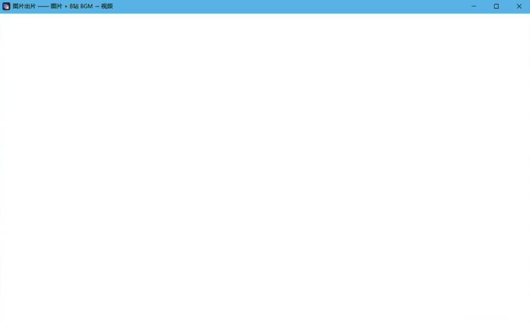

- **Any number of images and videos**: drag them in and order them, set the seconds for each one individually; a video becomes one clip at its original length, and can be trimmed, split, and given transitions; click anywhere on the timeline at the bottom to jump there, or drag a clip's right edge to change its duration.
- **Music straight from a video link, the whole track**: Bilibili (including b23.tv short links and bare BV / av ids), Douyin, YouTube, Kuaishou, Xiaohongshu, Weibo; you can also drag a local audio or video file straight into the window.
- **Preview without leaving the window**: the preview is composited live — change a parameter, drag the scrubber, switch a transition, and the picture changes on the next frame, with no waiting for a full re-render.
- **The preview behaves like a player**: under the picture there's a scrubber, play/pause, ±5 s, 0.5–2× speed, and four quality levels (Smooth / Standard / Sharp / Full size); speed and quality affect the preview only — the exported file still follows your settings.
- **Adding media isn't just images**: both images and videos can be dragged into the list or added with "Add media"; video clips can be trimmed by dragging their edges on the timeline, given in/out points with I/O, split with Ctrl+K, and still take color grading and transitions.
- **Adjustable output**: 9 aspect ratios plus hand-typed width/height, 30/60fps, three quality levels, five backdrops (own image / solid color pad / custom background image / background video / crop to fill), fade in–out and 12 built-in transitions, and an export folder.
- **Works straight out of the box**: images, folders, and audio/video files can all be dragged into the window; the folder opens automatically when an export finishes; EXIF orientation on photos is corrected automatically.
- **It can move**: optional slow zoom in / out / alternate zoom (Ken Burns) turns a still image into a shot with some breathing room.
- **Small conveniences**: five UI languages (简体中文 / 繁體中文 / English / 日本語 / 한국어); dark/light themes; pick one main color and the accent is paired automatically; three UI modes (Simple for a three-step cut / Standard for everyday editing / Pro for every parameter).
- **Projects can be saved**: one click saves a .p2v project (images, durations, intro/outro, audio blocks, subtitles — all in it), so you can carry on next time; it autosaves every 15 seconds, and after a crash the next open asks whether to restore; the "Project" menu holds recent files.
- **Subtitles**: import .srt / .ass and burn them straight into the final video (font and size are picked in Settings); no upload, no network, and no in-app editing.
- **A script can become a voice-over**: on the "Voice-over" tab, paste a script → pick a voice → synthesize the narration and sentence-level subtitles in one click; by default it uses the free Edge (no key, with timestamps), and you can also enter your own key for Gemini / Azure / OpenAI-compatible endpoints. When it's done the total length switches to "Follow narration", and the picture follows the sound.
- **Per-platform output**: on export pick Bilibili / Douyin / WeChat Channels / YouTube / Generic, and resolution and frame rate are set up for you; you can also grab a cover image with the same name at a point on the final timeline.
- **One layer on top**: an image or video over the final video (picture-in-picture): 3×3 anchor, scale, opacity, and in/out times can all be adjusted, and dragged right on the timeline.
- **Color grading**: per-clip brightness / contrast / saturation, plus a filter (.cube LUT — in-camera looks and film emulation rely on it), reachable from the right-click menu.
- **Audio you can see and shape**: real waveforms are drawn on the timeline, and each audio clip can set a gain (dB), and you can click a volume envelope onto the waveform (Alt + click to add a point, drag a point to change it, right-click to delete one).
- **Resource packs**: fonts, LUTs and transition presets can be packed into a zip and installed; once installed they appear in the matching dropdown/menu; a pack carries a manifest and checksums, and anything from an untrusted source is rejected outright.
- **No blind waiting**: exporting shows a percentage and the time remaining, and you can hit "Cancel" at any time; closing the window reminds you an export is still running; the first launch is maximized, and afterwards you can set it in Settings to remember the last size or use a fixed size.

## Quick start

1. Install the dependency (once):

   ```
   python -m pip install PyQt6
   ```

   `ffmpeg` and `ffprobe` need no manual install: on first run the tool asks once, and one click downloads them into `tools/` (about 120 MB; version 9.0.2 as measured).
   If ffmpeg is already on the system PATH, that copy is used and nothing is downloaded.

2. Double-click `启动.bat` (it is just `python pic2video.py`).
3. Drag images or videos into the window, or click "Add media".
4. Paste the link into the "Music link" box and wait for the status bar to say "Music ready: duration x:xx · file at: …" — music fetched from a link is stored in the tool data folder's `media/`, so it survives closing the program.
5. Look at the preview, click "Export video", pick a platform preset (or just let the parameters follow your settings), then pick a folder.

You can also drag a whole folder into the window (the images, audio and video inside are added together), or drag image and music files in directly. Dropping media onto an item in the list has three zones: landing on the **left third** inserts before it, the **middle** replaces it, and the **right third** inserts after it (the list draws an insertion line or a highlight box while you drag).

The keyboard works too: Ctrl+I adds media, Ctrl+M exports, F5 refreshes the preview, Space plays/pauses, Delete removes the selected image; for projects, Ctrl+N is new, Ctrl+O open, Ctrl+S save, Ctrl+Shift+S save as — all of these can be changed in Settings → Shortcuts.

Media isn't only images: **videos can be added too**. A video file dropped into the list (or added with "Add media") becomes a clip at its original length and, on the timeline, is trimmed by dragging its edges like an image clip, can be given in/out points with I/O, split into two with Ctrl+K, given a transition and color graded; drag a whole folder and the images and videos in it are added together in filename order. Only audio files dropped into the window take the "music / extra audio" path — to take just the soundtrack of a video, drop it into the "Music link" box.

## Project files (.p2v)

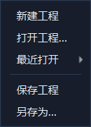

The "Project" button (or Ctrl+S) saves a .p2v project: an ordinary JSON holding the version number, frame rate, timing mode, the order and duration of each image, the intro/outro in- and out-points, the start and volume of audio blocks, and the subtitle content. The video and audio themselves don't go into the project, only their paths — so a project and its media can be copied separately.

- **Save / Save as**: Ctrl+S writes back in place, and the first save of an unsaved project asks for a path. Saving is atomic (a .tmp is written and then renamed), so a power cut halfway through can't destroy the old project.
- **Autosave**: every 15 seconds the changes are saved into the tool folder, and cleared on a normal save or window close. If the last session didn't exit normally, opening asks whether to restore that copy.
- **Recent**: the menu keeps up to 8, and deleted ones drop off the list by themselves.
- **Missing media**: on opening, any image or audio that has been moved is listed, and it asks whether to "Locate…"; pick a new location and every entry in the project pointing at that kind of file moves over with it.
- **Version**: a project carries a version. A version newer than the app is refused outright instead of being read on a guess — so a new project can't be corrupted.

## Subtitles

The "Subtitles" tab at the bottom left: click "Import subtitles…" and pick a .srt or .ass, and every cue's time and text is listed at once; both preview and export burn them into the picture.

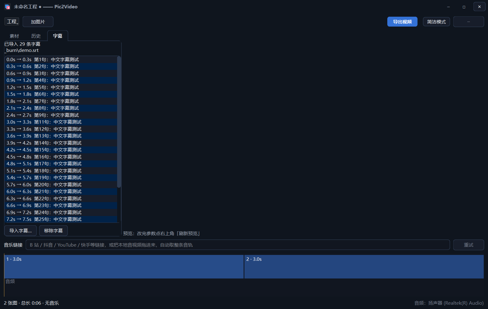

- **Import + burn only**: parsing happens once at import and the subtitle content is stored in the project (inside the .p2v), so it doesn't depend on the original file still being there; there is no adding text or retiming in the app.
- Font and size are picked in Settings → Picture → Subtitle font / Subtitle size. The size is "pixels at 1080p", and a 540p preview halves it proportionally, so the preview and the final video look the same.
- The default font is Microsoft YaHei. Some fonts (especially some .ttc files) only expose their first glyph set, or contain no Chinese at all — if the subtitles come out as boxes in the final video, try another font.
- Braces are shown literally (write a{b}c as a{b}c, no escaping needed); a line break inside one .srt cue becomes a forced line break in .ass. Bad cues whose end isn't later than their start are dropped, and one of them can't make the whole subtitle file unopenable.

## Voice-over (script → TTS → subtitles)

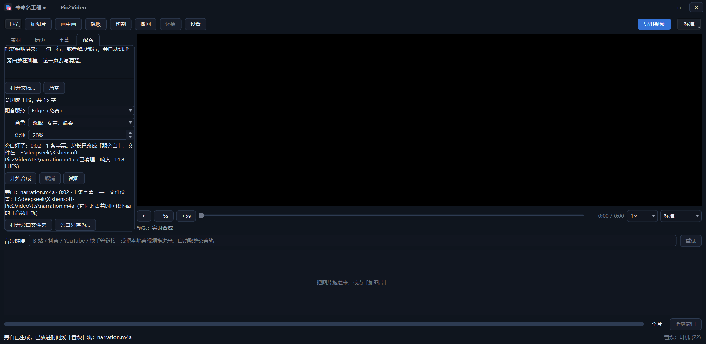

The "Voice-over" tab (only in Standard / Pro) turns "having a script" into "having a cut": paste a script → pick a voice → click "Start synthesis", and out comes a narration and sentence-level subtitles, with the total picture length automatically following the narration.

- **Script**: paste it straight into the box top left, or "Open script…" to read a .txt / .md (UTF-8, GBK also works). One sentence per line, or one whole paragraph, both work — sentences are split on punctuation, then chunked at about 1000 characters per part; under the box it shows live "Will split into N parts, M characters in total".
- **Voice**: Edge by default (free, no key), 14 Chinese voices (Mandarin / Northeastern / Shaanxi / Taiwan / Cantonese, male and female); rate -50% to +100%. To hear whether it suits before committing, "Preview voice" synthesizes just the first part.
- **Synthesis**: runs part by part in the background, the progress bar shows "done / total parts", you can hit "Cancel" at any time, and a single failed part can be re-run. Each part's result is cached in the tool folder (`tts/`) keyed by "text + provider + voice + rate", so clicking again after an interruption skips the parts already done.
- **Once it's hooked up**: the narration goes onto the timeline's audio track (with a waveform), the sentence-level subtitles go to the "Subtitles" tab, and the timing switches to "Follow narration" automatically — the media fill the narration's length, and the total length is the narration's length. To use the subtitles elsewhere, click "Save as .srt…" on the "Subtitles" tab.
- **Where the narration file is**: the bottom of the Voice-over tab prints the full path (under the tool folder, `tts/narration_<内容指纹>.m4a`, where 内容指纹 is the content fingerprint: different scripts each keep their own, so they don't overwrite each other), and "Open narration folder" next to it locates it in Explorer; to put it somewhere of your own, click "Save narration as…" and the project switches to the copy you chose.
- **Clean-up after synthesis** (on by default, can be turned off in Settings → Voice-over): trims the extra silence at the start and end of each part, cuts the high-frequency clicks and low-frequency plosives at the beginning, then brings the whole narration to **loudness -14** per EBU R128 (LUFS is a loudness unit, roughly the platform-standard "normal volume"), and finally limits it as a safety net. The silence trimmed off moves the subtitles forward along with it, so nothing drifts. The status bar says "(cleaned, -14.0 LUFS)".
- **Subtitle wrapping**: at most 18 characters per line and two lines at most; a sentence that long is split into two, so no single line covers the whole screen.
- **Gemini**: fill in your own Gemini key under Settings → Voice-over and it works (voices Kore / Puck / Aoede / Charon / Fenrir / Leda, and multiple speakers are supported). Gemini gives no timestamps, so the same text is quietly run through the free Edge as a timing template, and the subtitles are scaled by the actual duration; only if Edge can't be reached either does it fall back to spreading them by character count. It has no rate parameter, so the rate box greys out — to go faster, shorten the script.
- **Azure Speech**: enter the key and region (e.g. `eastasia`) under Settings → Voice-over; it goes over REST + SSML, and its voices share their source with Edge (Xiaoxiao / Yunxi / Yunyang / Xiaoyi), with 500k characters a month on the free tier. REST returns no timestamps either, so the subtitles use Edge as the timing template again. A 429 is retried with backoff, and at the end it says "quota used up".
- **OpenAI-compatible endpoints**: enter the key and base_url (SiliconFlow, Volcano, MiniMax compatible layers all work), and optionally the model name (empty = `tts-1`); the rate is converted to `speed` (0.25–4.0). Endpoints without timestamps use the Edge alignment template too; failures distinguish a bad key from an exhausted quota from a network problem. The key is stored in plain text in the local settings file and never uploaded.
- **No assumption about your length**: any length of script works, and quota spent on your own key is your own quota; the free Edge has no daily limit, only soft limits on rate and concurrency.

### Multi-speaker dialogue (any role names)

Question and answer, or a group chat, needs no manual assembly: start each line with "name:" and anything written on the following lines counts as that role's turn. Names are 1–12 characters with no punctuation; `小明：`, `妈妈：`, `旁白：`, `老师：` all work.

```
小明：你好，我是小明。
妈妈：我是妈妈，今天的晚饭好了。
旁白：这是一个多人对话的测试。
老师：同学们好，我们开始上课。
```

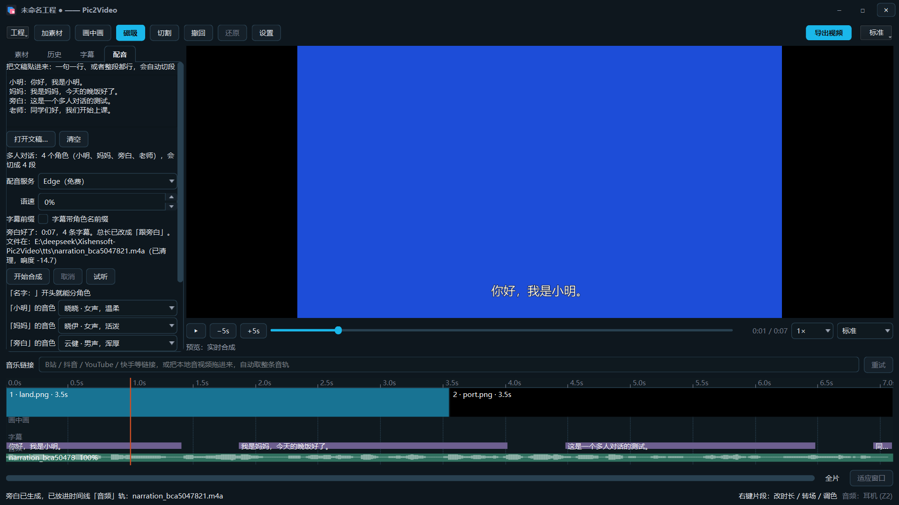

- The Voice-over tab scans out every role in order of appearance, one row per role, each with its own voice; when there are more roles than fit on screen, the page scrolls.
- The old forms still work: `角色 A：` / `角色 B：`, `A:` / `B:`, `主讲：` / `听友：` are all mapped onto the corresponding two roles.
- Each turn leaves 0.35 s of gap (a normal part gap is the 0.6 s from Settings), so it sounds like a real back-and-forth.
- Tick "Prefix captions with the role name" and the subtitles read "小明：你好，我是小明。"; leave it unticked and only the line is there.
- Each turn is a separate request, so for a service that bills per request like Gemini, more roles and more turns means more of your quota used.
- With no role markers in the script, everything works as before and no role table appears.
## Transitions

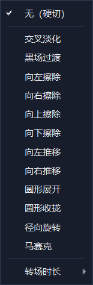

Right-click a picture element → "Transition" and pick a name; "None (hard cut)" cuts straight over. All 12 names come from ffmpeg's built-in `xfade` and use no external files:

| Name | Look |
| --- | --- |
| Cross fade / Fade through black | A dissolve; the fade through black dips dark in the middle |
| Wipe left / right / up / down | One picture wipes away while the next shows |
| Slide left / right | The next picture pushes the previous one out |
| Circle open / Circle close | A circle grows from small to large, or shrinks from large to small |
| Radial / Pixelize | Changes while turning; breaks into a mosaic first, then comes back |

- **Length**: "Transition length" in the same menu offers 0.2 / 0.3 / 0.5 / 0.8 / 1.0 s; "Follow setting" uses the seconds from Settings → Timing & motion → Clip transition.
- **Who decides**: as long as one of two neighbouring elements has a transition on, that boundary gets one; if both have one and the names differ, the earlier one wins.
- **Total length unchanged**: a transition is made by both clips each reaching half the transition length toward the other and then playing overlapped — 2 s + 2 s with a 0.8 s transition still exports as 4.0 s, except the transition takes the 1.6–2.4 s stretch and each clip's own still time is 0.4 s shorter. Video clips pull 0.4 s extra from the source to make up for it, so no content is missing. Preview and export go through the same filter, so they look the same.
- **Too long is blocked**: both neighbouring clips must be longer than twice the transition length. You're told on the spot when picking one, and it's checked again before export (so you never export half a broken file).
- Project files store each clip's transition name and length; older projects have neither and open as hard cuts.
- With a transition resource pack installed, the menu gains presets named "name (pack)" — they are still just "a built-in transition name + a default length", not a new algorithm; see the resource packs section below.

## Picture-in-picture

Click "Picture-in-picture" at the top and pick an image or a video, and it plays over the final video — position, size, opacity, and when it appears and disappears can all be adjusted.

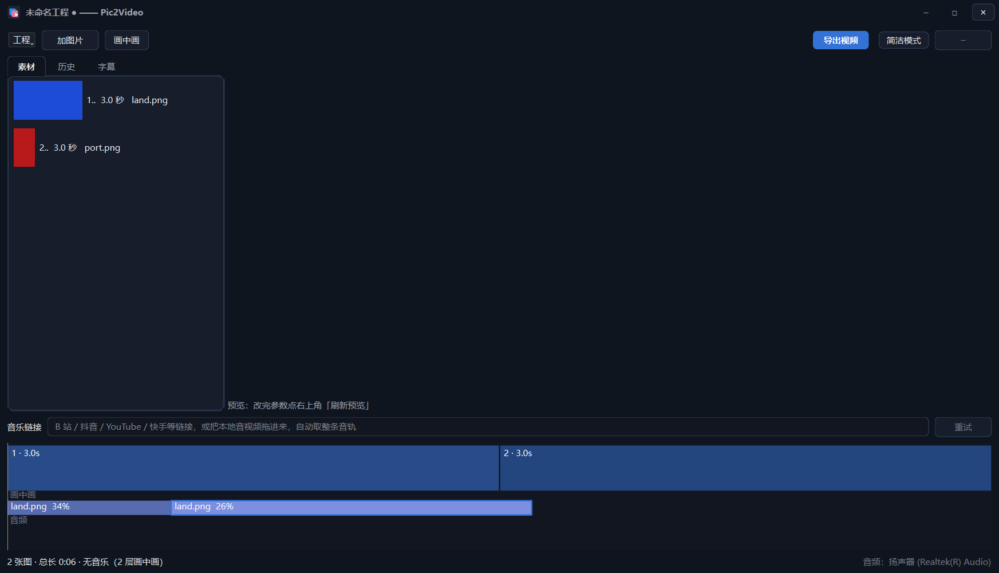

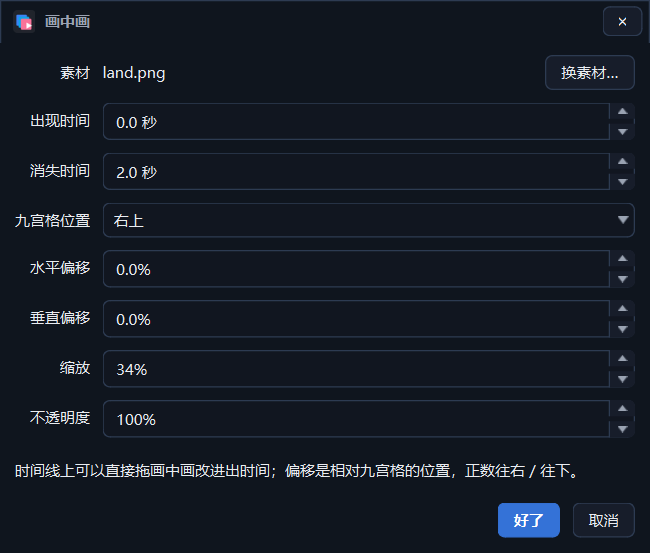

- **Placement**: pick a rough spot on the 3×3 grid (top right for a corner bug, dead centre for a mask), then fine-tune with the horizontal/vertical offset (as a percentage of the picture's width/height, positive to the right / down); "Scale" is relative to the final width, and 40% is roughly a top-right corner block.
- **Appear / disappear**: type seconds, or drag the start point right on the "Picture-in-picture" track in the middle of the timeline. Several layers can sit on the same track and are stacked in the order they were added, later ones covering earlier ones.
- **Opacity**: 0–100%; use it to fade segments yourself, or just as a semi-transparent watermark.
- **Total length unchanged**: overlays are a second pass over the final video and don't change the main track's timing; the final video is as long as the main track, and anything past the end is not drawn.
- Right-click a block on the "Picture-in-picture" track to edit or delete it; the project file stores each layer's media path, time, position, scale and opacity.

## Color grading

Right-click any picture element (image, video, intro or outro) → "Color…": three sliders plus one filter (LUT), and changes land in the preview immediately.

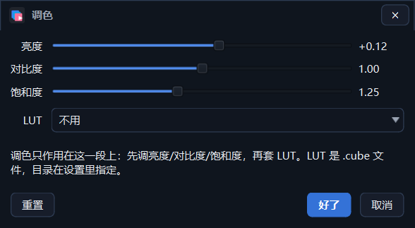

- **Brightness / Contrast / Saturation**: brightness is -1.0 to 1.0 (0 leaves it alone), contrast and saturation are multipliers (1.00 leaves them alone). All three are ffmpeg's eq filter, and when applied to the whole film the backdrop is graded with it.
- **Filter (LUT)**: Settings → Picture → LUT folder points at the folder holding .cube files; the dropdown in the color dialog lists the .cube files in that folder. "None" means only the three sliders apply.
- **Affects this clip only**: to grade one image two ways, split it into two clips and grade each.
- **LUT files are media too**: a moved file is reported before export just like a missing image, and can be relocated when the project is reopened. Both the color parameters and the LUT path are written into the project file (.p2v).

## Export presets and cover

Clicking "Export video" brings up this dialog first: pick a platform, see the actual parameters, and decide whether to grab a cover along the way.

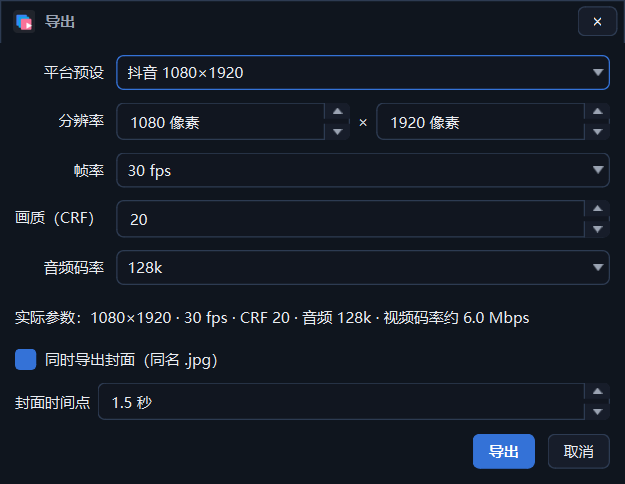

| Preset | Resolution | Frame rate | Quality | Audio | Filename suffix |
| --- | --- | --- | --- | --- | --- |
| Generic (use current settings) | the width/height from settings | the frame rate from settings | the quality from settings | 192k | none |
| Bilibili 1080p60 | 1920×1080 | 60 | 18 | 192k | _bilibili |
| Douyin 1080×1920 | 1080×1920 | 30 | 20 | 128k | _douyin |
| WeChat Channels 1080p30 | 1920×1080 | 30 | 20 | 128k | _channels |
| YouTube 1080p30 | 1920×1080 | 30 | 20 | 192k | _youtube |

- **Change any one field and it becomes "Custom"**: resolution, frame rate, quality and audio bitrate can all be changed on the spot, and the "Actual:" line in the dialog refreshes with them; the bitrate is only an order-of-magnitude estimate (the lower the quality number, the higher it is estimated).
- **Frame rate is converted**: the project timeline is stored at the frame rate from settings; picking a 60fps preset recomputes each clip's frame count at the target rate before export, so the final length is unchanged and won't come out half as long.
- **Cover**: tick "Also export a cover (.jpg, same name)" and pick a time point (by default the exact middle of the first image clip, on the final video's timeline); after a successful export a .jpg with the same name is written to the same folder — that frame of the final video. Both the status bar and the dialog after export write out the cover's full path; a failed grab only shows one line and doesn't affect the video that was already exported.
- **Remember the last choice**: the last preset, whether to take a cover, and the cover time point are stored in settings.json, and the next export dialog opens the same way.
- The preset name is written into the project file (.p2v) too, but only as a marker: what actually applies is always the parameters chosen at export.

## Music from each platform

| Source | What it needs | Notes |
| --- | --- | --- |
| Bilibili | nothing | Needs no login and reads no cookies; takes the highest-bitrate track of the DASH audio |
| Douyin / YouTube / Kuaishou / Xiaohongshu / Weibo | `yt-dlp` | **Downloaded on demand**: in Settings → "Misc" click "Install" to put it in the tool folder's `tools/` (about 25 MB), and "Remove" when you don't need it; the first time you paste such a link it asks once as well |
| Local files | nothing | Audio is used as the music directly; a video is added to the timeline as media (to take just its track, drop it into the "Music link" box) |

It takes the **whole audio track** and doesn't do vocal separation.

This is background music and it covers every media clip. To layer more audio on top (sound effects, a second piece of music, narration), right-click an audio block on the timeline → "Add audio file…", or just drag audio files into the window: one audio file, one block, each with its own start point and volume on the wheel.

## Audio clips (waveform / envelope / gain)

Every audio block on the timeline draws the real waveform, and even quiet material is normalized to its own loudest point so the shape is visible:

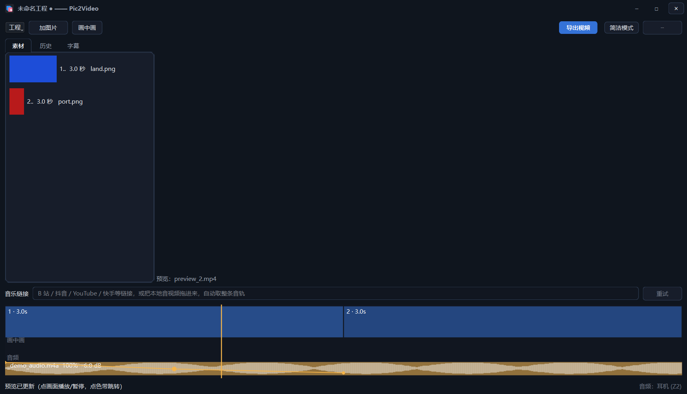

- **Gain**: right-click an audio block → "Gain…", from -24 to +12 dB, and 0 means as-is. Good for lifting a quiet narration all at once.
- **Envelope**: hold Alt and click on the audio block to add a point (the x axis is time, the y axis is volume as 0–100%), drag a point up or down to change it, right-click a point to delete it. Between points the change is linear, and the exported sound follows that line — music fade-ins and ducking a narration and lifting it again are all done with it.
- **Gain first, envelope second**: the two multiply, so -6 dB plus a 50% envelope ends up around -12 dB.
- **Where the waveform comes from**: ffmpeg decodes the audio to mono 8 kHz peaks, one cache per clip, in `peaks/` (`%LOCALAPPDATA%\Pic2Video\peaks\` in the packaged build); it recomputes automatically when the file's size or modification time changes.
- Gain and envelope are both stored in the .p2v project and are still there next time.

Right-clicking an audio block gives these entries:

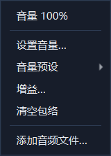

## Resource packs (fonts / LUTs / transition presets)

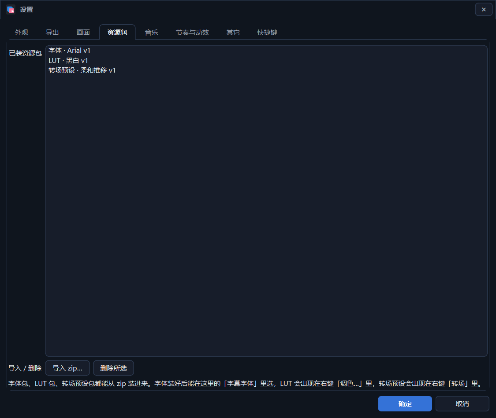

Settings → Resource packs (a page of its own in Pro mode): click "Import zip…" and pick a pack, and once installed it is in the list — the dialog and the "Open assets folder" button both tell you where it went; select one and click "Remove selected" and it asks first, and if a project is using it, it also tells you which clip after removing.

- **Where they go**: unrelated to project files, they all live in the tool data folder's `assets/fonts`, `assets/luts`, `assets/transitions` (`%LOCALAPPDATA%\Pic2Video\assets\` in the packaged build). A project still records file paths, so think of the resource packs too when copying a project.
- **Font packs** (.ttf / .otf / .ttc): once installed they appear in the Settings → Picture → Subtitle font dropdown; when burning subtitles that pack's folder is handed to libass automatically, so the font needn't be installed system-wide. .ttc only exposes its first glyph set.
- **LUT packs** (.cube): once installed they appear in the right-click "Color…" LUT dropdown, alongside the .cube files placed manually in the "LUT folder".
- **Transition preset packs** (.json): one file per preset, holding a name, which built-in xfade to use, and the default seconds; once installed they appear in right-click → "Transition", marked "(pack)". They bring no new algorithm and can only combine the 12 built-in ffmpeg names.

A pack is a zip with `manifest.json` at the root, every file carrying a sha256:

```json
{
  "name": "My LUT collection",
  "version": "1.0",
  "kind": "lut",
  "entries": [
    {"path": "teal-orange.cube", "sha256": "…64 hex digits…"}
  ]
}
```

- **kind** can only be `font` / `lut` / `transition`, and the extension has to match (fonts .ttf/.otf/.ttc, LUTs .cube, transitions .json).
- **Safety boundary**: absolute paths, `..` traversal, symlinks and executables are all rejected; at most 64 files and no more than 64 MB unpacked (guarding against zip bombs); extra files not declared in the manifest and files whose checksum doesn't match are rejected too. Nothing is written until every check passes: the files are unpacked into a temporary directory first, then renamed atomically into the real one, so a failed install never leaves half a pack behind.
- **Version**: reinstalling the same version of a pack with the same name is refused (remove it, then install); a different version overwrites directly, and the old directory is not kept.
- **After removing**: it disappears from the dropdown/menu immediately. If the current project is still using the pack (a clip's LUT, or the subtitle font), it says where it is used, so you can change it before rendering.

## Command line (for batches/scripts)

```
python pic2video.py --export 输出.mp4 --audio 本地音频.m4a 图1.jpg 图2.png 图3.webp
python pic2video.py --export 输出.mp4 --audio "https://www.douyin.com/video/..." 图1.jpg 图2.png
python pic2video.py --export 输出.mp4 --bili BV13qs46FE9C --total 4 图1.jpg 图2.png
python pic2video.py --export 竖屏.mp4 --bili BV... --ratio 9:16 --fps 60 --fit cover --transition fade 图1.jpg 图2.png
```

`--total` is the seconds per image; `--fps` / `--ratio` / `--width` / `--height` / `--fit` / `--bg` /
`--pad-color` / `--no-bg-blur` / `--transition` / `--motion` / `--crop-focus` / `--volume` are the same as on the settings page; the command line does not write `settings.json`.

## The interface

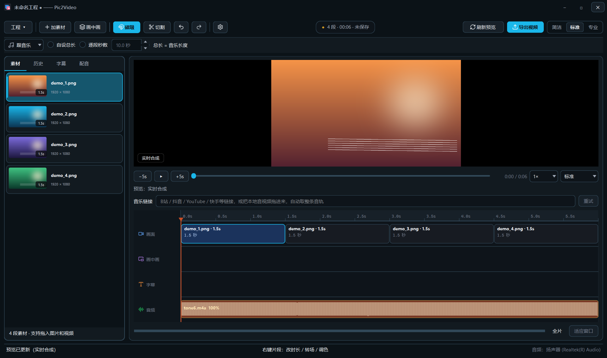

While exporting, the status bar gives a percentage and the time remaining, and you can cancel at any time:

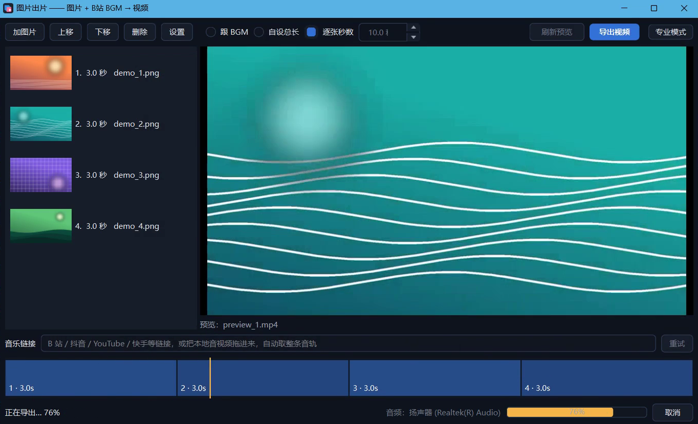

The window frame is drawn by the app itself and changes with the dark/light theme and the main color — no system gray borders: drag the title bar to move the window, drag the four edges/corners to resize, double-click the title bar to maximize. Settings, color pickers, notices and the seconds prompts all use the same frame; the file-picking step deliberately stays with the system's native dialog, so Quick Access, recent locations and mounted cloud drives all behave as usual.

### The three UI modes

The button in the top right of the toolbar opens a menu, and the three modes can be switched freely; the choice applies immediately and is remembered next time. The default is **Simple**.

| Mode | For whom | Toolbar | Timeline | Settings pages |
| --- | --- | --- | --- | --- |
| **Simple** | just want to turn a stack of images/videos into a video and post it | Add media / Export video | picture track + audio track | Appearance / Export / Picture, three blocks |
| **Standard** | everyday editing | plus Project / Picture-in-picture / Snap / Cut / Undo / Redo / Settings | three tracks, timeline can zoom | six pages: Appearance / Export / Picture / Voice-over / Music / Timing & motion |
| **Pro** | every parameter matters | everything (reorder, timing, refresh preview are all there) | everything | Resource packs / Misc / Shortcuts each get their own page |

- Simple mode hands reordering, deleting and changing seconds to the right-click menu: right-click the media list, right-click a timeline block.
- Simple mode has no "Project" button; "⋯" holds New / Open / Recent / Save / Save as / Settings.
- Appears only when used: in Simple mode the picture-in-picture track only appears once you add an overlay, and the "Subtitles" tab only once you import subtitles; the timeline zoom bar is always there in Standard and above, and in Simple it only shows up after you zoom in.

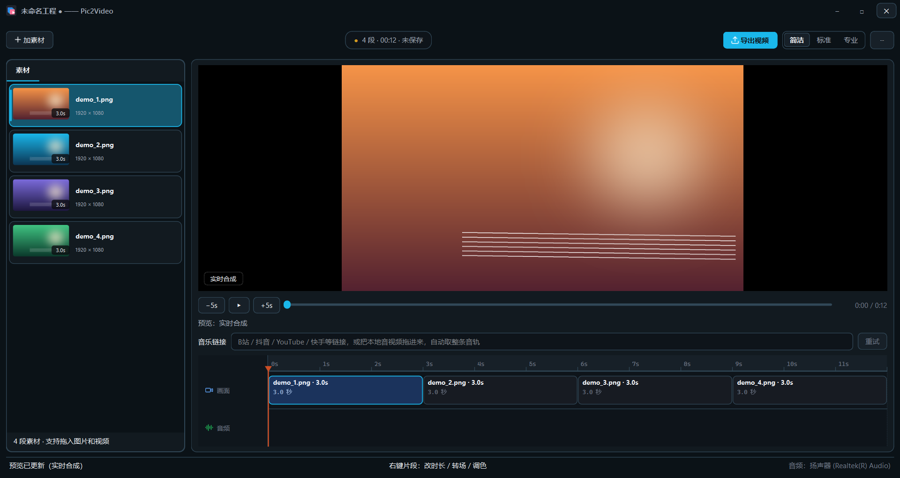


Simple mode's settings page keeps just three blocks:

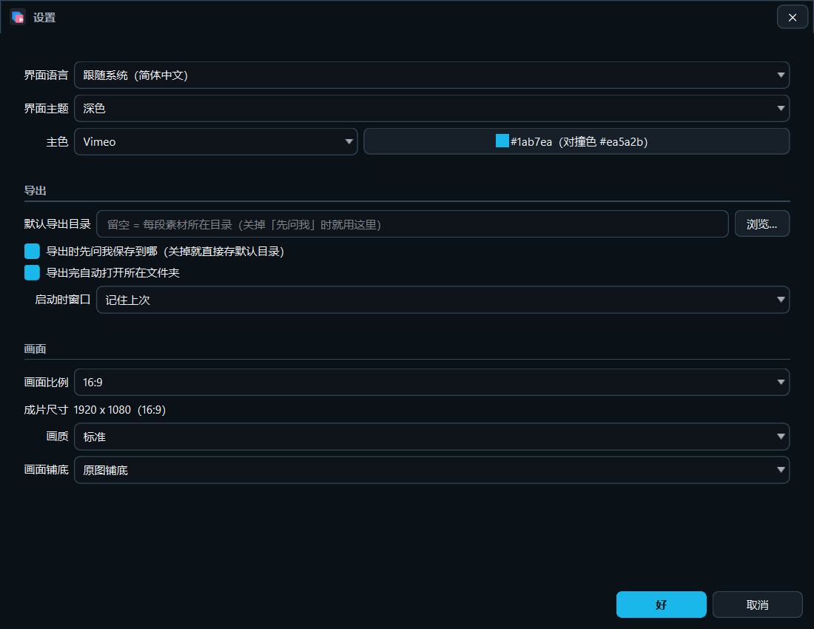

At the bottom is the timeline, with four tracks: at the top the picture elements (intro / images / videos / outro), in the middle two tracks for picture-in-picture (only used when there are overlays) and subtitles (only used when there are subtitles), and at the bottom the audio elements.

- On the left of the toolbar is the timing dropdown: **Match music** (media spread evenly over the whole track) or **Match footage length** (each clip = intro + outro total length ÷ number of media clips); next to it are the two radio options "Set total" and "Per clip". After picking, the right side spells out what the total length is now based on (e.g. "Length = music length", "Length = the seconds below"), and hovering gives a full explanation.
- Click a block = the preview jumps to that element's start; press and drag left or right and the block follows (i.e. it changes position on that track).
- Drag a block's right edge to change how long this image shows; for a video clip like the intro/outro, dragging the left/right edge = changing the in/out point (up to the source length, at least one frame left), dragging an audio block in the middle changes its start time, and dragging its left/right edge = trimming its head/tail (the left edge takes the source start with it, and the right can be pulled at most to the end of the source file).
- The **Snap** switch on the toolbar (on by default) makes a dragged edge stick to nearby time points: joints between clips, intro/outro, audio block starts and ends, and the playhead. A blue dashed line appears while dragging when it has snapped; hold **Alt** while dragging = no snapping this time. When Snap and Cut are on, the buttons light up in the main color, so you can see at a glance whether the mode is on.
- The **Cut** switch on the toolbar is blade mode: click a picture or audio block and it is cut into two at the second you clicked (too close to an edge and it says it can't), and **Esc** leaves the mode.
- Right-click an audio block → "Delete and close gap" = ripple delete: that audio is removed and everything after it moves up to fill the gap.
- With the playhead inside an element: press **I** for the in point, **O** for the out point, **Ctrl+K** to cut here (an image clip is cut by time, a video clip is cut at the in/out point into two clips whose combined length stays the same).
- Hold **Shift** (or Ctrl) and click several elements = multi-select, and later settings apply to all the selected elements at once.
- Right-click a block to open that element's menu: picture elements can toggle "Fade in · out", go into "Color…", pick one of the 12 built-in transitions from "Transition" (or a hard cut), and set that clip's transition length separately; the picture-in-picture track can add / edit / delete overlays; audio elements can set volume (25%–200% presets or typed in), set gain, clear the envelope, and with a multi-select change them all at once.
- With one picture element and one audio clip selected at the same time, the picture menu gains "Stretch this visual to the audio": the image or video's duration changes to the audio's length, a video shorter than the audio loops, and a longer one is cut at the end.
- With the wheel over an audio block, scroll up and down to change the volume (5% per notch).
- The media list on the left supports **Shift / Ctrl multi-select** too: delete, move up/down and double-click-to-change-duration all apply to the selected items together; list and timeline selection are linked, and dragging to reorder keeps each clip's color grading, transition and in/out points.
- When dragging files in from outside onto the media list, the drop target says outright what it will do: the middle band is "Replace clip N" or (over a video clip) "Insert after clip N", the left/right edges are "Insert before clip N / after clip N", and dropping on empty space is "Add at the end" — no need to let go first to find out.
- Above the timeline at the bottom there's a time ruler (its density changes automatically with the zoom), so once you've zoomed in you can still tell at a glance which second a block falls on; on the right of the bottom bar there's a permanent line "Right-click a clip: duration / transition / color", so the right-click menu's features don't have to be guessed at.
- Picture blocks on the timeline write out the file name, so several similarly named images don't get confused.
- When there are many clips squeezed together, zoom: **Ctrl+wheel** zooms the timeline in/out (centred on the mouse position, up to 64×), **Shift+wheel** or dragging the scrollbar under the timeline scrolls left and right, and **Ctrl+0** / "Fit to window" at the bottom right goes back to the whole film; once zoomed, the playhead follows automatically when it leaves the visible range.
- To move several clips at once: press and drag on empty timeline space to draw a box (say, dragging up from the empty track with no audio), and the picture blocks, overlays and audio the box touches are selected together; then drag any one of them and the whole block moves, with a dashed line showing where it will land. Shift / Ctrl while dragging the box = add to the existing selection.
- On the subtitle track it's one block per cue: click to jump to that cue's start, drag left/right to move the whole cue earlier/later (its length stays the same, and both export and preview follow); the subtitle text itself is still read and edited on the "Subtitles" tab, not on the track.

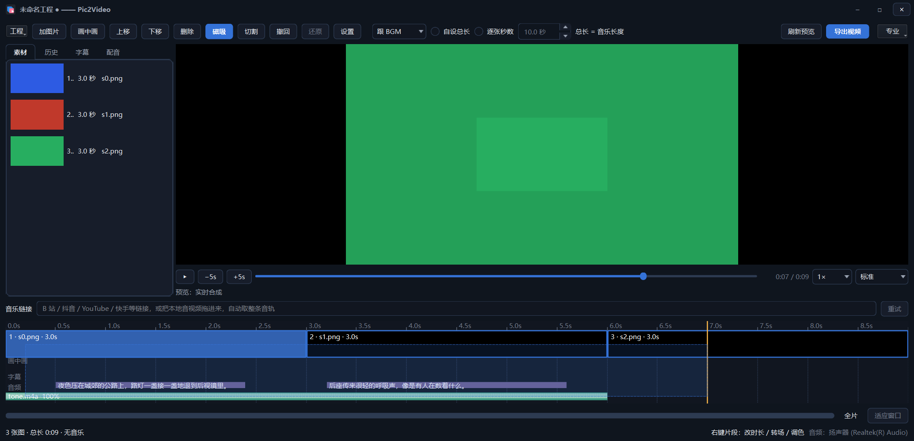
- Keyboard: **← / →** step one frame, **Shift + ← / →** step one second, **Home / End** jump to the intro / outro, Space plays and pauses (inside text fields, dropdowns and lists it is left to the widget as usual).
- Pressing Enter in the music link box starts fetching the audio track — no need to click "Retry".
- When a whole media folder has been moved, relocating can pick the folder once and match by file name automatically; anything that doesn't match is asked about one by one.

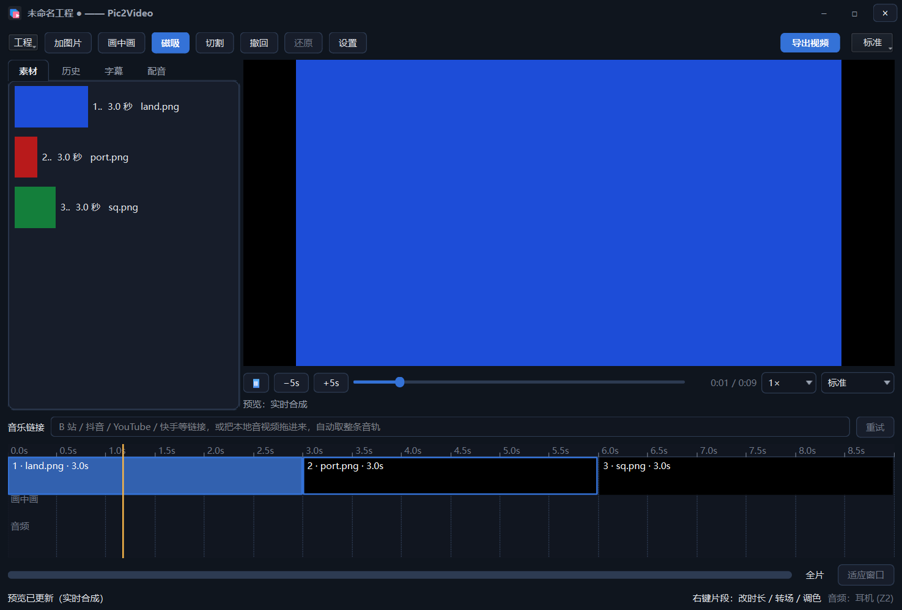

Under the preview there's a playback bar: the picture itself can be clicked to play/pause (the cursor turns into a hand over it); play/pause (Space works too), −5s / +5s, in the middle the scrubber (press and drag, click to jump) and "current / total", on the right the speed dropdown and the quality dropdown. Dragging the playhead, clicking a block on the timeline, or dragging the scrubber all update the picture live; quality only changes the preview resolution — Smooth 640 / Standard 960 / Sharp 1280 / Full size matches the final video, and a small final video is never upscaled.

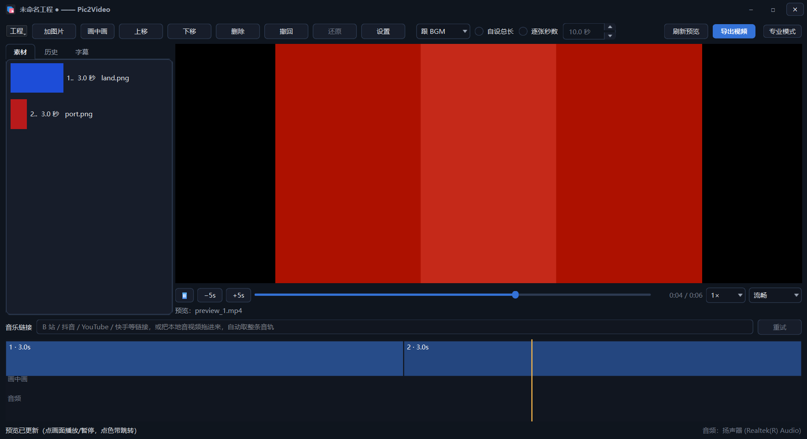

### How live preview works

The preview area isn't "render an mp4 first and then play it"; it's a compositor that draws by time:

- Every frame is assembled on the spot by `Scene.frame_at(t)`: backdrop, scale, fades, Ken Burns, the 12 transitions, picture-in-picture, subtitles and color grading are all drawn directly with QPainter at the preview resolution; images are decoded into memory once, and nearby clips have their backdrop prepared ahead of time.
- The audio track is mixed separately into one `.m4a` that acts as the master clock: only the audio filters run, which takes a few hundred milliseconds; the picture refreshes frame by frame according to the player position, so playing, dragging and ±5 s never wait for encoding.
- Changing a parameter only rebuilds the scene model and redraws one frame, and doesn't start video encoding; only export goes through ffmpeg's full filtergraph.
- In the preview the 12 transitions are approximations (export still uses ffmpeg's xfade); video clips like the intro/outro go through a persistent decode pipeline that reads frames in order and only reopens when you jump far.

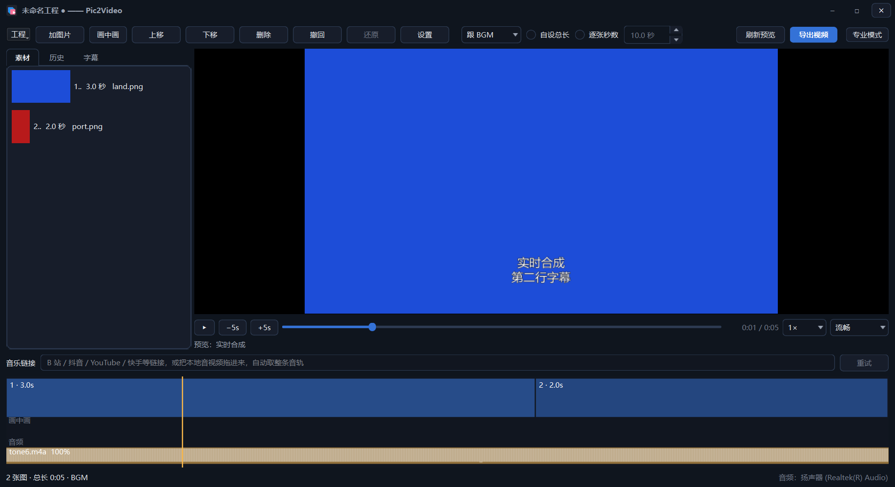

## Settings

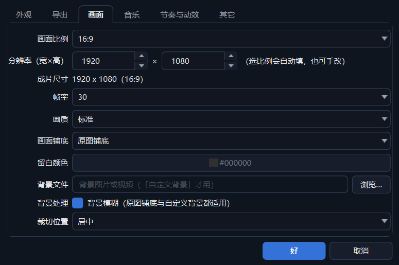

The settings pages are grouped into **Appearance / Export / Picture / Voice-over / Music / Timing & motion / Resource packs / Misc / Shortcuts**: in Standard and Pro each group is a page of its own (switch pages at the top instead of scrolling one screen), and Standard tucks away the Pro pages Resource packs / Misc / Shortcuts; Simple doesn't switch pages at all — one column all the way down, with only Appearance / Export / Picture left, and empty groups folded away together with their headings.

| Item | Description |
| --- | --- |
| Language / Theme | five languages; follow system / light / dark |
| Main color | brand color presets from 12 video sites (Bilibili / YouTube / Douyin / Kuaishou / Xiaohongshu / Weibo / Tencent Video / iQIYI / Youku / Netflix / Twitch / Vimeo), or click on the right to open the color wheel and pick your own; the accent is computed automatically at 180° |
| Default export folder | empty = the folder of each clip's file |
| Ask where to save on export | on by default (shows a save dialog); turn it off and it saves straight to the default folder above without asking |
| Export preset / cover | not changed here: chosen in the export dialog, and the last preset, whether to take a cover and the cover time point are recorded in settings.json automatically |
| LUT folder | the folder holding .cube filter files; the right-click "Color…" dialog lists them from this folder |
| Aspect ratio / Resolution / Frame rate / Quality | the 9 ratios are presets only, and width and height can both be typed in; 30/60fps; High / Standard / Small file |
| Backdrop / Pad color / Background file / Background | five backdrops; the solid color is yours to pick; a background image/video can be blurred or not |
| Default timing / Per-image default | Match music, Match footage length, Set total, Per clip (Match footage length = intro + outro total ÷ number of media clips, each playing that long) |
| Music start / Music length | from which second to use it, and for how long; "Whole track" / 0 = use it to the end |
| Music fade-in · fade-out / Clip transition | seconds are adjustable; the transition length here is the default for clips that never set their own (a single clip can be changed in the right-click menu) |
| Motion | Still / Slow zoom in / Slow zoom out / Alternate zoom (Ken Burns, Still by default) |
| Crop focus | when cropping to fill, keep the center / top / bottom (portrait photos often want the top) |
| Subtitle font / Subtitle size | the font used for subtitles burned into the video; the size is defined at 1080p (16–120), and the preview scales it with the picture height. Fonts from resource packs are listed here too |
| Resource packs | install fonts / LUTs / transition presets from a zip; once installed they show up in the matching dropdowns and right-click menus — see the "Resource packs" section above |
| Voice-over | provider, key (Gemini / Azure / OpenAI-compatible), Azure region, compatible endpoint URL and model name, voice proxy, pause between parts, clean-up after synthesis — see the "Voice-over" section above |
| Default intro video / Default outro video | inserted at the very front / very end when the first image is added; left empty, nothing is added. The intro carries no music: with an intro the music starts at the first media clip, and the same goes for the outro |
| Music volume | 0–200%, 100% by default |
| Open the folder after exporting | on by default; turn it off and only the completion notice appears |
| Window on startup / Fixed size | "Start maximized" by default; you can also choose Remember last or Fixed size (type width×height). On a smaller screen the window is clamped into the screen automatically |
| ffmpeg | the export engine (about 120 MB). With no ffmpeg installed, the first launch asks "Download it now?", and it's usable once downloaded; it can also be removed here and downloaded again later |
| yt-dlp | the parser for Douyin / YouTube and other sites (about 25 MB). Shows whether it's installed, with one-click install or remove |

The Music page and "Misc" (component management) look like this:

| Music | Misc (ffmpeg / yt-dlp) |
| --- | --- |
| 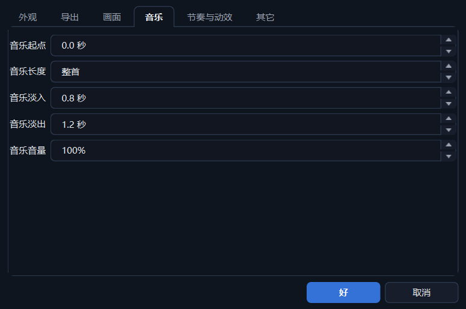 | 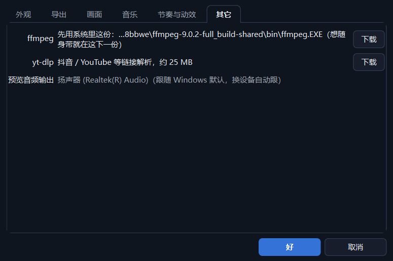 |

The light theme, and the color wheel opened from the right of the main color (the accent is computed automatically):

| Light | Picking on the color wheel |
| --- | --- |
| 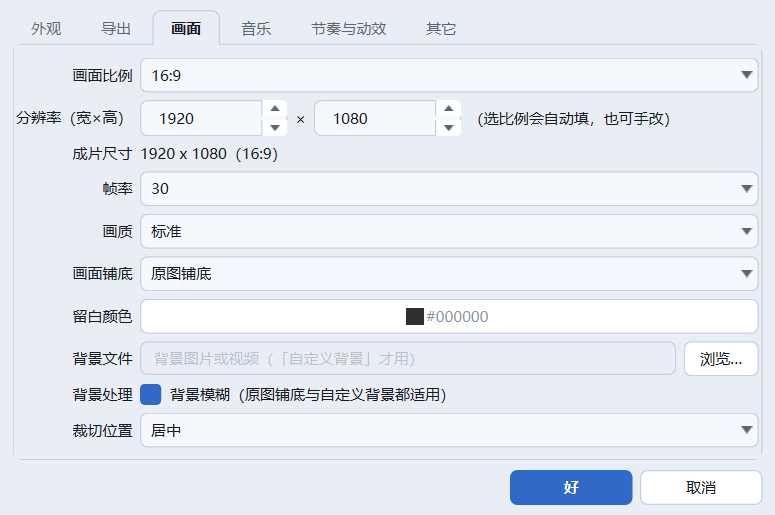 | 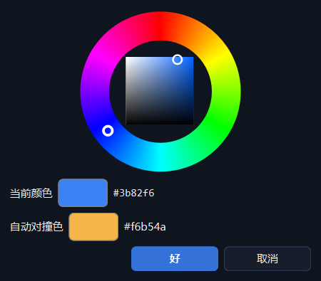 |

Preview audio always follows the **Windows default output device**, and unplugging or plugging in headphones switches automatically with no restart.

After exporting, the folder opens automatically (it can be turned off in Settings). While exporting, the status bar shows progress and "about x:xx left", with a "Cancel" next to it; the window size, position, language, theme,
and the last export folder are all recorded in settings.json, and the next launch is the same.

## Project layout

```
pic2video.py     main program (window + command line)
bili_audio.py    Bilibili audio (WBI signing + playurl)
audio_source.py  source detection and the yt-dlp wrapper
components.py    on-demand download and removal of ffmpeg / yt-dlp
theme.py         theme, main/accent colors, QSS
i18n.py          the five languages' strings
tts_engine.py    voice-over: chunking, Edge synthesis, sentence timestamps, cache and concatenation
启动.bat          double-click to open the window
tests/           unit checks (1425)
docs/            research notes, design records (wayfinder tickets) and the original probe scripts
screenshots/     the screenshots used in this README
```

## Development

```
python tests/test_project.py     # timeline / frame counts / settings / filtergraph / theme / audio sources / bad-image precheck / project files / in-out points / subtitles / transitions / export presets and cover / picture-in-picture / color grading / audio envelope / resource packs / preview bar / live compositing / the three UI modes / voice-over tab / UI hints / media (images and videos)
python tests/scan_keys.py        # checks every Chinese tr() string has four translations
```

## Packaging a portable exe

Double-click `build.bat` (it needs python; the script installs PyInstaller for you if it's missing). When it's done, under `dist\Pic2Video\`:

```
Pic2Video.exe    double-click to run
_internal\       runtime files, kept next to the exe
```

Copy the whole `dist\Pic2Video\` folder to someone else and it runs, with no installation (about 115 MB).

To check that the voice-over really makes sound after packaging, run `Pic2Video.exe --tts-selftest 结果.json`:
it opens no window, really synthesizes one sentence, and writes whether it worked into that JSON file.

The release package does **not** ship ffmpeg and yt-dlp: on first launch, if the system has no ffmpeg, it asks once and then downloads it to
`tools\` (about 120 MB, downloaded only once); if you want to save space one day, it can be removed in Settings → Misc and will download itself again when needed.

## Known limitations

- Bilibili paid/member preview videos only give the preview segment; region/copyright-restricted ones fail outright with a reason.
- If a site like Douyin / YouTube requires a login (age restriction, member content), yt-dlp fails and shows the reason.
- Export takes about 1/5 of the video's length; for very long music, use "Per clip" to control the total, or just wait and watch the time remaining while exporting.
- Once an image has been moved/deleted, the export reports which one first, and adding it again is enough; after saving to a project and reopening, it asks whether to relocate.
- Subtitle text is burn-only and can't be edited on the track: on the subtitle track you can click to jump to a cue and drag the whole cue to change its in/out time (its length stays the same); to change the text or nudge it word by word, save a .srt and edit that.
- All four voice-over providers can make sound: Edge (free, with sentence timestamps), Gemini, Azure Speech, and OpenAI-compatible endpoints; the last three need your own key, and none of them gives timestamps, so the subtitles are aligned with Edge. Gemini's free tier quota is tight (about 10 requests a day as measured by the community).
- Gemini's free tier quota is very tight (about 10 requests a day as measured by the community); a long script gets split into many parts, and hitting the limit backs off and retries three times before reporting "quota used up"; switch to Edge or try again tomorrow.
- Voice-over does no automatic voice-print role assignment and no word-level highlighting: roles are marked explicitly with "name:" in the script, one voice per role.
- The clean-up after synthesis only removes clicks / removes plosives / trims silence / normalizes loudness (-14), with no denoising model: a recording with obvious background noise won't be rescued.
- Only fonts installed on the system or installed from a resource pack are recognized; a font file that isn't installed won't be embedded (.ttc only exposes its first glyph set, and a few fonts can't be used for subtitles).
- Transitions only use ffmpeg's own 12 names; external transition files can't be imported and expressions can't be written by hand (transition presets in resource packs can only combine those 12 names too; new effects mean changing the code).
- Audio only does gain and volume envelope: no multiple tracks, no denoise / EQ / compression, and no automatic ducking; about 250 ms after a change the audio track remixes automatically and you hear it right away.
- Snapping only applies to the edge being dragged at the end of the drag, and doesn't pull whole blocks together into a "seamless join"; a blade cut only cuts time and doesn't change the source file, and the two clips can each be trimmed again afterwards.
- Ripple delete only pulls audio blocks earlier; picture clips don't move with them. An empty placeholder audio block can't be trimmed at head or tail.
- Export only uses libx264 software encoding (crf + preset); no hardware encoding (NVENC / QSV), and no multi-platform batch export or direct upload.
- The cover time point is on the final video's timeline (transitions eat a little from both clips); to grab the exact middle of a transition, type the seconds in by hand.
- Color grading only has brightness / contrast / saturation + one .cube LUT filter: no curves, color wheels or HSL per-channel work; the LUT only reads 3D .cube (1D .cube isn't read), and .3dl / .m3d aren't accepted.
- Picture-in-picture only does "an overlay on top of the final video": no rotation, masks or keyframe animation, and no multi-track nesting / treating overlays as main-track clips; anything more complex needs a real editing suite.
- Video clips are decoded frame by frame at their original frame rate: dragging the scrubber far away occasionally waits one or two frames; motion (slow zoom in / out) only applies to images, and video clips keep their original picture.
- The preview is composited live: the 12 transitions are approximations (export goes through ffmpeg's xfade, so edge detail differs slightly); the intro/outro and video overlays are decoded frame by frame, so jumping far occasionally waits one or two frames; color grading preview on video clips isn't hooked up live yet (export is still accurate). Quality only affects the preview, and speed only affects playback.
- To save a row of buttons, Simple mode hands move up / move down / delete / change seconds to the right-click menu, and fixes timing and total length to the defaults in Settings → Timing & motion; switch to Standard or Pro for per-clip tweaks.
- So far it has only been verified on Windows.
- File picking uses the system's native dialog (the borders don't match, in exchange for Quick Access and recent locations).

## FAQ

### I pasted a link but no audio track comes back

**Symptom**: the line in the status bar sits there, or turns into an error; the "Music link" field below never gets a duration.

**Causes** (roughly in order of frequency):

1. **The content itself isn't available**: Bilibili paid / charging / premium content only gives a preview segment; YouTube has age restrictions, Douyin has private videos; region or copyright restrictions. All of these need a logged-in session, and this tool doesn't read cookies.
2. **The link isn't recognised**: a dead short link (b23.tv opening as that "nothing here" JSON), or a collection page copied instead of the video page.
3. **Missing parser**: sites like Douyin / YouTube / Kuaishou say "install the audio module first" when yt-dlp isn't installed.
4. **The network can't reach it**: Bilibili's API is rate-limiting (-352/-412), or the machine can't reach the site.
5. **"Stuck" doesn't necessarily mean frozen**: yt-dlp's timeout is 15 minutes, and failed Bilibili requests retry 3 times themselves, so a throttled network looks like a long silence.

**Two steps**:

1. Read the status bar or the dialog text first — Bilibili's error codes are all turned into readable messages (table below), so you can match yours up directly.
2. Match it up and act: missing component → Settings → Misc → yt-dlp → "Install"; rate limiting → wait a few minutes and hit "Retry", don't click repeatedly. When all you get is a vague "Couldn't fetch the audio track (retry from Settings for details)" (common for Douyin/YouTube), don't burn time on the link: download that video itself and drop it straight into the "Music link" box — that goes through local audio extraction, needs no network and doesn't touch yt-dlp.

### The exported video looks dark / darker than the original images

**Symptom**: the whole video looks grey and not bright enough, a ring around the edges is darker than the middle, or every image starts and ends black.

**Four cases, four causes** (work out which one it is, don't mix them up):

1. **The whole video is grey, white isn't white**: the final video is limited range (16–235), and the v1.0.0 package didn't state the color range in the file (`ffprobe` reads back `color_range=unknown`), so the player can only guess; if it guesses full, 235 is shown as 255, white becomes 92%, black is lifted to 16, and the look is grey.
   **Fixed in v1.0.1**: the source appends `setparams=range=tv:colorspace=bt709:color_primaries=bt709:color_trc=bt709` at the end of the filtergraph, and in the export package `ffprobe` truthfully reports `color_range=tv / color_space=bt709 / color_transfer=bt709 / color_primaries=bt709` (a unit test watches this). If v1.0.0 looked grey to you, switch to v1.0.1 and export again — the old download package has been withdrawn.
2. **The edges are darker than the middle**: the backdrop is "Own image backdrop" + a blurred background, and that blurred surround is deliberately darkened by 8% (`gblur=sigma=40,eq=brightness=-0.08`). Measured on pure orange #FF8000: the subject's centre stays RGB(253,126,0), the left edge becomes (228,100,0). **This is by design, not a bug**.
3. **The image has an alpha channel** (PNG watermarks and cut-outs are the most common): transparent parts are pure black in the final video — a PNG on a fully transparent background measures RGB (0,0,0) there.
4. **The transition is "Fade"**: every clip fades to black on the way in and out (0.3 s by default), and the intro/outro tend to look like "a few black frames". To change the look, pick another name in the right-click "Transition" menu.

**Two steps**:

1. Work out which one it is first: the whole video dark → check in another player; only the edges dark → Settings → Picture → Backdrop → change it to "Crop to fill" or "Solid color pad" (pick a bright color); images with transparency → save them as JPG, or put a white background behind them in Paint/PowerPoint and import that.
2. Don't want the fade through black: Settings → Timing & motion → Clip transition → "Hard cut", or push the transition length down to 0.1 s; or set just one clip to "None (hard cut)" in its right-click menu.

### The preview area stays black

**Symptom**: the middle is black and dragging the scrubber changes nothing, or the status bar shows an error.

**Causes**:

1. **No media yet**: with no media the preview is black and the status bar says "Add images first".
2. **The image file is gone / unreadable**: the preview decodes from the path on the fly, so a moved, deleted or broken file draws a black frame; on export it says exactly "Can't read this file: …".
3. **Audio mixing failed**: the status bar says "Preview audio failed" — usually ffmpeg is missing or the temp folder isn't writable, and the picture itself is unaffected.
4. **The player can't open the audio track**: Qt reports `ResourceError` / `FormatError`, the status bar assembles "Preview playback error: …", and playback has no master clock then, so pressing play does nothing.
5. **Remote desktop / virtual machine**: without a hardware surface the window may be all black (the final video itself is fine).

**Two steps**:

1. Check the status bar first: no media → add media; the image path changed → relocate it in the Project menu; it says ffmpeg is missing → let it download.
2. Still black: make sure `%TEMP%` has space and the images are still where they were; in a remote desktop try opening it on the local machine — to judge whether the final video is fine, just play the exported mp4.

### The ffmpeg download fails

**Symptom**: the first launch asks "Download it now?", and clicking it leaves the progress bar stuck, or shows "Download failed".

**Cause**: what gets downloaded is gyan.dev's Windows build package (the one listed in the Windows column on ffmpeg's site), a 119 MB archive that unpacks to about 210 MB. The download is one whole-package request with a 60-second timeout, **no resume and no automatic retry**, so one network hiccup fails the whole thing; a corporate proxy/firewall can block it, and an antivirus sometimes treats the freshly downloaded `ffmpeg.exe` as suspicious.

**Two steps**:

1. Hit "Download" again (a transient network hiccup is the most common case); behind a proxy, check that the proxy applies to gyan.dev as well.
2. If it still fails, install it manually: `winget install Gyan.FFmpeg`, then reopen the tool and it will use the system copy; or download the zip yourself and put `ffmpeg.exe` and `ffprobe.exe` into the program folder's `tools\`.

Once it's installed it can be removed at any time in Settings → Misc, and it downloads itself again when needed.

For deeper troubleshooting (every conclusion marked with its code location and measured numbers): [docs/research/faq-常见故障.md](docs/research/faq-常见故障.md).

### Error message reference (Bilibili)

| Status bar text | Real cause | What to do |
| --- | --- | --- |
| Video not found or deleted | The post was deleted or is not visible | Pick another video |
| Video unavailable (deleted / private / under review) | Same as above — the author set it private or it's under review | Wait for review, or pick another video |
| Region restricted — not available from here | Region restriction (-688) | A network in the right region is needed |
| Copyright restricted — cannot be watched | Copyright restriction (-689) | Pick another video |
| Sponsor-only video (bilibili charging) | Charging-only (87007) | This tool carries no account; pick another video |
| Paid video — must be purchased first | Paid content (87008) | Same as above |
| This is a preview clip of member/paid content; the full track needs a premium account | Only the preview is available (is_preview=1) | Pick another video, or bring your own audio file and drop it in |
| Blocked by Bilibili's rate limiting — retry later | Rate limiting (-352) | Wait a few dozen seconds and click "Retry" |
| Bad request — the link may not be a valid video URL | Wrong link format (-400) | Copy the video page URL, not the collection |
| Can't reach this site (a proxy may be needed) | This one comes from yt-dlp, for Douyin/YouTube and other sites | Check the network or proxy |
| This site wants you logged in; can't get the audio | yt-dlp hit a login wall | This tool doesn't read cookies; pick a public video |

## License

[MIT](LICENSE) © 2026 Xishensoft

The third-party components used have their own licenses: ffmpeg (GPL build, downloaded on demand at first run, not distributed with the repository),
PyQt6 (GPL-3.0 / commercial dual license), yt-dlp (Unlicense), and this project's own code is MIT; if you redistribute this project, note that the ffmpeg and PyQt6 licenses have to be honoured as well.
