# Xishensoft's Pic2Video

[简体中文](README.md) · [繁體中文](README.zh-TW.md) · [English](README.en.md) · 日本語 · [한국어](README.ko.md)

画像や動画を数枚用意し、動画リンクを貼るだけで、背景音楽付きの完成動画をワンクリックで書き出せます。動画づくりでいちばん手間のかからない手順：**画像 / 動画 + Bilibili / Douyin / YouTube の音楽 → mp4**。

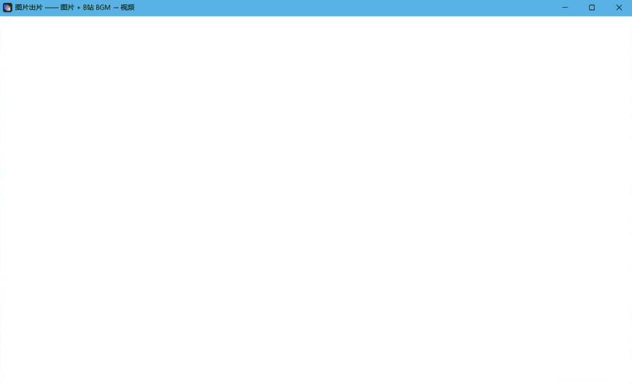

- **画像も動画も何本でも**：ドラッグして並べ替え、クリップごとに秒数を調整。動画は元の長さのまま 1 クリップになり、前後のトリム・分割・トランジション適用ができます。下部のタイムラインはクリックした位置へジャンプし、右端をドラッグすればそのまま長さを変更できます。
- **音楽は動画リンクから音声トラック全体を取得**：Bilibili（b23.tv 短縮リンク / BV・av 番号そのまま）、Douyin、YouTube、Kuaishou、小紅書、Weibo。ローカルの音声・動画をウィンドウへ直接ドラッグすることもできます。
- **ウィンドウ内でプレビュー**：プレビューはリアルタイム合成です。パラメータを変え、シークバーを動かし、トランジションを切り替えると、次のフレームですぐ反映されます。全体の再レンダリングを待つ必要はありません。
- **プレビューはプレーヤーのように**：映像の下にシークバー、再生 / 一時停止、±5 秒、0.5–2× の速度、4 段階の画質（スムーズ / 標準 / シャープ / 元のサイズ）があります。速度と画質はプレビューだけに影響し、完成動画は設定どおりに書き出されます。
- **素材は画像だけではない**：画像も動画も一覧へドラッグするか「素材を追加」を押せば追加できます。動画クリップはタイムライン上で端をドラッグしてトリム、I/O キーでイン点・アウト点を設定、Ctrl+K で分割でき、色調整やトランジションもそのまま適用できます。
- **仕様は調整可能**：9 種類のアスペクト比 + 幅・高さの手入力、30/60fps、3 段階の画質、5 種類の背景（元画像を背景に / 単色の余白 / カスタム背景画像 / カスタム背景動画 / 切り抜いて全面）、フェードイン・アウトと 12 種類の内蔵トランジション、書き出し先。
- **すぐ使える**：画像、フォルダー、音声・動画ファイルをそのままウィンドウへドラッグできます。書き出し後は保存先フォルダーを自動で開き、写真の EXIF の向きも自動で補正します。
- **動かせる**：任意でゆっくりズームイン / ズームアウト / 交互ズーム（Ken Burns）を選べ、静止画に呼吸感のあるカメラワークを与えます。
- **ちょっとした便利機能**：簡体字中国語 / 繁体字中国語 / English / 日本語 / 한국어 の 5 言語の UI。ダーク / ライトテーマ。メインカラーを 1 つ選ぶだけでアクセントカラーを自動で組み合わせ。3 段階の UI モード（シンプルは 3 ステップで書き出し / 標準は日常的な編集 / プロはすべてのパラメータ）。
- **プロジェクトを保存できる**：.p2v プロジェクトとしてワンクリックで保存（画像、長さ、オープニング・エンディング、オーディオクリップ、字幕をすべて格納）。次に開けば続きから編集できます。15 秒ごとに自動保存し、クラッシュしても次回起動時に復元するか確認します。「プロジェクト」メニューには最近開いたものがあります。
- **字幕**：.srt / .ass を読み込み、そのまま動画に焼き込みます（フォントとサイズは設定で選択）。アップロードも通信もせず、アプリ内での編集も行いません。
- **原稿からそのまま音声合成**：「音声」タブに原稿を貼り → 音色を選び → ワンクリックでナレーションと文単位の字幕を合成。既定は無料の Edge（キー不要、タイムスタンプ付き）で、Gemini / Azure / OpenAI 互換エンドポイントの自分のキーも使えます。合成後は合計時間が自動で「ナレーションに合わせる」になり、映像が音声に追従します。
- **プラットフォーム別の書き出し**：書き出し時に Bilibili / Douyin / WeChat 視頻号 / YouTube / 汎用 を選ぶと、解像度とフレームレートが自動で設定されます。ついでに完成動画のタイムラインに合わせて同名のカバー画像も書き出せます。
- **画面を 1 枚重ねられる**：画像や動画を完成映像の上に重ねられます（ピクチャーインピクチャー）。9 分割の位置、拡大縮小、不透明度、表示開始・終了を調整でき、タイムライン上で直接ドラッグもできます。
- **色調整できる**：クリップごとに明るさ / コントラスト / 彩度を調整でき、フィルター（.cube の LUT、カメラ内ルックやフィルム感はこれで）も適用できます。右クリックから開けます。
- **音声が見えて、触れる**：タイムラインに実際の波形を描画します。オーディオクリップごとにゲイン（dB）を設定でき、波形上で音量エンベロープを打てます（Alt + クリックで点を追加、点をドラッグで値変更、右クリックで点を削除）。
- **リソースパック**：フォント、LUT、トランジションプリセットは zip にまとめてインストールでき、入れると対応するドロップダウン / メニューに現れます。パッケージにはマニフェストとチェックサムがあり、素性の怪しいものは拒否します。
- **無駄に待たせない**：書き出しはパーセントと残り時間を表示し、いつでも「キャンセル」できます。書き出し中に閉じようとすると確認が出ます。初回起動時は最大化で開き、その後は設定で前回を記憶または固定サイズに変更できます。

## クイックスタート

1. 依存関係をインストール（1 回だけ）：

   ```
   python -m pip install PyQt6
   ```

   `ffmpeg` と `ffprobe` は自分で入れる必要はありません。初回起動時に確認が出て、承諾すると `tools/` へ自動ダウンロードされます（約 120 MB、実測 9.0.2）。
   システムの PATH に ffmpeg が既にある場合はそれを使い、ダウンロードは行いません。

2. `启动.bat` をダブルクリック（中身は `python pic2video.py`）。
3. 画像や動画をウィンドウへドラッグするか、「素材を追加」を押します。
4. リンクを「音楽リンク」欄に貼り、ステータスバーに「音楽を読み込みました：長さ x:xx · ファイル：…」と出るまで待ちます。リンクから取得した音楽はツールのデータフォルダーの `media/` に保存され、アプリを閉じても消えません。
5. プレビューを確認し、「動画を書き出す」を押してプラットフォーム別プリセットを選択（または設定どおりのまま）、保存先を選びます。

フォルダーごとウィンドウへドラッグすることもできます（中の画像・音声・動画がまとめて追加されます）。画像や音楽ファイルを直接ドラッグしてもかまいません。一覧の項目の上にドロップする位置によって動作が 3 つに分かれます：**左 1/3** に落とすとその前に挿入、**中央**に落とすと置き換え、**右 1/3** に落とすとその後に挿入（ドラッグ中は一覧に挿入線またはハイライト枠が表示されます）。

キーボードでも操作できます：Ctrl+I で素材を追加、Ctrl+M で書き出し、F5 でプレビュー更新、スペースで再生 / 一時停止、Delete で選択中の画像を削除。プロジェクト関連は Ctrl+N で新規、Ctrl+O で開く、Ctrl+S で保存、Ctrl+Shift+S で別名保存。これらのキーは 設定 → ショートカット で変更できます。

素材は画像だけではありません：**動画も追加できます**。動画ファイルを一覧へドラッグ（または「素材を追加」）すると、元の長さのまま 1 クリップになります。タイムライン上では画像クリップと同じように端をドラッグしてトリム、I/O でイン点・アウト点を設定、Ctrl+K で 2 つに分割、トランジション選択、色調整ができます。フォルダーごとドラッグした場合は、中の画像と動画がファイル名順にまとめて追加されます。音声ファイルだけをウィンドウへドラッグした場合のみ「音楽 / 追加オーディオ」の扱いになります。動画から音声だけを取りたいときは、「音楽リンク」欄へドラッグしてください。

## プロジェクトファイル（.p2v）

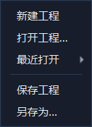

「プロジェクト」ボタン（または Ctrl+S）で .p2v プロジェクトとして保存できます。中身は普通の JSON で、バージョン番号、フレームレート、テンポモード、各画像の順序と長さ、オープニング・エンディングのイン点・アウト点、オーディオクリップの開始位置と音量、字幕の内容が書かれています。動画と音声そのものはプロジェクトに入らず、パスだけを記録します。そのためプロジェクトと素材は別々にコピーできます。

- **保存 / 別名で保存**：Ctrl+S は元の場所へ上書き。未保存なら最初にパスを確認します。保存はアトミック書き込み（.tmp に書いてからリネーム）なので、書き込み中に電源が落ちても既存のプロジェクトは壊れません。
- **自動保存**：15 秒ごとに変更をツールフォルダーへ保存し、正常に保存したかウィンドウを閉じると削除されます。前回が正常終了でなかった場合、次回起動時にそのファイルを復元するか確認します。
- **最近開いたもの**：メニューに最大 8 件。削除されたものは自動で一覧から消えます。
- **素材が見つからない**：開いたときに画像や音声が移動されていると、一覧で示して「再指定…」するか確認します。新しい場所を選ぶと、その種類を指すプロジェクト内の項目がまとめて切り替わります。
- **バージョン**：プロジェクトには version が入っています。アプリより新しいバージョンは推測で読まずに開くのを拒否します。新しいプロジェクトを壊さないためです。

## 字幕

左下の「字幕」タブ：「字幕を読み込む…」から .srt または .ass を選ぶと、各項目の時間と文字がすぐ一覧表示され、プレビューでも書き出しでも画面に焼き込まれます。

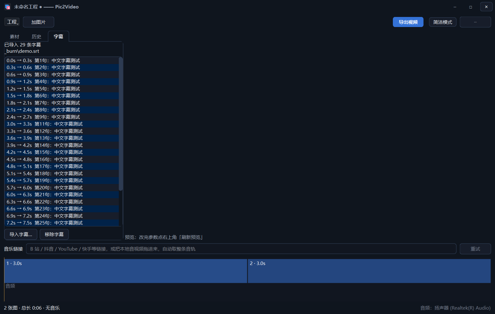

- **読み込み + 焼き込み**のみ：解析は読み込み時に 1 回だけ行い、字幕内容はプロジェクト（.p2v）に保存されるので元ファイルの有無に依存しません。アプリ内での文字追加やタイムライン編集は行いません。
- フォントとサイズは 設定 → 画面 → 字幕フォント / 字幕サイズ で選びます。サイズは「1080p でのピクセル数」で、540p のプレビューでは比例して半分になります。そのためプレビューと完成動画の見た目は一致します。
- 既定のフォントは Microsoft YaHei です。フォントによっては（特に一部の .ttc）最初の字形セットしか取得できない、あるいは中国語をまったく含まないことがあります。完成動画で字幕が豆腐（□）になるときは別のフォントを試してください。
- 波括弧はそのまま表示されます（a{b}c は a{b}c と書けばよく、自分でエスケープする必要はありません）。.srt で 1 つの字幕内の改行は、.ass では強制改行になります。end が start より後ろでない壊れた項目は捨てられ、字幕ファイル全体が開けなくなることはありません。

## 音声（原稿 → TTS → 字幕）

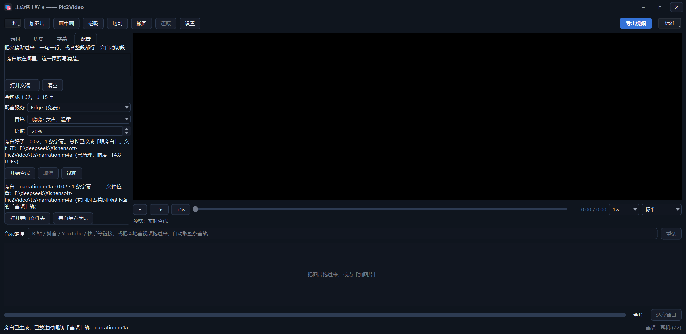

「音声」タブ（標準 / プロモードでのみ表示）は「原稿がある」を「動画がある」に変えます：原稿を貼る → 音色を選ぶ →「合成を開始」を押すと、ナレーションと文単位の字幕ができ、合計時間は自動でナレーションに合わせて決まります。

- **原稿**：左上の欄に直接貼るか、「原稿を開く…」で .txt / .md を読み込みます（UTF-8、GBK も可）。1 行 1 文でも、まとまった段落でも構いません。句読点で自動的に文に分け、さらに約 1000 字ごとに区切ります。欄の下には「N 個に分割、合計 M 文字」がリアルタイムで表示されます。
- **音色**：既定は Edge（無料、キー不要）。中国語の音色は 14 種類（普通話 / 東北弁 / 陝西弁 / 台湾 / 広東語、男女あり）。速度は -50%〜+100%。合うか先に聴きたいときは「試聴」で最初の区間だけを合成します。
- **合成**：バックグラウンドで区間ごとに実行し、進捗バーに「完了 / 全区間」を表示します。いつでも「キャンセル」でき、1 区間だけ失敗した場合は再実行できます。各区間の結果は「テキスト + サービス + 音色 + 速度」でツールフォルダー（`tts/`）にキャッシュされ、途中で中断してもう一度押すと合成済みの区間はスキップされます。
- **つないだあと**：ナレーションはタイムラインの音声トラック（波形付き）へ、文単位の字幕は「字幕」タブへ入ります。テンポは自動で「ナレーションに合わせる」に切り替わり、素材はナレーションの長さに合わせて配分され、合計時間はナレーションの長さになります。字幕を別の用途に使いたいときは、「字幕」タブの「.srt で保存…」を押します。
- **ナレーションファイルの場所**：音声タブのいちばん下にフルパスがそのまま表示されます（ツールフォルダー内の `tts/narration_<内容指纹>.m4a`。原稿ごとに別ファイルになり、上書きされません）。隣の「ナレーションのフォルダーを開く」でエクスプローラー上に表示されます。自分の好きな場所に置きたいときは「ナレーションを別名で保存…」を押すと、保存後にプロジェクトは選んだファイルを使うようになります。
- **合成後に軽く整える**（既定オン、設定 → 音声 でオフ可）：区間の先頭と末尾の余分な無音を切り、冒頭の高域のクリック音と低域のポップ音を削り、EBU R128 に沿ってナレーション全体を **ラウドネス -14** に合わせ（LUFS はラウドネスの単位で、プラットフォーム標準の「普通の音量」にほぼ相当）、最後にリミッターで保護します。切り取った無音の分だけ字幕も前にずれるので、ずれは生じません。ステータスバーには「（クリーン済み、-14.0）」と表示されます。
- **字幕の折り返し**：1 行は最大 18 文字、最大 2 行。長すぎる文は自動的に 2 つに分かれ、1 行が画面いっぱいに広がることはありません。
- **Gemini**：設定 → 音声 で自分の Gemini キーを入力すれば使えます（音色は Kore / Puck / Aoede / Charon / Fenrir / Leda、複数話者も可）。Gemini はタイムスタンプを返さないため、同じテキストを無料の Edge で裏側に 1 回通してテンポの雛形とし、字幕を実際の長さに合わせて伸縮します。Edge にもつながらない場合のみ、文字数で割り振る方式に戻ります。速度パラメータがないため、速度欄は自動的にグレーアウトします。速くしたいときは原稿を直してください。
- **Azure 音声**：設定 → 音声 でキーとリージョン（例 `eastasia`）を入力すると、REST + SSML で動作します。音色は Edge と同源（Xiaoxiao / Yunxi / Yunyang / Xiaoyi）で、無料枠は月 50 万字です。REST はタイムスタンプを返さないため、字幕は同じく Edge をテンポの雛形にします。429 に当たると待機して再試行し、最終的に「枠を使い切りました」と表示します。
- **OpenAI 互換エンドポイント**：キーと base_url を入力します（SiliconFlow、Volcengine、MiniMax の互換レイヤーでも可）。モデル名も任意で入力できます（空 = `tts-1`）。速度は `speed`（0.25〜4.0）に換算されます。タイムスタンプを返さないエンドポイントは同じく Edge をテンポの雛形に使います。失敗時はキーの誤り・枠の使い切り・ネットワークの問題を区別して表示します。キーは本機の設定ファイルに平文で保存され、アップロードされません。
- **尺を決め打ちしない**：どんなに長い原稿でもかまいません。自分のキーを使う場合の枠はあなたの枠です。無料の Edge には 1 日の回数制限はなく、速度と同時実行に関する緩い制限だけがあります。

### 複数人の会話（任意の役名）

一問一答も多人数のチャットも手作業で組み立てる必要はありません。各行を「名前：」で始め、続く行はそのキャラクターのそのターンとして扱われます。名前は 1〜12 文字で句読点なし。`小明：`、`妈妈：`、`旁白：`、`老师：` のいずれも使えます。

```
小明：こんにちは、小明です。
妈妈：お母さんです。今日の夕食ができたよ。
旁白：これは複数人会話のテストです。
老师：みなさん、こんにちは。授業を始めます。
```

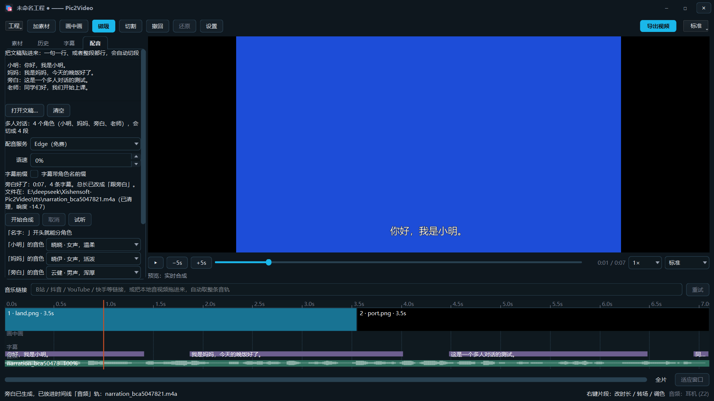

- 音声タブは登場順にすべての役を拾い、役ごとに 1 行で個別に音色を選べます。役が多くて 1 画面に収まらないときは、このページを上下にスクロールできます。
- 従来の書き方も引き続き使えます：`角色 A：` / `角色 B：`、`A:` / `B:`、`主讲：` / `听友：` は、いずれも対応する 2 役にまとめられます。
- ターンとターンの間は 0.35 秒空けます（通常の区間間は設定の 0.6 秒）。本当に会話しているように聞こえます。
- 「字幕に話者名の接頭辞を付ける」をオンにすると、字幕は「小明：こんにちは、小明です。」のように出力されます。オフなら台詞だけです。
- ターンごとに 1 回リクエストを送るため、Gemini のように回数で枠を消費するサービスでは、役やターンが多いほど消費回数が増えます。
- 原稿に役のマーカーがない場合は従来どおりで、役の一覧は増えません。
## トランジション

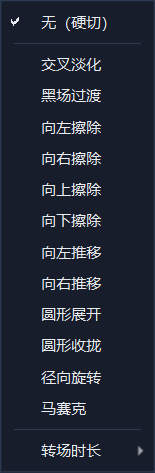

画面要素を右クリック → 「トランジション」で名前を選ぶだけです。「なし（ハードカット）」はそのまま切り替えます。12 個の名前はすべて ffmpeg 内蔵の `xfade` に由来し、外部ファイルは使いません：

| 名前 | 見え方 |
| --- | --- |
| クロスフェード / 黒フェード | ディゾルブ。黒フェードは途中で少し暗くなる |
| 左ワイプ / 右ワイプ / 上ワイプ / 下ワイプ | 前の映像を拭いながら次を出す |
| 左スライド / 右スライド | 次の映像が前の映像を押し出す |
| 円形オープン / 円形クローズ | 円が小さいところから広がる展開、大きいところから縮む収納 |
| 放射状 / モザイク | 回転しながら切り替わる。モザイクは一度崩れてから戻る |

- **長さ**：同じ階層のメニューの「切り替え時間」で 0.2 / 0.3 / 0.5 / 0.8 / 1.0 秒から選べます。「設定に従う」は 設定 → テンポと動き → クリップのトランジション の秒数を使います。
- **どちらが優先か**：隣り合う 2 つの要素のどちらかでトランジションがオンなら、その境界は切り替わります。両方がオンで名前が違う場合は前の要素の指定に従います。
- **合計時間は変わらない**：トランジションは 2 つのクリップが「それぞれ相手側へ半分ずつ伸びて重なって再生される」形で作られます。2 秒 + 2 秒でトランジション 0.8 秒なら、完成動画は依然 4.0 秒のまま。トランジションが 1.6〜2.4 秒の区間を占め、2 つのクリップの実質的な静止時間がそれぞれ 0.4 秒ずつ減るだけです。動画クリップはソースから 0.4 秒余分に取得して補うため、内容は欠けません。プレビューと書き出しは同じフィルターを通るので見た目も一致します。
- **収まらないときは止める**：隣り合う 2 つのクリップは、どちらも「トランジションの長さの 2 倍」より長い必要があります。トランジション選択時にその場で知らせ、書き出し前にももう一度チェックします（壊れた途中までの動画は書き出しません）。
- プロジェクトファイルには各クリップのトランジション名と長さが保存されます。古いプロジェクトにはこの 2 項目がないため、開くとハードカットになります。
- トランジションのリソースパックを入れると、メニューに「名前（パック）」のプリセットが増えます。ただし中身は「内蔵トランジション名 + 既定の長さ」にすぎず、新しいアルゴリズムではありません。下のリソースパックの節を参照してください。

## ピクチャーインピクチャー

上部の「ピクチャーインピクチャー」で画像か動画を選ぶと、完成映像の上に重ねて再生されます。位置、大きさ、透明度、表示開始・終了のタイミングを調整できます。

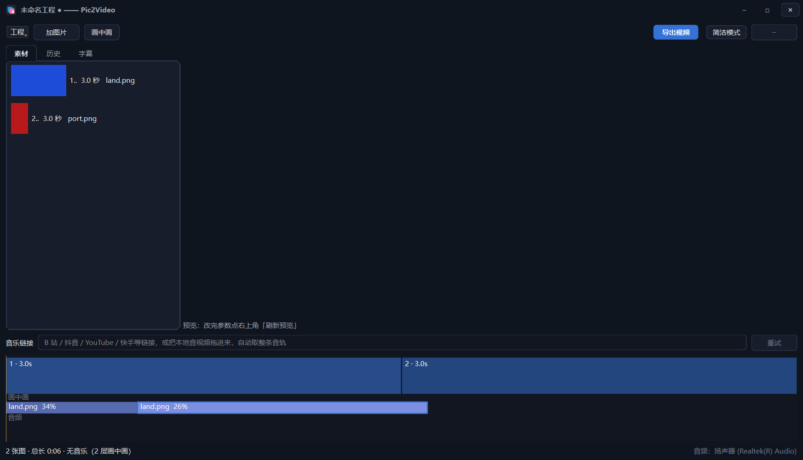

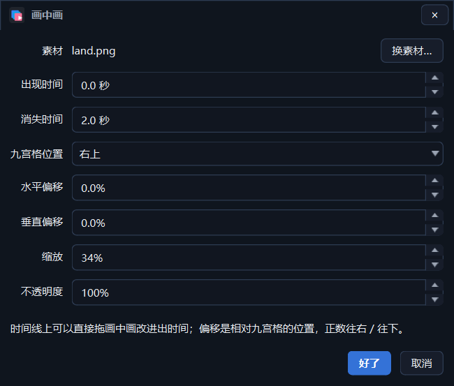

- **配置**：9 分割でおおよその位置を選び（右上をアイコン代わりに、中央をマスク代わりに、など）、横 / 縦オフセットで微調整します（画面の幅・高さに対する割合、正の値で右 / 下へ）。「拡大縮小」は完成幅に対する割合で、40% なら右上の一区画くらいです。
- **表示開始 / 終了**：秒数を入力するか、タイムライン中央の「ピクチャーインピクチャー」トラック上でドラッグして開始位置を変えます。同じトラックに何層でも置け、追加した順に重なり、後のものが前のものを覆います。
- **不透明度**：0〜100%。フェードイン・アウトは不透明度を区間ごとに重ねて作ることも、半透明のウォーターマークとして使うこともできます。
- **合計時間は変わらない**：重ねは完成映像の上に乗る 2 回目のパスで、メイントラックの時間は変えません。メイントラックがどこまで続くかで完成動画の長さが決まり、エンディングを超えた部分は描画されません。
- 「ピクチャーインピクチャー」トラック上のブロックは右クリックで再編集または削除できます。プロジェクトファイルには各層の素材パス、時間、位置、拡大縮小、不透明度がまとめて保存されます。

## 色調整

任意の画面要素（画像、動画、オープニング・エンディング）を右クリック →「色調整…」。3 本のスライダーと 1 つのフィルター（LUT）で、変更はすぐプレビューに反映されます。

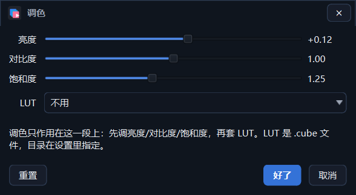

- **明るさ / コントラスト / 彩度**：明るさは -1.0〜1.0（0 で変化なし）、コントラストと彩度は倍率（1.00 で変化なし）。3 つとも ffmpeg の eq フィルターで、全体に適用すると背景の敷き方も一緒に調整されます。
- **フィルター（LUT）**：設定 → 画面 → LUT フォルダー で .cube ファイルのあるフォルダーを指定します。色調整ダイアログのドロップダウンには、そのフォルダー内の .cube が並びます。「使わない」を選ぶと 3 本のスライダーだけが効きます。
- **効くのはこのクリップだけ**：同じ画像に 2 通りの調整をしたいときは、2 つのクリップに分割して別々に調整します。
- **LUT ファイルも素材のうち**：ファイルを移動すると画像の欠落と同じように書き出し前に報告され、プロジェクトを保存して開き直すときに再指定できます。色調整のパラメータと LUT のパスはどちらもプロジェクトファイル（.p2v）に保存されます。

## 書き出しプリセットとカバー画像

「動画を書き出す」を押すと最初にこのダイアログが出ます。プラットフォームを選び、実際の設定を確認し、ついでにカバー画像を書き出すか決めます。

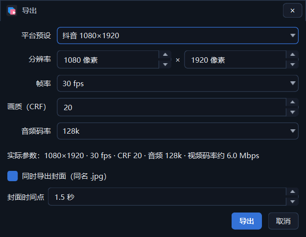

| プリセット | 解像度 | フレームレート | 画質 | 音声 | ファイル名の接尾辞 |
| --- | --- | --- | --- | --- | --- |
| 汎用（設定どおり） | 設定の幅・高さ | 設定のフレームレート | 設定の画質 | 192k | なし |
| Bilibili 1080p60 | 1920×1080 | 60 | 18 | 192k | _bilibili |
| Douyin 1080×1920 | 1080×1920 | 30 | 20 | 128k | _douyin |
| WeChat 視頻号 1080p30 | 1920×1080 | 30 | 20 | 128k | _channels |
| YouTube 1080p30 | 1920×1080 | 30 | 20 | 192k | _youtube |

- **どれかを手で変えると「カスタム」になる**：解像度、フレームレート、画質、音声ビットレートはその場で変更でき、ダイアログの「実際の設定」の行も連動して更新されます。ビットレートは経験則による目安です（画質の数値が小さいほど高く見積もられます）。
- **フレームレートは換算される**：プロジェクトのタイムラインは設定のフレームレートで保存されています。60fps のプリセットを選ぶと、書き出し前に目標のフレームレートで各クリップのフレーム数を再計算します。完成動画の長さは変わらず、半分になることはありません。
- **カバー画像**：「カバー画像も書き出す」にチェックして時刻を選びます（既定は最初の画像素材のちょうど中央、完成動画のタイムライン基準）。書き出しに成功すると同じフォルダーに同名の .jpg が生成され、それが完成動画のそのフレームになります。書き出し完了時のステータスバーとダイアログにはカバー画像のフルパスが表示されます。カバー画像の取得に失敗した場合は一言表示するだけで、書き出し済みの動画には影響しません。
- **前回の選択を記憶**：前回使ったプリセット、カバー画像の有無、カバー画像の時刻は settings.json に保存され、次に書き出しダイアログを開いたときも同じ状態になります。
- プリセット名もプロジェクトファイル（.p2v）に書き込まれますが、あくまで目印です。実際に効くのは常に書き出し時に選んだパラメータです。

## 各プラットフォームの音楽

| ソース | 必要なもの | 説明 |
| --- | --- | --- |
| Bilibili | なし | ログイン不要、Cookie も読みません。DASH 音声トラックのうちビットレートが最も高いものを取得 |
| Douyin / YouTube / Kuaishou / 小紅書 / Weibo | `yt-dlp` | **必要時にダウンロード**：設定 →「その他」で「ダウンロード」を押すとツールフォルダーの `tools/` に入ります（約 25 MB）。不要になったら「削除」で消せます。この手のリンクを初めて貼ったときにも一度確認します |
| ローカルファイル | なし | 音声はそのまま音楽として使用。動画は素材としてタイムラインに追加（音声だけ取りたいときは「音楽リンク」欄へドラッグ） |

取得するのは**音声トラック全体**で、ボーカル分離は行いません。

これは背景音楽で、すべての素材クリップに敷かれます。別の音声（効果音、2 本目の音楽、ナレーション）を重ねたいときは、タイムラインのオーディオブロックを右クリック →「オーディオを追加…」、または音声ファイルをそのままウィンドウへドラッグします。音声 1 本につき 1 ブロックで、開始位置は個別にドラッグ、音量はホイールで変更できます。

## オーディオブロック（波形 / エンベロープ / ゲイン）

タイムラインの各オーディオブロックには実際の波形が描かれ、静かな素材でも自身の最大値で正規化されるので起伏がはっきり見えます：

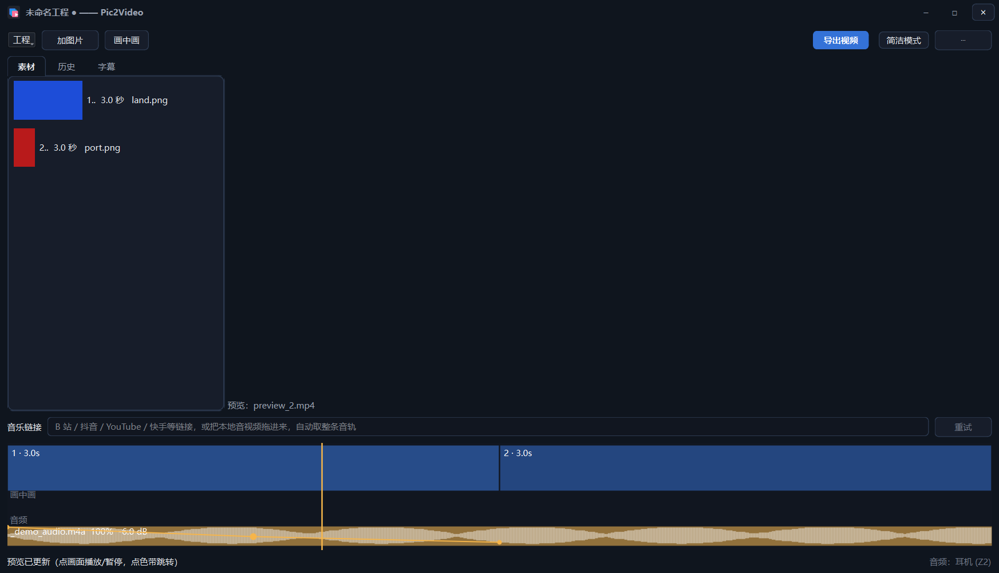

- **ゲイン**：オーディオブロックを右クリック →「ゲイン…」。範囲は -24 〜 +12 dB で、0 なら元のまま。小さめのナレーション全体を持ち上げるのに向いています。
- **エンベロープ**：Alt を押しながらオーディオブロックをクリックすると点が 1 つ増えます（横軸が時間、縦軸が 0〜100% の音量）。点を押したまま上下にドラッグすると値が変わり、右クリックでその点を削除します。点と点の間は直線的に補間され、書き出した音声もこの線に従います。音楽のフェードインや、ナレーションをいったん下げてから戻す、といった表現はこれで行います。
- **ゲインが先、エンベロープが後**：両者は掛け合わされるため、-6 dB に 50% のエンベロープを掛けると最終的に約 -12 dB になります。
- **波形の出どころ**：ffmpeg で音声をモノラル 8 kHz のピーク値に変換し、素材 1 本につき 1 つのキャッシュとして `peaks/` に置きます（パッケージ版では `%LOCALAPPDATA%\Pic2Video\peaks\`）。素材のファイルサイズや更新日時が変わると自動で再計算します。
- ゲインとエンベロープはどちらも .p2v プロジェクトに保存され、次に開いたときも残っています。

オーディオブロックの右クリックメニューは次のとおりです：

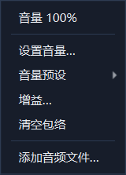

## リソースパック（フォント / LUT / トランジションプリセット）

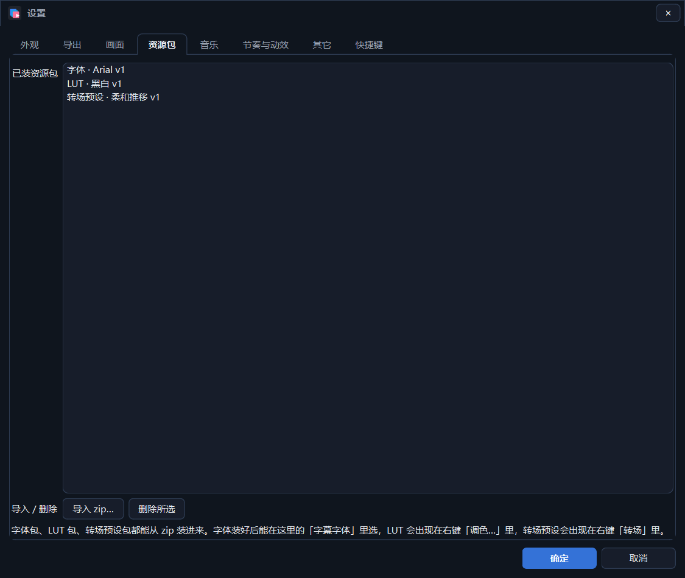

設定 → リソースパック（プロモードでは独立したページ）：「zip をインポート…」でパッケージを選ぶと、インストール後に一覧へ表示されます。ポップアップと「リソースフォルダーを開く」ボタンでインストール先がわかります。選択して「選択項目を削除」を押すと確認があり、使用中のプロジェクトがある場合は削除後にどのクリップかを知らせます。

- **インストール先**：プロジェクトファイルとは無関係に、ツールのデータフォルダーの `assets/fonts`、`assets/luts`、`assets/transitions` にまとめて置かれます（パッケージ版は `%LOCALAPPDATA%\Pic2Video\assets\`）。プロジェクトにはあくまでファイルパスが記録されるため、プロジェクトをコピーするときはリソースパックも一緒に考える必要があります。
- **フォントパック**（.ttf / .otf / .ttc）：インストールすると 設定 → 画面 → 字幕フォント のドロップダウンに現れます。字幕を焼き込むときにそのパックのフォルダーを libass へ自動で渡すため、事前にシステムへフォントを入れる必要はありません。.ttc は最初の字形セットのみ使用します。
- **LUT パック**（.cube）：インストールすると右クリック「色調整…」の LUT ドロップダウンに現れ、「LUT フォルダー」に手動で置いた .cube と並びます。
- **トランジションプリセットパック**（.json）：1 ファイルにつき 1 プリセットで、名前、使用する内蔵 xfade、既定の秒数が書かれています。インストールすると右クリック →「トランジション」に「（パック）」と付いて現れます。新しいアルゴリズムは持たず、ffmpeg 内蔵の 12 個の名前を組み合わせるだけです。

パッケージは 1 つの zip で、ルートに `manifest.json` を置き、各ファイルに sha256 を付けます：

```json
{
  "name": "私の LUT コレクション",
  "version": "1.0",
  "kind": "lut",
  "entries": [
    {"path": "teal-orange.cube", "sha256": "…64 桁の 16 進数…"}
  ]
}
```

- **kind** は `font` / `lut` / `transition` のいずれかで、拡張子も一致している必要があります（フォント .ttf/.otf/.ttc、LUT .cube、トランジション .json）。
- **安全上の境界**：絶対パス、`..` による上位参照、シンボリックリンク、実行ファイルは一律拒否します。ファイルは最大 64 個、展開後 64 MB 以下（zip ボム対策）。マニフェストに宣言のない余分なファイルや、チェックサムが合わないファイルも受け付けません。すべての検証を通ってから書き込みます：まず一時フォルダーへ展開し、正式なフォルダーへアトミックにリネームするため、失敗しても中途半端なファイルは残りません。
- **バージョン**：同じ名前で同じバージョンのパッケージを再度インストールすると拒否されます（先に削除してから入れ直し）。異なるバージョンはそのまま上書きされ、古いフォルダーは残りません。
- **削除したあと**：ドロップダウン / メニューからすぐ消えます。現在のプロジェクトがそのパックを使っている場合（あるクリップの LUT、または字幕フォント）は、どこで使っているかを知らせるので、レンダリング前に差し替えてください。

## コマンドライン（バッチ / スクリプト用）

```
python pic2video.py --export 输出.mp4 --audio 本地音频.m4a 图1.jpg 图2.png 图3.webp
python pic2video.py --export 输出.mp4 --audio "https://www.douyin.com/video/..." 图1.jpg 图2.png
python pic2video.py --export 输出.mp4 --bili BV13qs46FE9C --total 4 图1.jpg 图2.png
python pic2video.py --export 竖屏.mp4 --bili BV... --ratio 9:16 --fps 60 --fit cover --transition fade 图1.jpg 图2.png
```

`--total` は 1 枚あたりの秒数。`--fps` / `--ratio` / `--width` / `--height` / `--fit` / `--bg` /
`--pad-color` / `--no-bg-blur` / `--transition` / `--motion` / `--crop-focus` / `--volume` は設定ページと同じです。コマンドラインでは `settings.json` を書き換えません。

## インターフェース

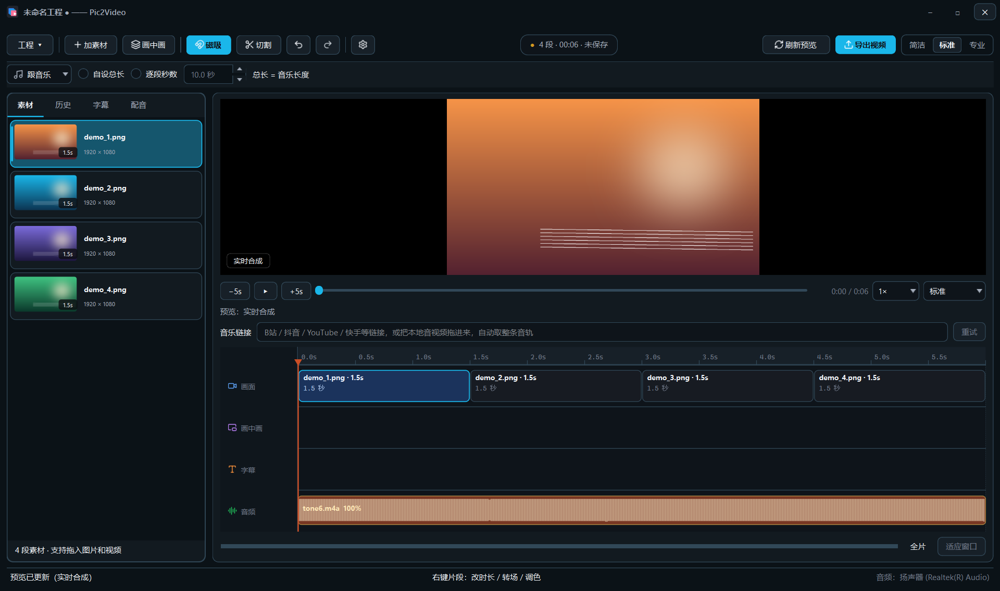

書き出し中はステータスバーにパーセントと残り時間が出て、いつでもキャンセルできます：

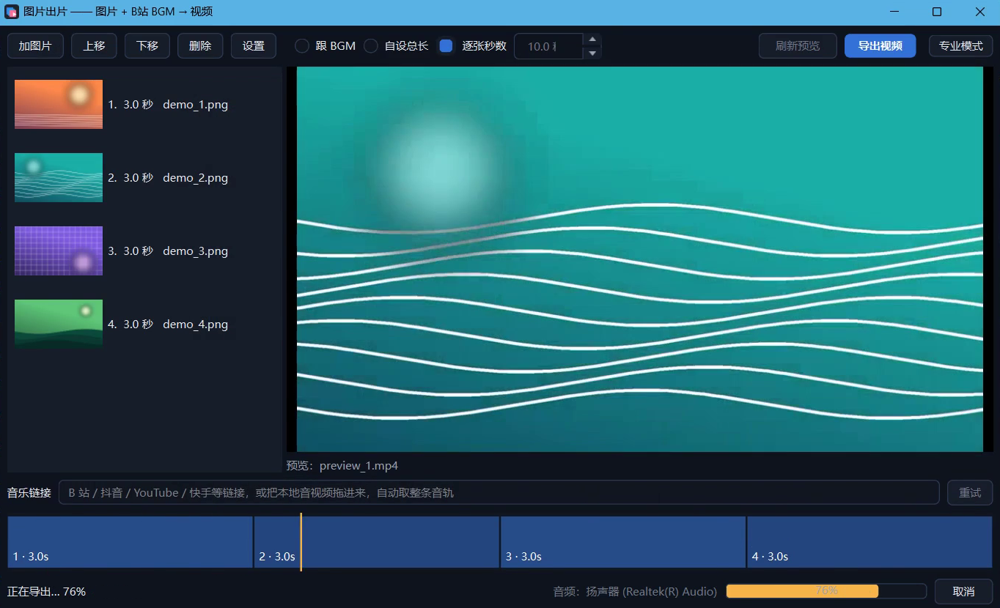

ウィンドウの枠はアプリが自前で描画しており、ダーク / ライトテーマやメインカラーに合わせて変わります。システム標準のグレーの枠は使いません。タイトルバーをドラッグして移動、ウィンドウの四辺・四隅をドラッグしてサイズ変更、タイトルバーをダブルクリックで最大化します。設定、色選択、お知らせ、秒数の入力といったウィンドウも同じ枠を使います。ファイル選択だけは意図的に OS ネイティブのダイアログに任せており、クイックアクセスや最近使った場所、クラウドのマウントも普段どおりに使えます。

### 3 つの UI モード

ツールバー右上のボタンを押すとメニューが開き、3 つのモードを自由に切り替えられます。選んだ時点で反映され、次回起動時も記憶されています。既定は**シンプル**です。

| モード | 対象 | ツールバー | タイムライン | 設定ページ |
| --- | --- | --- | --- | --- |
| **シンプル** | 画像や動画をまとめて動画にして投稿したいだけ | 素材を追加 / 動画を書き出す | 映像トラック + 音声トラック | 外観 / 書き出し / 画面 の 3 ブロック |
| **標準** | 日常的な編集 | さらに プロジェクト / ピクチャーインピクチャー / スナップ / カット / 元に戻す / やり直し / 設定 | 3 本のトラック、タイムラインの拡大縮小可 | 6 ページ：外観 / 書き出し / 画面 / 音声 / 音楽 / テンポと動き |
| **プロ** | すべてのパラメータを管理したい | すべて表示（並べ替え、テンポ、プレビュー更新も含む） | すべて表示 | リソースパック / その他 / ショートカット がそれぞれ独立ページ |

- シンプルモードでは並べ替え、削除、秒数の変更を右クリックに任せます。素材一覧の右クリックも、タイムラインのクリップの右クリックもあります。
- シンプルモードには「プロジェクト」ボタンがなく、「⋯」の中に 新規 / 開く / 最近開いたもの / 保存 / 別名で保存 / 設定 があります。
- 使ったときだけ現れる：シンプルモードでは重ねを追加して初めてピクチャーインピクチャーのトラックが増え、字幕を読み込んで初めて「字幕」タブが増えます。タイムラインのズームバーは標準以上では常時表示、シンプルモードでは一度拡大したときだけ現れます。

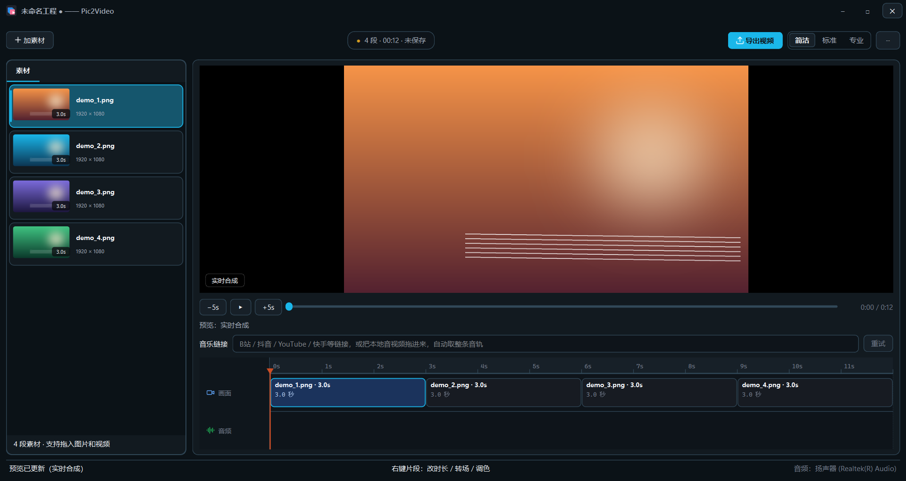


シンプルモードの設定ページは 3 ブロックだけです：

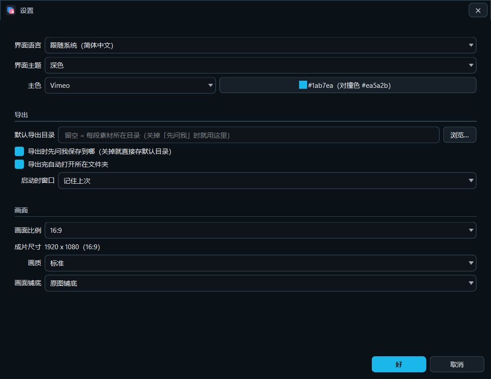

下部がタイムラインで、4 本のトラックがあります。いちばん上が画面要素（オープニング / 画像 / 動画 / エンディング）、中央の 2 本がピクチャーインピクチャー（重ねがあるときだけ使用）と字幕（字幕があるときだけ使用）、いちばん下が音声要素です。

- ツールバーの左側はテンポのドロップダウンです：**音楽に合わせる**（素材を音楽全体に均等割り）または **素材の長さに合わせる**（各クリップ ＝ オープニング + エンディングの合計 ÷ 素材数）。隣に「合計時間を指定」「1個ずつ秒数」の 2 つのラジオボタンもあります。選ぶと右側に今回の合計時間が何基準かを表示し（例：「長さ = 音楽の長さ」「長さ = 下の秒数」）、マウスを乗せると詳しい説明も出ます。
- クリップをクリックするとプレビューがその要素の先頭へジャンプします。押したまま左右にドラッグするとそのブロックが移動します（このトラック上での位置変更）。
- クリップの右端をドラッグするとこの画像の表示時間を変更。オープニング・エンディングのような動画クリップでは左端 / 右端のドラッグがイン点 / アウト点の変更になります（最長で元動画の長さ、最短で 1 フレーム）。オーディオブロックは中央をドラッグで開始時刻、左端 / 右端をドラッグで先頭 / 末尾のトリムになります（左端はソース側の開始位置も一緒に動き、右側は最大でソースファイルの末尾まで）。
- ツールバーの **スナップ** スイッチ（既定オン）は、ドラッグ中の端を近くの時点に吸着させます：クリップ同士の継ぎ目、オープニング・エンディング、オーディオブロックの先頭・末尾、再生ヘッド。ドラッグ中に青い破線が出たら吸着しています。**Alt** を押しながらのドラッグはこの 1 回だけ吸着しません。スナップとカットがオンのときはボタンがメインカラーに点灯し、今そのモードかどうかが一目でわかります。
- ツールバーの **カット** スイッチはブレードモードです：画面クリップまたはオーディオブロックをクリックすると、クリックしたその秒で 2 つに分割されます（端に近すぎると切れない旨の表示が出ます）。**Esc** でこのモードを終了します。
- オーディオブロックを右クリック →「削除して詰める」＝リップル削除：この音声を削除し、後ろの音声を空いた分だけまとめて前に詰めます。
- 再生ヘッドをある要素の上で止め、**I** でイン点、**O** でアウト点を設定、**Ctrl+K** でここを分割します（画像クリップは長さを分割、動画クリップはイン点・アウト点に従って 2 つに分割し、合計は元の長さのまま）。
- **Shift**（または Ctrl）を押しながら複数の要素をクリックすると複数選択になり、その後の設定は選択した要素すべてに適用されます。
- クリップを右クリックするとその要素のメニューが開きます：画面要素では「フェード」のオン / オフ、「色調整…」への移動、「トランジション」から内蔵 12 種のいずれか（またはハードカット）の選択、このクリップだけのトランジション長の指定ができます。ピクチャーインピクチャーのトラックでは重ねの追加 / 変更 / 削除、音声要素では音量（25%〜200% のプリセットまたは手入力）、ゲイン、エンベロープのクリアができ、複数選択時はまとめて変更できます。
- 画面要素と音声を同時に選択すると、画面のメニューに「この音声いっぱいに映像を合わせる」が増えます：画像または動画の長さをこの音声の長さに変更し、動画が音声より短ければループ、長ければ末尾から切り詰めます。
- マウスホイールをオーディオブロックの上で上下に回すと、そのまま音量を変更できます（1 目盛り 5%）。
- 左の素材一覧でも **Shift / Ctrl で複数選択**できます：削除、上へ / 下へ、ダブルクリックでの長さ変更は選択した複数枚にまとめて適用されます。一覧とタイムラインの選択は連動し、ドラッグで並べ替えても各クリップに設定済みの色調整、トランジション、イン点・アウト点は保たれます。
- 外部からファイルを素材一覧へドラッグすると、ドロップ位置で何が起きるかがその場で表示されます：中央は「N 番目を置き換え」または（動画クリップ上なら）「N 番目の後に挿入」、左 / 右は「N 番目の前に挿入 / 後に挿入」、空白部分は「末尾に追加」。手を離す前に結果がわかります。
- 下部タイムラインの上には時間目盛りがあり（拡大率に応じて密度が自動で変化）、拡大後もクリップが何秒目にあるか一目でわかります。下部バーの右側には「右クリック：長さ / トランジション / 色」が常時表示され、右クリックメニューの機能を推測する必要はありません。
- タイムラインの画面クリップにはファイル名が表示され、名前の似た画像でも取り違えません。
- クリップが増えて窮屈になったら拡大縮小：**Ctrl+ホイール**でタイムラインを拡大 / 縮小（マウス位置を中心に、最大 64 倍）、**Shift+ホイール**またはタイムライン下のスクロールバーで左右に移動、**Ctrl+0** / 右下の「ウィンドウに合わせる」で全体表示に戻ります。拡大後は再生ヘッドが見える範囲から出ると自動で追従します。
- 複数のクリップをまとめて動かしたいとき：タイムラインの空白部分からドラッグして矩形を描くと（たとえば音声のない空のトラックから上へドラッグ）、囲んだ画面クリップ、重ね、音声がまとめて選択されます。そのあとどれか 1 つをドラッグすると全体が一緒に動き、ドロップ位置には破線のヒントが出ます。Shift / Ctrl を押しながらの矩形選択は、現在の選択に追加します。
- 字幕トラックは 1 文につき 1 ブロックです：クリックでその文の先頭へジャンプ、左右にドラッグすると文全体を前 / 後ろへ移動します（文の長さは変わらず、書き出しとプレビューにも反映されます）。字幕の文字自体は「字幕」タブで確認するもので、トラック上では変更しません。

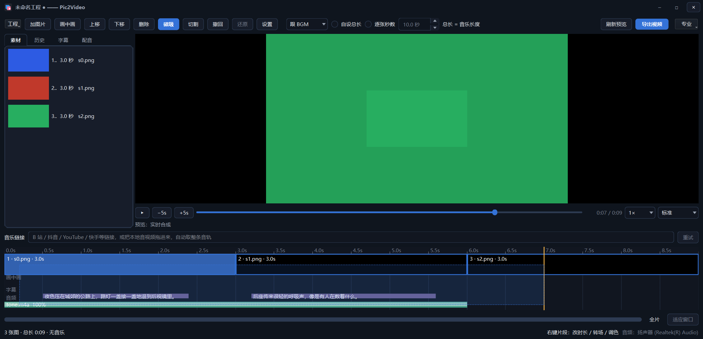
- キーボード：**← / →** で 1 フレーム、**Shift + ← / →** で 1 秒、**Home / End** でオープニング / エンディングへ移動、スペースで再生 / 一時停止（入力欄、ドロップダウン、一覧の中では通常どおりコントロール側が使います）。
- 音楽リンクの入力欄で Enter を押すとそのまま音声トラックの取得が始まり、「再試行」を押す必要はありません。
- 素材のフォルダーごと移動した場合、再指定ではまずフォルダーを一度選べばファイル名で自動的に対応づけられます。対応づかないものだけ 1 つずつ確認します。

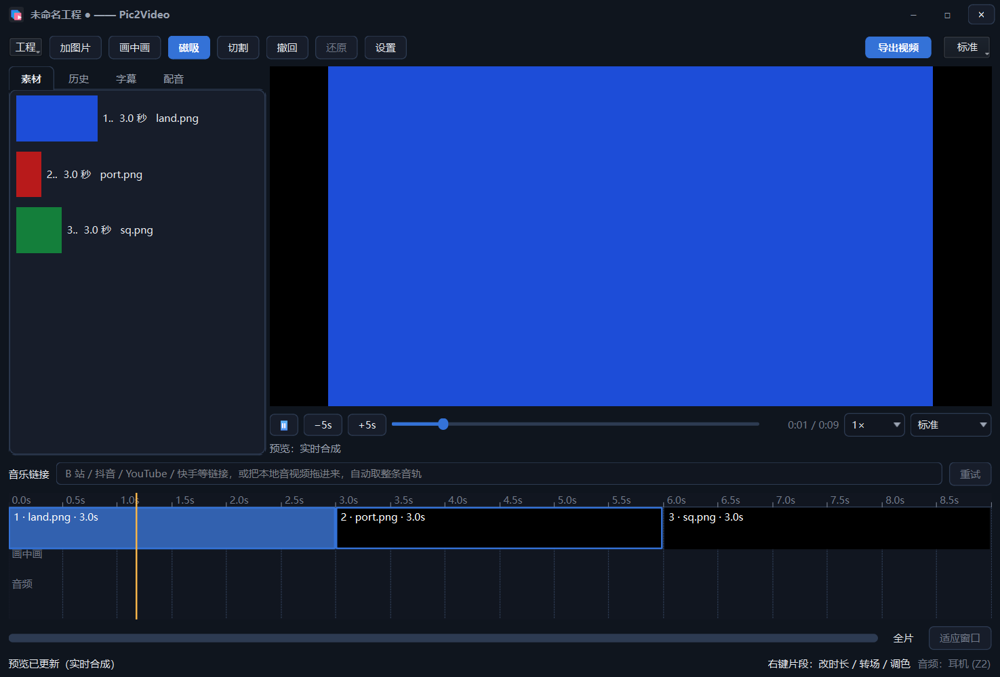

プレビュー映像の下は再生コントロールバーです。左側の映像自体をクリックしても再生 / 一時停止できます（マウスを乗せると手の形になります）。再生 / 一時停止（スペースでも可）、−5s / +5s、中央はシークバー（押したままドラッグ、クリックした位置へジャンプ）と「現在 / 合計」、右側は速度とプレビュー画質のドロップダウンです。再生ヘッドをドラッグする、タイムラインのクリップをクリックする、シークバーを動かす、いずれも映像がリアルタイムで追従します。画質はプレビューの解像度だけを変えます：スムーズ 640 / 標準 960 / シャープ 1280 / 元のサイズは完成動画と同じ大きさで、小さい完成動画が拡大されることはありません。

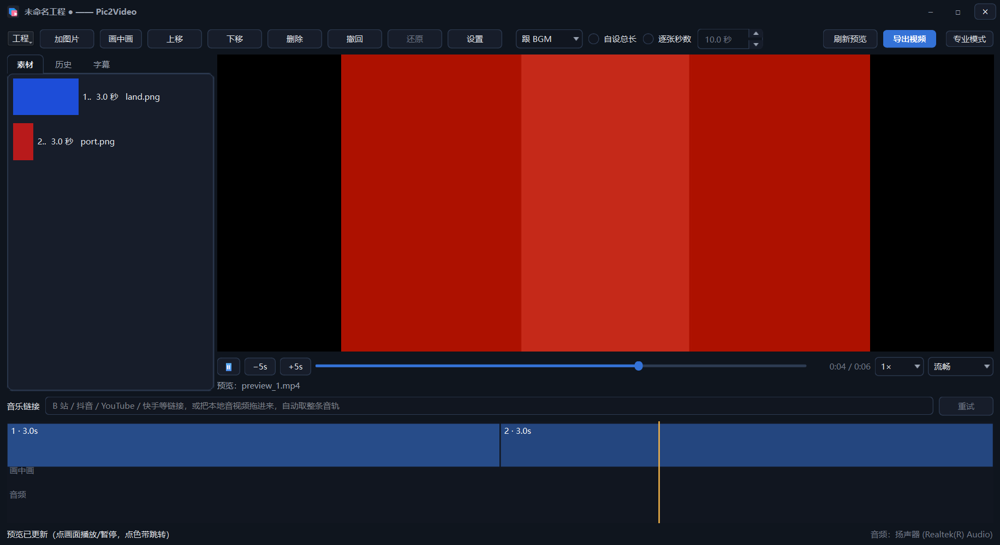

### リアルタイムプレビューの仕組み

プレビューは「mp4 を書き出してから再生する」ものではなく、時間に応じてその場で描くコンポジターです：

- 各フレームは `Scene.frame_at(t)` がその場で組み立てます：背景の敷き方、拡大縮小、フェードイン・アウト、Ken Burns、12 種のトランジション、ピクチャーインピクチャー、字幕、色調整を、プレビュー解像度で QPainter により直接描画します。画像は 1 回デコードしてメモリに載せ、近くの区間は先に下地を用意しておきます。
- 音声トラックは別途 1 本の `.m4a` にミックスしてマスタークロックにします。音声フィルターだけを走らせるので数百ミリ秒で完了します。映像はプレーヤーの位置に合わせてフレームごとに更新されるため、再生、シーク、±5 秒のいずれもエンコード待ちが発生しません。
- パラメータを変えてもシーンモデルを組み直して 1 フレーム描き直すだけで、動画エンコードは始めません。ffmpeg の完全な filtergraph を通るのは書き出し時だけです。
- 12 種のトランジションはプレビューでは近似表示です（書き出しでは引き続き ffmpeg の xfade を使用）。オープニング・エンディングのような動画クリップは常設のデコードパイプラインで順にフレームを読み、大きくジャンプしたときだけ開き直します。

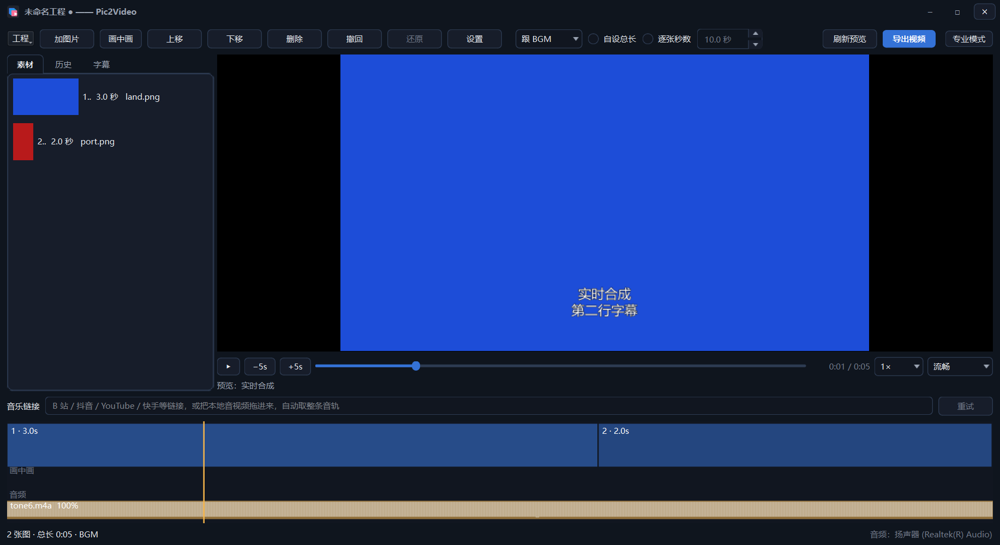

## 設定

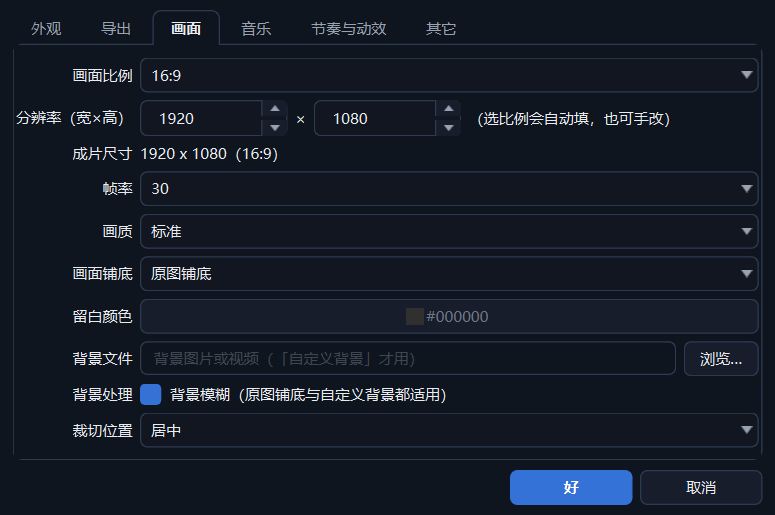

設定ページは **外観 / 書き出し / 画面 / 音声 / 音楽 / テンポと動き / リソースパック / その他 / ショートカット** に分かれます。標準とプロモードでは各グループが 1 ページになり（上部でタブを切り替えるので 1 画面をスクロールし続ける必要はありません）、標準モードではリソースパック / その他 / ショートカットといったプロ向けページが畳まれます。シンプルモードではページを分けず 1 列に並べ、外観 / 書き出し / 画面 だけが残り、空になったグループは見出しごと畳まれます。

| 項目 | 説明 |
| --- | --- |
| 表示言語 / テーマ | 5 言語。システムに従う / ライト / ダーク |
| メインカラー | 12 の動画サイトのブランドカラープリセット（ビリビリ / YouTube / 抖音（Douyin） / 快手（Kuaishou） / 小紅書（RED） / 微博（Weibo） / テンセントビデオ / 愛奇芸（iQIYI） / 優酷（Youku） / Netflix / Twitch / Vimeo）。右側を押してカラーホイールから自分で調整もでき、アクセントカラーは 180° で自動計算 |
| 既定の書き出し先 | 空 = 各素材のファイルがあるフォルダー |
| 書き出し先を毎回たずねる | 既定オン（保存ダイアログを表示）。オフなら上の既定フォルダーへ直接保存し、ダイアログは出ません |
| 書き出しプリセット / カバー画像 | 設定ページでは変更しません：書き出しダイアログで選び、前回のプリセット、カバー画像の有無、カバー画像の時刻は自動で settings.json に記録されます |
| LUT フォルダー | フィルター .cube ファイルを置くフォルダー。右クリック「色調整…」のときにこのフォルダーから一覧表示して選べます |
| アスペクト比 / 解像度 / フレームレート / 画質 | 9 種類の比率はプリセット扱いで、幅・高さは手入力も可。30/60fps。高画質 / 標準 / 小さめ |
| 背景の敷き方 / 余白の色 / 背景ファイル / 背景処理 | 5 種類の背景。単色は自分で選べます。背景画像 / 動画はぼかすかどうかを選べます |
| 既定のテンポ / 1枚ずつの既定秒数 | 音楽に合わせる、素材の長さに合わせる、合計時間を指定、1個ずつ秒数（素材の長さに合わせる ＝ オープニング + エンディングの合計 ÷ 素材数。各クリップがこの長さで再生されます） |
| 音楽の開始位置 / 音楽の長さ | 何秒目から使い、どのくらいの長さ使うか。「曲全体」 / 0 = 最後まで使う |
| 音楽フェードイン・アウト / クリップのトランジション | 秒数を調整可。ここでのトランジション時間は個別設定していないクリップの既定値です（個々のクリップは右クリックメニューで変更できます） |
| 映像の動き | 静止 / ゆっくりズームイン / ゆっくりズームアウト / 交互ズーム（Ken Burns、既定は静止） |
| トリミング位置 | 切り抜いて全面のときに中央 / 上寄せ / 下寄せのどこを残すか（人物写真は上寄せが多い） |
| 字幕フォント / 字幕サイズ | 動画に焼き込む字幕がこのフォントを使います。サイズは 1080p 基準（16〜120）で、プレビューでは画面の高さに合わせて比例縮小されます。リソースパックのフォントもここに一緒に並びます |
| リソースパック | zip からフォント / LUT / トランジションプリセットをインストール。入れると対応するドロップダウンと右クリックメニューに現れます。詳しくは上の「リソースパック」の節を参照 |
| 音声 | 音声サービス、キー（Gemini / Azure / OpenAI 互換）、Azure リージョン、互換エンドポイントのアドレスとモデル名、音声用プロキシ、区間の間隔、合成後のクリーンアップ。詳しくは上の「音声」の節を参照 |
| 既定のオープニング動画 / 既定のエンディング動画 | 最初の画像を追加したときに先頭 / 末尾へ自動で挿入され、空なら追加しません。オープニング区間には音楽をかけません：オープニングがある場合、音楽は最初の素材から始まり、エンディング区間も同様です |
| 音楽の音量 | 0〜200%、既定 100% |
| 書き出し後にフォルダーを開く | 既定オン。オフなら完了のお知らせだけを表示 |
| 起動時のウィンドウ / 固定サイズ | 既定は「最大化で起動」。前回を記憶、または固定サイズ（幅×高さを自分で入力）も選べます。より小さい画面に移るとウィンドウは自動で画面内に収まります |
| ffmpeg | 書き出しエンジン（約 120 MB）。ffmpeg 未インストールの場合、初回起動時に「今すぐダウンロードしますか」と確認し、完了後そのまま使えます。ここで削除したり、後で入れ直すこともできます |
| yt-dlp | Douyin / YouTube などのプラットフォーム用パーサー（約 25 MB）。インストール状況を表示し、ワンクリックでダウンロードまたは削除できます |

音楽ページと「その他」（コンポーネント管理）はこのとおりです：

| 音楽 | その他（ffmpeg / yt-dlp） |
| --- | --- |
| 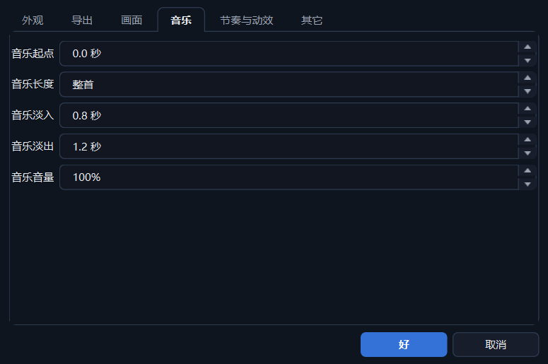 | 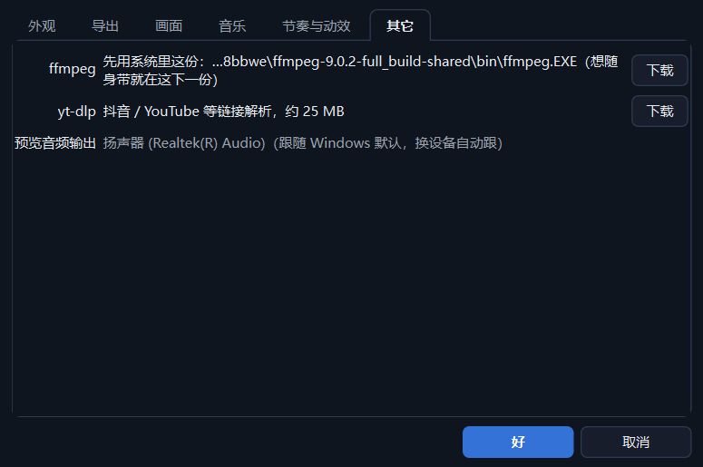 |

ライトテーマと、メインカラーの右側を押して開くカラーホイール（アクセントカラーは自動計算）：

| ライト | カラーホイールで選択 |
| --- | --- |
| 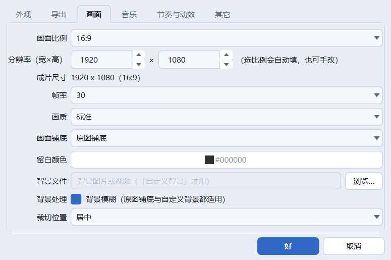 | 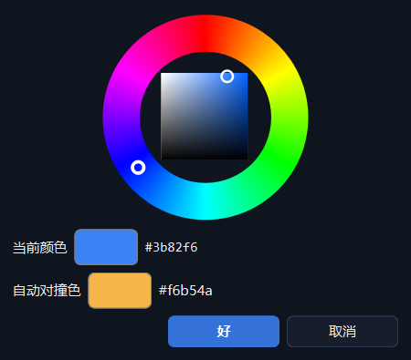 |

プレビューの音声は常に **Windows の既定の出力デバイス** に従い、ヘッドホンの抜き差しでも自動で切り替わり、再起動は不要です。

書き出し後は保存先フォルダーが自動で開きます（設定でオフにできます）。書き出し中はステータスバーに進捗と「残り約 x:xx」が表示され、隣に「キャンセル」が増えます。ウィンドウのサイズ、位置、言語、テーマ、前回の書き出し先は settings.json に記録され、次回起動時も同じになります。

## プロジェクト構成

```
pic2video.py     メインプログラム（ウィンドウ + コマンドライン）
bili_audio.py    Bilibili からの音声取得（WBI 署名 + playurl）
audio_source.py  音源の判定と yt-dlp のラッパー
components.py    ffmpeg / yt-dlp の必要時ダウンロードと削除
theme.py         テーマ、メインカラー / アクセントカラー、QSS
i18n.py          5 言語の文言
tts_engine.py    音声合成：分割、Edge 合成、文単位タイムスタンプ、キャッシュと結合
启动.bat          ダブルクリックでウィンドウを開く
tests/           ユニットチェック（1425 件）
docs/            調査ノート、設計記録（wayfinder チケット）、元のプローブスクリプト
screenshots/     README 内のスクリーンショット
```

## 開発

```
python tests/test_project.py     # タイムライン / フレーム数 / 設定 / filtergraph / テーマ / 音源 / 壊れた画像の事前チェック / プロジェクトファイル / イン点・アウト点 / 字幕 / トランジション / 書き出しプリセットとカバー画像 / ピクチャーインピクチャー / 色調整 / オーディオエンベロープ / リソースパック / プレビューコントロールバー / リアルタイム合成 / UI 3 モード / 音声タブ / UI ヒント / 素材（画像と動画）
python tests/scan_keys.py        # tr() の中国語すべてに 4 言語の訳があるか確認
```

## インストール不要の exe にパッケージ

`build.bat` をダブルクリック（python が必要。PyInstaller が未インストールならスクリプトが先に入れてくれます）。完了すると `dist\Pic2Video\` の下に：

```
Pic2Video.exe    ダブルクリックで起動
_internal\       実行時ファイル。exe と同じ場所に置く
```

`dist\Pic2Video\` フォルダーごと他人にコピーすれば、インストールなしで動きます（約 115 MB）。

パッケージ後に音声合成が本当に音を出せるか確認したいときは、`Pic2Video.exe --tts-selftest 结果.json` を実行します。ウィンドウを開かず、実際に 1 文だけ合成し、成功したかどうかをその JSON ファイルに書き込みます。

リリースパッケージには ffmpeg と yt-dlp を**含みません**：初回起動時にシステムに ffmpeg がなければ確認のうえ
`tools\` へ自動ダウンロードします（約 120 MB、1 回だけ）。容量を空けたくなったら 設定 → その他 で削除でき、次に必要になればまた自動でダウンロードします。

## 既知の制限

- Bilibili の有料 / 会員限定の試聴動画は試聴クリップしか取得できません。地域 / 著作権の制限があるものは理由を表示して直接失敗します。
- Douyin / YouTube などのプラットフォームがログインを要求する場合（年齢制限、会員コンテンツ）、yt-dlp は失敗し理由を表示します。
- 書き出し時間は動画の長さの約 1/5 です。長い音楽では「1個ずつ秒数」で合計時間を制御するか、書き出し時に残り時間を見ながら待つことをおすすめします。
- 画像を移動 / 削除すると、書き出し前にどれかを報告します。追加し直せば解決します。プロジェクトとして保存して開き直すと再指定するか確認します。
- 字幕の文字は焼き込むだけで、トラック上では変更できません。字幕トラックではクリックでその文へジャンプ、ドラッグで文全体の表示区間を変更できます（文の長さは不変）。文字を変えたり 1 文字単位で微調整したいときは、.srt に保存してから編集してください。
- 音声合成は 4 社とも音を出せます：Edge（無料、文単位のタイムスタンプ付き）、Gemini、Azure 音声、OpenAI 互換エンドポイント。後の 3 社は自分のキーが必要で、いずれもタイムスタンプを返さないため、字幕は Edge に合わせます。Gemini の無料枠は厳しめです（コミュニティの実測で 1 日約 10 回）。
- Gemini の無料枠は非常に厳しく（コミュニティの実測で 1 日約 10 リクエスト）、長い原稿は複数区間に分かれるため、上限に当たると待機して 3 回再試行し、それでもだめなら「枠を使い切りました」と表示します。そのときは Edge に切り替えるか、翌日試してください。
- 音声合成は声紋による自動の役分けや、文字単位のハイライトは行いません。役は原稿の「名前：」で明示し、役ごとに 1 つの音色を割り当てます。
- 合成後のクリーンアップはクリック音除去 / ポップ音除去 / 無音カット / ラウドネス正規化（-14）だけで、ノイズ除去モデルは載せていません。ノイズの目立つ元録音はきれいになりません。
- フォントはシステムにインストール済みのもの、またはリソースパックから入れたものだけを使います。フォントファイルを同梱しても埋め込まれることはありません（.ttc は最初の字形セットのみ、一部のフォントは字幕に使えません）。
- トランジションは ffmpeg 標準の 12 個の名前だけを使い、外部のトランジションファイルの読み込みや独自の式の記述はできません（リソースパックのトランジションプリセットもこの 12 個を組み合わせるだけです。新しい効果を足すにはコード変更が必要です）。
- 音声はゲインと音量エンベロープのみ：マルチトラック、ノイズ除去 / イコライザー / コンプレッサーはなく、自動ダッキングも行いません。変更後約 250 ミリ秒で音声トラックが自動で再ミックスされ、すぐに聴けます。
- スナップはドラッグを終えたその端にだけ効き、ブロック全体を吸着させて「シームレスに接続」するようなことはしません。ブレードでの分割は時間を切るだけで元ファイルは変更せず、分割後の 2 つはそれぞれさらにトリムできます。
- リップル削除はオーディオブロックを前へ詰めるだけで、画面クリップは一緒に動きません。空のプレースホルダーのオーディオブロックは前後をトリムできません。
- 書き出しは libx264 のソフトウェアエンコード（crf + preset）のみで、ハードウェアエンコード（NVENC / QSV）は行いません。複数プラットフォームへの一括書き出しや直接アップロードも行いません。
- カバー画像の時刻は完成動画のタイムライン基準です（トランジションで 2 つのクリップが少しずつ詰まります）。トランジションのちょうど中間を切り出したいときは秒数を手入力してください。
- 色調整は明るさ / コントラスト / 彩度 + 1 つの .cube LUT のみ：カーブ、カラーホイール、HSL 分色は行いません。LUT は 3D の .cube のみ読み込み（1D の .cube は非対応）、.3dl / .m3d も読みません。
- ピクチャーインピクチャーは「完成映像に重ねるレイヤー」のみ：回転、マスク、キーフレームアニメーションはできず、マルチトラックのネストや重ねをメイントラックとして並べることもできません。より複雑な合成には本格的な編集ソフトが必要です。
- 動画クリップは元のフレームレートで 1 フレームずつデコードします。シークバーで大きく飛ぶと 1〜2 フレーム待つことがあります。映像の動き（ゆっくりズームイン / アウト）は画像にのみ作用し、動画クリップは元の映像のままです。
- プレビューはリアルタイム合成です：12 種のトランジションは近似表示で（書き出しは ffmpeg の xfade を通るため、端の細部がわずかに異なります）、オープニング・エンディングと動画の重ねは 1 フレームずつデコードするため、大きく飛ぶと 1〜2 フレーム待つことがあります。動画クリップ上の色調整プレビューはまだリアルタイムに接続されていません（書き出しは正確です）。画質はプレビューだけ、速度は再生だけに影響します。
- シンプルモードはボタンの列を減らすため、上へ / 下へ / 削除 / 秒数の変更を右クリックメニューに任せ、テンポと合計時間は「設定 → テンポと動き」の既定値に固定されます。クリップごとに細かく調整したいときは標準またはプロに切り替えてください。
- 現時点では Windows でのみ検証しています。
- ファイル選択は OS ネイティブのダイアログを使います（枠の見た目は統一されませんが、その代わりクイックアクセスや最近使った場所がそのまま使えます）。

## よくある質問

### リンクを貼ったが音声トラックを取得できない

**症状**：ステータスバーの表示が止まったまま、またはエラー 1 行に変わる。下の「音楽リンク」欄にいつまでも長さが出ない。

**原因**（よくある順）：

1. **内容自体が取得できない**：Bilibili の有料 / 投げ銭 / プレミアム会員コンテンツは試聴クリップのみ。YouTube は年齢制限、Douyin は非公開動画、地域や著作権の制限も。これらはログイン状態が必要で、本ツールは Cookie を読みません。
2. **リンクが認識されない**：短縮リンクが失効している（b23.tv を開くと「啥都木有」のような JSON が返る）、動画ページではなくコレクションページをコピーした。
3. **パーサーがない**：Douyin / YouTube / Kuaishou のようなサイトは、yt-dlp 未インストール時に「先に音源コンポーネントをダウンロード」と表示します。
4. **ネットワークが届かない**：Bilibili の API がレート制限（-352/-412）に遭っている、またはこの端末からサイトへ接続できない。
5. **「ずっと動かない」は必ずしもフリーズではない**：yt-dlp のタイムアウトは 15 分、Bilibili のリクエスト失敗は自動で 3 回再試行するため、回線が絞られていると長時間止まったように見えます。

**2 ステップ**：

1. まずステータスバーかダイアログの本文を読みます。Bilibili のエラーコードはすべて日本語に翻訳されている（対応表は下）ので、そのまま照合できます。
2. 照合してから対処します。コンポーネント不足 → 設定 → その他 → yt-dlp の「ダウンロード」を押す。レート制限 → 数分待ってから「再試行」を押す。連続で押さないこと。漠然と「音声の取得に失敗しました（設定からもう一度お試しください）」とだけ出る場合（Douyin / YouTube などでよくある）は、リンクに固執せず、その動画自体をダウンロードして「音楽リンク」欄へ直接ドラッグしてください。ローカルからの音声抽出になり、ネットワークも yt-dlp も通りません。

### 書き出した動画が暗い / 元画像より暗い

**症状**：全体がグレーがかって明るくない、周囲が中央より暗い、または各画像の冒頭と末尾が黒くなる。

**4 つのケース、4 つの原因**（どれかを判別し、混同しないこと）：

1. **全体がグレーがかって白が白くない**：完成動画は limited range（16–235）ですが、v1.0.0 のパッケージはファイルにカラー範囲を書き込んでいませんでした（`ffprobe` で読むと `color_range=unknown`）。プレーヤーは推測するしかなく、full と推測すると 235 を 255 として表示し、白は 92%、黒は 16 に持ち上げられ、見た目がグレーがかります。
   **v1.0.1 で修正済み**：ソースでは filtergraph の末尾に `setparams=range=tv:colorspace=bt709:color_primaries=bt709:color_trc=bt709` を追加し、書き出したファイルは `ffprobe` が `color_range=tv / color_space=bt709 / color_transfer=bt709 / color_primaries=bt709` と正しく報告します（ユニットテストで監視しています）。v1.0.0 でグレーがかると感じた場合は v1.0.1 に替えて書き出し直せば正常になります。旧版のダウンロードパッケージはすでに取り下げられています。
2. **周囲が中央より暗い**：背景が「元画像を背景に」+ 背景ぼかしで、ぼかした下地の周囲を意図的に 8% 暗くしています（`gblur=sigma=40,eq=brightness=-0.08`）。純粋なオレンジ #FF8000 で実測：被写体中央の RGB(253,126,0) は変わらず、左端は (228,100,0) になります。**これは仕様であり、バグではありません**。
3. **画像にアルファチャンネルがある**（PNG のウォーターマークや背景除去画像でよくある）：透明部分は完成動画では真っ黒になります。完全に透明な背景の PNG で実測すると、書き出し後の透明部分の RGB は (0,0,0) です。
4. **トランジションが「フェード」になっている**：各クリップの入りと出が黒へフェードします（既定 0.3 秒）。オープニング・エンディングで最も「数フレーム黒い」ように見えます。見え方を変えたいときは右クリックメニューの「トランジション」で別の名前を選んでください。

**2 ステップ**：

1. まずどれかを切り分けます。全体が暗い → 別のプレーヤーで再確認。周囲だけ暗い → 設定 → 画面 → 背景の敷き方を「切り抜いて全面」か「単色の余白」に変更（明るい色を選ぶ）。透明付きの画像 → JPG で保存し直すか、ペイント / PowerPoint で白背景を敷いてから読み込む。
2. 黒フェードが不要なら：設定 → テンポと動き → クリップのトランジション を「ハードカット」に変更するか、トランジション時間を 0.1 秒まで下げます。特定のクリップだけ右クリックで「なし（ハードカット）」を選ぶこともできます。

### プレビューがずっと黒い

**症状**：中央が黒いままで、シークバーを動かしても変わらない。またはステータスバーにエラーが出ている。

**原因**：

1. **まだ素材を追加していない**：素材がないときプレビューは黒背景で、ステータスバーに「先に素材を追加」と表示されます。
2. **画像ファイルがない / 読み込めない**：プレビューはパスからその場でデコードするため、ファイルが移動・削除・破損していると黒フレームになります。書き出し時には「このファイルを読み込めません：…」と明示的に報告します。
3. **音声のミックスに失敗**：ステータスバーに「プレビューの音声に失敗しました」と出ます。通常は ffmpeg の不足か一時フォルダーへ書き込めないことが原因で、映像自体には影響しません。
4. **プレーヤーが音声トラックを開けない**：Qt が `ResourceError` / `FormatError` を出し、ステータスバーには「プレビュー再生エラー：…」と表示されます。このとき再生のマスタークロックがないため、再生を押しても進みません。
5. **リモートデスクトップ / 仮想マシン**：ハードウェアサーフェスが取得できないと、ウィンドウが真っ黒になることがあります（完成動画自体には問題ありません）。

**2 ステップ**：

1. まずステータスバーを見ます。素材がなければ追加、画像パスが変わったらプロジェクトメニューで再指定、ffmpeg 不足の表示ならダウンロードさせます。
2. それでも黒い場合：`%TEMP%` に空きがあるか、画像が元の場所にあるかを確認します。リモートデスクトップならローカルで開いて試してください。完成動画が正常かどうかは、書き出した mp4 を直接再生すればわかります。

### ffmpeg のダウンロードに失敗する

**症状**：初回起動時に「今すぐ自動でダウンロードしますか」と聞かれ、押すと進捗バーが止まる、または「ダウンロード失敗」が出る。

**原因**：ダウンロードするのは gyan.dev の Windows ビルド（ffmpeg 公式サイトの Windows 欄に載っているもの）で、圧縮ファイルは 119 MB、展開すると約 210 MB になります。ダウンロードは 1 回のまとまったリクエストで、タイムアウトは 60 秒。**途中で切れても再開せず、自動再試行もしません**。そのため回線が一瞬揺れるだけで全体が失敗します。社内プロキシ / ファイアウォールに遮断されることもあり、ウイルス対策ソフトがダウンロード直後の `ffmpeg.exe` を不審なファイルとして処理してしまうこともあります。

**2 ステップ**：

1. もう一度「ダウンロード」を押します（一時的な回線の揺れが最も多い原因）。プロキシを使っている場合は、gyan.dev にもプロキシが効いているか確認してください。
2. それでもだめなら手動でインストール：`winget install Gyan.FFmpeg`。インストール後にツールを開き直すと、システムのものを使います。自分で zip を落として、`ffmpeg.exe`、`ffprobe.exe` をプログラムフォルダーの `tools\` に入れてもかまいません。

インストール後は 設定 → その他 でいつでも削除でき、次に必要になればまた自動でダウンロードします。

より詳しい切り分け（各結論に対応するコード位置と実測値付き）：[docs/research/faq-常见故障.md](docs/research/faq-常见故障.md)。

### エラー原文の対応表（Bilibili）

| ステータスバーの原文 | 実際の原因 | 対処 |
| --- | --- | --- |
| 動画が存在しないか削除されています | 投稿が削除されたか非表示 | 別の動画にする |
| 動画を表示できません（削除・非公開・審査中） | 同上。作者が非公開にしたか審査中 | 審査を待つか動画を変える |
| 地域制限があります。この回線では視聴できません | 地域制限（-688） | 該当地域の回線が必要 |
| 著作権の制限があり視聴できません | 著作権制限（-689） | 別の動画にする |
| 支援者限定動画です（Bilibili の投げ銭が必要） | 投げ銭限定（87007） | 本ツールはアカウントを持たないため、別の動画にする |
| 有料動画です。購入が必要です | 有料コンテンツ（87008） | 同上 |
| 会員・有料コンテンツの試聴用クリップです。全音声にはプレミアム会員が必要 | 試聴しか取得できない（is_preview=1） | 別の動画にするか、自分で音声ファイルを用意してドラッグする |
| Bilibili のレート制限で遮断されました。時間をおいて再試行 | レート制限（-352） | 数十秒待って「再試行」を押す |
| リクエストが不正です。有効な動画リンクではない可能性 | リンク形式が不正（-400） | コレクションではなく動画ページのアドレスをコピーする |
| このサイトに接続できません（プロキシが必要かもしれません） | これは yt-dlp のもので、Douyin / YouTube など | ネットワークまたはプロキシを確認 |
| このサイトはログインが必要で、今は音声を取得できません | yt-dlp がログインの壁に当たった | 本ツールは Cookie を読みません。公開動画に変える |

## ライセンス

[MIT](LICENSE) © 2026 Xishensoft

使用しているサードパーティコンポーネントにはそれぞれ独自のライセンスがあります：ffmpeg（GPL ビルド、初回起動時に必要に応じてダウンロードされ、リポジトリには同梱されません）、
PyQt6（GPL-3.0 / 商用のデュアルライセンス）、yt-dlp（Unlicense）。本プロジェクト自身のコードは MIT です。本プロジェクトを再配布する場合は、ffmpeg と PyQt6 のライセンスも併せて守る必要がある点に注意してください。
