# Xishensoft's Pic2Video

[简体中文](README.md) · [繁體中文](README.zh-TW.md) · [English](README.en.md) · [日本語](README.ja.md) · 한국어

몇 장의 사진이나 영상, 그리고 영상 링크 하나만 붙여넣으면 배경 음악이 깔린 완성본을 한 번에 뽑아냅니다. 영상 만들기에서 가장 손이 덜 가는 단계: **사진 / 영상 + 빌리빌리 / 더우인 / YouTube 음악 → mp4**.

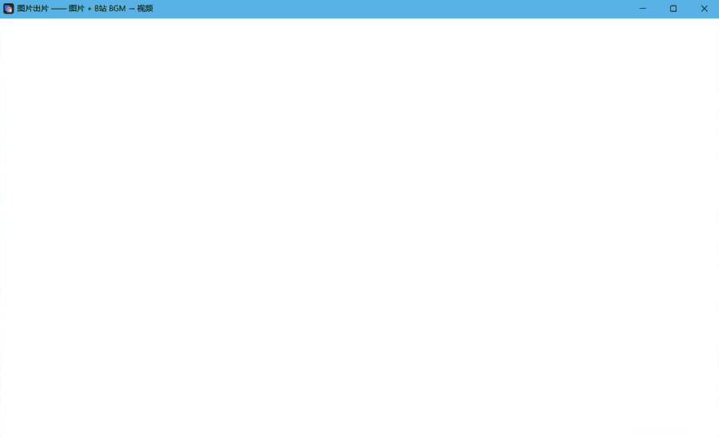

- **사진, 영상 몇 개든**: 끌어다 놓고 순서를 바꾸고, 구간마다 초를 따로 조절합니다. 영상은 원래 길이대로 한 구간이 되고 앞뒤를 자르거나 구간을 나누거나 전환을 입힐 수 있으며, 아래 타임라인은 누른 곳으로 점프하고 오른쪽 경계를 끌면 길이가 바로 바뀝니다.
- **음악은 영상 링크에서 오디오 트랙 전체를 그대로 뽑아옵니다**: 빌리빌리(b23.tv 단축 링크 / 맨 BV, av 번호 포함), 더우인, YouTube, 콰이쇼우, 샤오홍슈, 웨이보. 로컬 오디오/영상 파일을 창에 직접 끌어다 놓아도 됩니다.
- **창 안에서 바로 미리보기**: 미리보기는 실시간 합성입니다. 값을 바꾸고, 진행 바를 끌고, 전환을 바꾸면 화면이 다음 프레임에서 바로 바뀌고, 전체를 다시 렌더링할 필요가 없습니다.
- **미리보기가 플레이어처럼**: 미리보기 화면 아래에 진행 바, 재생/일시정지, ±5초, 0.5–2× 배속, 네 단계 화질(부드럽게 / 표준 / 선명하게 / 원본 크기)이 있습니다. 배속과 화질은 미리보기에만 영향을 주고, 완성본은 설정대로 내보냅니다.
- **소재는 사진만이 아닙니다**: 사진과 영상 모두 목록으로 끌거나 「소재 추가」를 누르면 됩니다. 영상 구간은 타임라인에서 경계를 끌어 자르고, I/O로 인점/아웃점을 지정하고, Ctrl+K로 나눌 수 있으며, 색 보정과 전환도 그대로 적용됩니다.
- **규격 조절**: 9가지 화면 비율 + 가로/세로 직접 입력, 30/60fps, 화질 3단계, 다섯 가지 배경 방식(원본 이미지 배경 / 단색 여백 / 사용자 배경 이미지 / 배경 동영상 / 잘라서 채우기), 페이드 인/아웃과 12가지 내장 전환, 내보내기 폴더.
- **바로 쓸 수 있음**: 사진, 폴더, 오디오/영상 파일을 창에 그대로 끌어다 놓을 수 있고, 내보내기가 끝나면 폴더가 자동으로 열립니다. 사진의 EXIF 방향도 자동으로 바로잡습니다.
- **움직이게**: 선택 사항인 느린 확대 / 축소 / 교차 줌(Ken Burns)으로 정지 이미지를 숨 쉬는 듯한 화면으로 만들 수 있습니다.
- **자잘한 편의 기능**: 간체 중국어 / 번체 중국어 / English / 日本語 / 한국어 다섯 가지 인터페이스, 다크/라이트 테마, 메인 색 하나만 고르면 대비색이 자동으로 짝지어지고, 세 가지 인터페이스 모드(간단은 세 단계로 완성 / 표준은 일상 편집 / 전문가는 모든 파라미터).
- **프로젝트를 저장**: .p2v 프로젝트로 한 번에 저장(사진, 길이, 오프닝/엔딩, 오디오 블록, 자막이 모두 들어 있음)하고 다음에 열어 이어서 편집할 수 있습니다. 15초마다 자동 저장되고, 비정상 종료 시 다음에 열 때 복구할지 물어봅니다. 「프로젝트」 메뉴에 최근 항목이 있습니다.
- **자막**: .srt / .ass를 가져와 완성본에 바로 굽습니다(글꼴, 크기는 설정에서 선택). 업로드도, 네트워크도 쓰지 않고, 앱 안에서 편집하지도 않습니다.
- **원고를 바로 더빙으로**: 「더빙」 페이지에 원고를 붙여넣고 → 음성을 고르고 → 한 번에 나레이션과 문장 단위 자막을 합성합니다. 기본은 무료 Edge(키 불필요, 타임스탬프 포함)이고, 자신의 Gemini / Azure / OpenAI 호환 엔드포인트 키를 넣을 수도 있습니다. 합성이 끝나면 총 길이가 자동으로 「내레이션에 맞추기」로 바뀌고 화면이 소리를 따라갑니다.
- **플랫폼별로 내보내기**: 내보낼 때 빌리빌리 / 더우인 / 위챗 채널 / YouTube / 일반을 고르면 해상도와 프레임 레이트가 자동으로 맞춰집니다. 덤으로 완성본 타임라인 기준으로 같은 이름의 표지 이미지를 뽑을 수 있습니다.
- **화면을 한 겹 더**: 사진이나 영상을 완성본 위에 겹쳐 재생(부분 화면): 3×3 배치, 크기, 불투명도, 등장/퇴장 시간을 조절할 수 있고 타임라인에서 바로 끌 수 있습니다.
- **색 보정**: 소재마다 밝기 / 대비 / 채도를 따로 조절하고 필터(.cube LUT, 카메라 내 색 보정과 필름 느낌이 여기에 기댑니다)도 하나 적용할 수 있으며, 오른쪽 클릭으로 들어갑니다.
- **오디오가 보이고 만져짐**: 타임라인에 실제 파형을 그리고, 오디오마다 게인(dB)을 설정하고 파형 위에 볼륨 엔벨로프를 찍을 수 있습니다(Alt + 클릭으로 점 추가, 점을 끌어 값 변경, 오른쪽 클릭으로 점 삭제).
- **리소스 팩**: 글꼴, LUT, 전환 프리셋을 zip으로 묶어 설치하면 해당 드롭다운/메뉴에 나타납니다. 팩에는 매니페스트와 체크섬이 있어 출처가 맞지 않으면 그대로 거부합니다.
- **헛기다리지 않음**: 내보내기에 퍼센트와 남은 시간이 나오고 언제든 「취소」를 누를 수 있으며, 내보내는 중에 창을 닫으려 하면 알려줍니다. 처음 열면 최대화되고, 이후 설정에서 마지막 크기 기억이나 고정 크기로 바꿀 수 있습니다.

## 빠른 시작

1. 의존성 설치(한 번만):

   ```
   python -m pip install PyQt6
   ```

   `ffmpeg`, `ffprobe`는 직접 설치할 필요가 없습니다. 처음 실행할 때 한 번 물어보고, 누르면 `tools/`로 자동 다운로드합니다(약 120 MB, 실측 9.0.2).
   시스템 PATH에 ffmpeg가 이미 있으면 그걸 그대로 쓰고, 다시 받지 않습니다.

2. `启动.bat`을 더블클릭(`python pic2video.py`와 같습니다).
3. 사진이나 영상을 창으로 끌어다 놓거나 「소재 추가」를 누릅니다.
4. 링크를 「음악 링크」 칸에 붙여넣고 상태 표시줄에 「음악 준비됨: 길이 x:xx · 파일: …」이 뜰 때까지 기다립니다 — 링크에서 받아온 음악은 도구 데이터 폴더의 `media/`에 저장되어 프로그램을 닫아도 사라지지 않습니다.
5. 미리보기를 확인하고 「영상 내보내기」를 누른 뒤 플랫폼 프리셋을 고르고(또는 파라미터가 설정을 따르게 두고) 폴더를 선택합니다.

폴더 하나를 통째로 창에 끌어다 놓아도 됩니다(안의 사진, 오디오/영상이 함께 추가됩니다). 사진, 음악 파일을 직접 끌어다 놓아도 됩니다. 소재를 목록의 한 항목 위로 끌면 세 구역으로 나뉩니다: **왼쪽 3분의 1**에 놓으면 그 앞에 삽입, **가운데**에 놓으면 그것을 교체, **오른쪽 3분의 1**에 놓으면 그 뒤에 삽입입니다(끌고 있는 동안 목록에 삽입선이나 강조 테두리가 그려집니다).

키보드도 됩니다: Ctrl+I 소재 추가, Ctrl+M 내보내기, F5 미리보기 새로고침, 스페이스 재생/일시정지, Delete 선택한 그림 삭제. 프로젝트 관련으로 Ctrl+N 새 프로젝트, Ctrl+O 열기, Ctrl+S 저장, Ctrl+Shift+S 다른 이름으로 저장 — 이 키들은 설정 → 단축키에서 모두 바꿀 수 있습니다.

소재는 사진만이 아닙니다: **영상도 추가됩니다**. 영상 파일을 목록으로 끌거나 「소재 추가」를 누르면 원래 길이대로 한 구간이 되고, 타임라인에서 사진 구간과 똑같이 경계를 끌어 자르고, I/O로 인점/아웃점을 지정하고, Ctrl+K로 두 구간으로 나누고, 전환을 고르고, 색 보정을 할 수 있습니다. 폴더를 통째로 끌면 안의 사진과 영상이 파일명 순서대로 함께 추가됩니다. 오디오 파일을 창에 끌 때만 「음악 / 추가 오디오」 경로로 갑니다 — 영상에서 오디오 트랙만 뽑고 싶으면 그 영상을 「음악 링크」 칸으로 끌어다 놓으세요.

## 프로젝트 파일(.p2v)

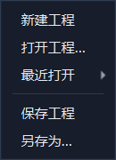

「프로젝트」 버튼(또는 Ctrl+S)으로 .p2v 프로젝트로 저장할 수 있습니다. 평범한 JSON으로, 버전 번호, 프레임 레이트, 길이 방식, 사진별 순서와 길이, 오프닝/엔딩의 인점·아웃점, 오디오 블록의 시작과 볼륨, 자막 내용을 적습니다. 영상과 오디오 자체는 프로젝트에 들어가지 않고 경로만 기록하므로 프로젝트와 소재를 따로 복사할 수 있습니다.

- **저장 / 다른 이름으로 저장**: Ctrl+S는 원래 자리에 저장하고, 한 번도 저장한 적 없으면 처음에 경로를 묻습니다. 저장은 원자적 쓰기(.tmp에 먼저 쓰고 이름을 바꿈)라서 쓰다가 전원이 나가도 기존 프로젝트가 망가지지 않습니다.
- **자동 저장**: 15초마다 변경 사항을 도구 폴더에 저장하고, 정상 저장이나 창 닫기에서 지웁니다. 지난번에 정상 종료하지 못했다면 열 때 그 사본을 복구할지 자동으로 물어봅니다.
- **최근 항목**: 메뉴에 최대 8개까지 남고, 삭제된 것은 목록에서 자동으로 사라집니다.
- **소재를 잃어버림**: 열 때 사진이나 오디오가 옮겨져 있으면 목록으로 보여주고 「위치 지정…」을 할지 묻습니다. 새 위치를 고르면 프로젝트에서 이 종류를 가리키는 항목이 모두 함께 바뀝니다.
- **버전**: 프로젝트에는 version이 들어 있습니다. 소프트웨어보다 새로운 버전은 추측해서 읽지 않고 바로 열기를 거부합니다 — 새 프로젝트를 망가뜨리지 않기 위해서입니다.

## 자막

왼쪽 아래 「자막」 페이지: 「자막 가져오기…」를 눌러 .srt 또는 .ass를 고르면 각 항목의 시간과 텍스트가 바로 나열되고, 미리보기와 내보내기 모두 화면에 굽습니다.

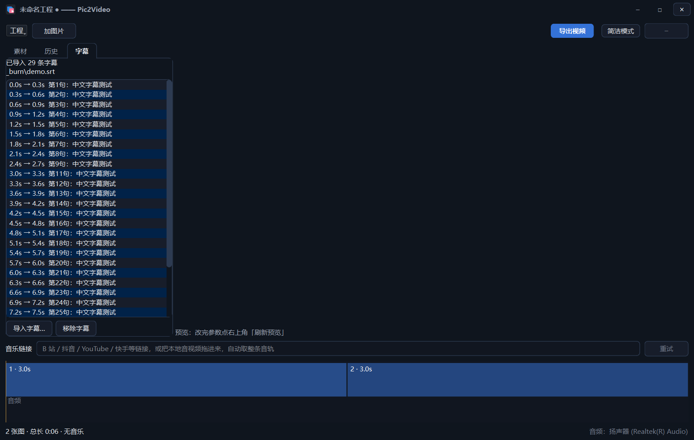

- **가져오기 + 굽기**만 합니다: 파싱은 가져올 때 한 번만 하고 자막 내용은 프로젝트(.p2v)에 저장되므로 원본 파일이 남아 있는지에 의존하지 않습니다. 앱 안에서 글자를 추가하거나 타임라인을 고치지는 않습니다.
- 글꼴, 크기는 설정 → 화면 → 자막 글꼴 / 자막 크기에서 고릅니다. 크기는 「1080p 기준 픽셀」이라 540p 미리보기에서는 비례해 절반이 되므로 미리보기와 완성본의 느낌이 일치합니다.
- 기본 글꼴은 Microsoft YaHei입니다. 일부 글꼴(특히 일부 .ttc)은 첫 번째 자형만 얻을 수 있거나 아예 중국어를 포함하지 않습니다 — 완성본에서 자막이 네모로 보이면 글꼴을 바꿔 보세요.
- 중괄호는 그대로 표시됩니다(a{b}c는 a{b}c라고 쓰면 되고 직접 이스케이프하지 않아도 됩니다). .srt에서 한 자막 안의 줄바꿈은 .ass에서 강제 줄바꿈이 됩니다. end가 start보다 늦지 않은 잘못된 항목은 버려지고, 그것 때문에 자막 전체가 열리지 않는 일은 없습니다.

## 더빙(원고 → TTS → 자막)

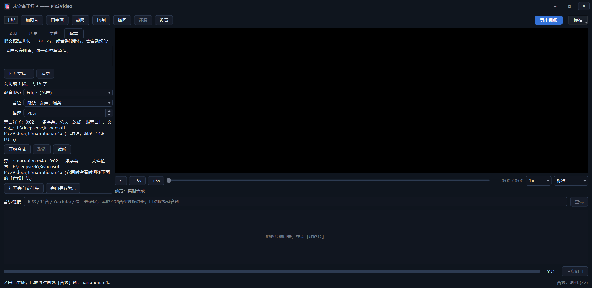

「더빙」 페이지(표준 / 전문가 모드에만 나타남)는 「원고가 있다」를 「영상이 있다」로 바꿉니다: 원고 붙여넣기 → 음성 선택 → 「합성 시작」을 누르면 나레이션 하나와 문장 단위 자막 하나가 나오고, 영상 총 길이가 자동으로 나레이션을 따라갑니다.

- **원고**: 왼쪽 위 칸에 바로 붙여넣거나, 「원고 열기…」로 .txt / .md(UTF-8, GBK도 인식)를 읽습니다. 한 줄에 한 문장이어도 되고 한 문단 통째여도 되며, 문장 부호로 자동으로 문장을 나누고 다시 문단당 약 1000자로 나눕니다. 칸 아래에 「N개 구간으로 나뉘며 총 M자」가 실시간으로 표시됩니다.
- **음성**: 기본은 Edge(무료, 키 불필요)이고 중국어 음성 14개(보통말 / 둥베이말 / 산시말 / 대만 / 광둥어, 남녀 모두)입니다. 속도는 -50%～+100%. 먼저 들어 보고 싶으면 「미리 듣기」를 누르면 첫 구간만 합성합니다.
- **합성**: 백그라운드에서 구간별로 돌고, 진행 바에 「완료 / 전체 구간」이 표시되며, 언제든 「취소」를 누를 수 있고 실패한 구간만 다시 돌릴 수 있습니다. 구간 결과는 「텍스트 + 서비스 + 음성 + 속도」 기준으로 도구 폴더(`tts/`)에 캐시되어, 중간에 끊겼다가 다시 누르면 이미 합성된 구간은 건너뜁니다.
- **연결 후**: 나레이션은 타임라인의 오디오 트랙으로(파형 포함), 문장 단위 자막은 「자막」 페이지로 들어갑니다. 길이 방식은 자동으로 「내레이션에 맞추기」로 바뀌고 소재가 나레이션 길이만큼 채워지며 총 길이는 나레이션 길이가 됩니다. 자막을 다른 곳에 쓰고 싶으면 「자막」 페이지의 「.srt로 저장…」을 누르세요.
- **나레이션 파일 위치**: 더빙 페이지 맨 아래에 전체 경로가 그대로 적힙니다(도구 폴더의 `tts/narration_<내용 지문>.m4a`, 원고마다 따로 저장되어 서로 덮어쓰지 않음). 옆의 「나레이션 폴더 열기」가 탐색기에서 그것을 찾아 주고, 원하는 곳에 두고 싶으면 「나레이션 다른 이름으로 저장…」을 누르면 저장 후 프로젝트가 고른 파일을 쓰도록 바뀝니다.
- **합성 후 정리**(기본 켜짐, 설정 → 더빙에서 끌 수 있음): 구간 앞뒤의 여분 침묵을 잘라내고, 시작 부분의 고주파 딸깍 소리와 저주파 퍽 소리를 깎아낸 뒤 EBU R128에 따라 나레이션 전체를 **라우드니스 -14**(LUFS는 음량 단위로, 플랫폼 표준의 “정상 음량”에 가깝습니다)로 맞추고 마지막에 리미터로 받쳐 줍니다. 잘라낸 침묵만큼 자막도 함께 앞으로 당겨져 어긋나지 않습니다. 상태 표시줄에 「(정리됨, 라우드니스 -14.0)」이 적힙니다.
- **자막 줄바꿈**: 한 줄에 최대 18자, 최대 두 줄이며, 너무 긴 문장은 자동으로 두 개로 쪼개져 한 줄이 화면을 다 채우지 않습니다.
- **Gemini**: 설정 → 더빙에서 자신의 Gemini 키를 넣으면 쓸 수 있습니다(음성 Kore / Puck / Aoede / Charon / Fenrir / Leda, 다중 화자도 가능). Gemini는 타임스탬프를 주지 않으므로 같은 텍스트로 무료 Edge를 조용히 한 번 돌려 길이 템플릿으로 삼고 자막을 실제 길이에 맞춰 조정합니다. Edge도 연결되지 않을 때만 글자 수로 나눕니다. 속도 파라미터가 없어서 속도 칸이 자동으로 회색이 됩니다 — 빠르게 하려면 원고를 고치세요.
- **Azure 음성**: 설정 → 더빙에 키와 지역(예: `eastasia`)을 넣고 REST + SSML을 씁니다. 음성은 Edge와 같은 계열(샤오샤오 / 윈시 / 윈양 / 샤오이)이고 무료 계층은 월 50만 자입니다. REST는 타임스탬프를 돌려주지 않으므로 자막은 마찬가지로 Edge를 길이 템플릿으로 씁니다. 429를 만나면 백오프 재시도하고, 끝내 「할당량 소진」을 알립니다.
- **OpenAI 호환 엔드포인트**: 키와 base_url(실리콘플로우, 화산, MiniMax의 호환 레이어 모두 가능)을 넣고 모델 이름도 넣을 수 있습니다(비우면 = `tts-1`). 속도는 `speed`(0.25～4.0)로 환산됩니다. 타임스탬프가 없는 엔드포인트도 Edge 정렬 템플릿을 씁니다. 실패하면 키가 틀렸는지, 할당량이 다했는지, 네트워크 문제인지 구분합니다. 키는 로컬 설정 파일에 평문으로 저장되고 업로드되지 않습니다.
- **영상 길이를 가정하지 않습니다**: 원고가 아무리 길어도 되고, 자신의 키 할당량을 쓰면 그 할당량이 곧 한도입니다. 무료 Edge는 하루 횟수 제한이 없고 속도와 동시 실행에만 소프트 제한이 있습니다.

### 다중 대화(임의의 역할 이름)

질문과 답, 여러 사람의 대화를 손으로 붙일 필요가 없습니다. 각 줄을 「이름:」으로 시작하면 뒤에 줄바꿈으로 이어 쓰는 내용이 모두 그 역할의 이번 차례로 처리됩니다. 이름은 1～12자, 문장 부호 없이. `민수:`, `엄마:`, `내레이션:`, `선생님:` 모두 됩니다.

```
민수: 안녕, 나는 민수야.
엄마: 나는 엄마, 오늘 저녁 다 됐단다.
내레이션: 이것은 다중 대화 테스트입니다.
선생님: 학생 여러분 안녕하세요, 수업을 시작하겠습니다.
```

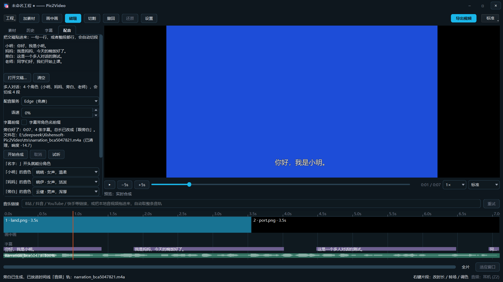

- 더빙 페이지는 등장 순서대로 모든 역할을 훑어서 역할마다 한 줄씩 보여주고 음성을 따로 고르게 합니다. 역할이 한 화면을 넘으면 이 페이지를 위아래로 스크롤할 수 있습니다.
- 예전 표기도 계속 지원합니다: `역할 A:` / `역할 B:`, `A:` / `B:`, `진행자:` / `청취자:` 모두 해당하는 두 역할로 묶입니다.
- 차례와 차례 사이에 0.35초를 둡니다(일반 구간 사이는 설정의 0.6초). 실제로 주고받는 것처럼 들립니다.
- 「자막에 역할 이름 붙이기」를 켜면 자막이 「민수: 안녕, 나는 민수야.」처럼 쓰이고, 끄면 대사만 나옵니다.
- 차례마다 요청을 따로 보내므로 Gemini처럼 호출당 할당량을 쓰는 서비스는 역할과 차례가 많을수록 더 많이 씁니다.
- 원고에 역할 표시가 없으면 예전과 똑같이 동작하고 역할 표가 생기지 않습니다.
## 전환

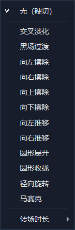

화면 요소를 오른쪽 클릭 → 「전환」에서 이름 하나를 고르면 됩니다. 「없음(하드 컷)」은 그냥 잘라 넘깁니다. 12개 이름은 모두 ffmpeg 내장 `xfade`에서 오며 외부 파일을 쓰지 않습니다:

| 이름 | 느낌 |
| --- | --- |
| 크로스 페이드 / 블랙 페이드 | 디졸브. 블랙 페이드는 중간에 한 번 어두워집니다 |
| 왼쪽 / 오른쪽 / 위쪽 / 아래쪽 와이프 | 한쪽으로 지우면서 다음 장면을 드러냅니다 |
| 왼쪽 / 오른쪽 슬라이드 | 다음 장면이 이전 장면을 밀어냅니다 |
| 원형 확장 / 원형 축소 | 원이 작은 것에서 커지는 확장, 큰 것에서 작아지는 축소 |
| 방사형 / 모자이크 | 돌면서 바뀜, 먼저 모자이크로 부서졌다가 복원 |

- **길이**: 같은 메뉴 안의 「전환 시간」에서 0.2 / 0.3 / 0.5 / 0.8 / 1.0초를 고를 수 있고, 「설정 따르기」는 설정 → 템포와 움직임 → 클립 전환의 초를 씁니다.
- **누가 결정하나**: 인접한 두 요소 중 하나만 전환이 켜져 있어도 그 경계는 전환되고, 둘 다 켜져 있는데 이름이 다르면 앞쪽 것을 따릅니다.
- **총 길이는 그대로**: 전환은 두 구간이 「서로 쪽으로 반씩 더 뻗어 겹쳐 재생」되도록 맞춘 것입니다 — 2초 + 2초, 전환 0.8초면 완성본은 여전히 4.0초이고, 전환이 1.6–2.4초 구간을 차지하는 대신 두 구간의 실제 정지 시간이 각각 0.4초씩 줄어듭니다. 영상 구간은 소스에서 0.4초를 더 가져와 채우므로 내용이 빠지지 않습니다. 미리보기와 내보내기가 같은 필터를 타서 느낌이 일치합니다.
- **안 들어가면 막습니다**: 인접한 두 구간이 각각 「전환 시간의 두 배」보다 길어야 합니다. 전환을 고를 때 그 자리에서 알려주고, 내보내기 전에도 한 번 더 막습니다(반쯤 망가진 영상을 내보내지 않음).
- 프로젝트 파일에 구간별 전환 이름과 길이가 저장됩니다. 예전 프로젝트에는 이 두 항목이 없어 열면 하드 컷입니다.
- 전환 리소스 팩을 설치하면 메뉴에 「이름(리소스 팩)」 프리셋이 추가됩니다 — 여전히 「내장 전환 이름 + 기본 길이」일 뿐 새 알고리즘이 아닙니다. 아래 리소스 팩 절을 보세요.

## 부분 화면

위쪽 「부분 화면」을 눌러 사진 한 장이나 영상 한 편을 고르면 완성본 위에 겹쳐 재생됩니다 — 위치, 크기, 투명도, 언제 나타나고 사라지는지 모두 조절할 수 있습니다.

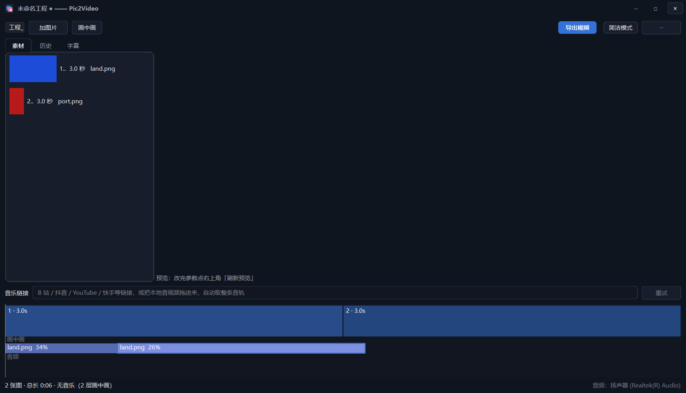

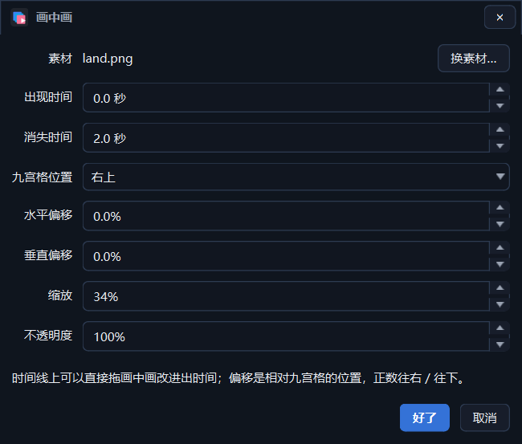

- **배치**: 3×3에서 대략 위치를 고르고(오른쪽 위는 코너 배지, 정중앙은 마스크로도 가능), 가로/세로 오프셋으로 미세 조정합니다(화면 가로/세로 대비 퍼센트, 양수는 오른쪽 / 아래로). 「크기」는 완성본 너비 기준이라 40%면 오른쪽 위 한 조각 정도입니다.
- **등장 / 퇴장**: 초를 적거나, 타임라인 가운데의 「부분 화면」 트랙에서 시작점을 끌어 바꿉니다. 같은 트랙에 여러 겹을 놓을 수 있고, 추가한 순서대로 겹겹이 쌓여 뒤에 온 것이 앞을 덮습니다.
- **불투명도**: 0–100%. 페이드 인/아웃을 스스로 구간을 겹쳐 만들 수도 있고, 그냥 반투명 워터마크로 쓸 수도 있습니다.
- **총 길이는 그대로**: 오버레이는 완성본 위에 얹는 두 번째 패스라 메인 트랙의 시간을 바꾸지 않습니다. 메인 트랙이 얼마나 길든 완성본은 그만큼이고, 엔딩을 넘어선 부분은 그려지지 않습니다.
- 「부분 화면」 트랙의 블록을 오른쪽 클릭하면 다시 편집하거나 지울 수 있고, 프로젝트 파일에 겹마다 소재 경로, 시간, 위치, 크기, 불투명도가 함께 저장됩니다.

## 색 보정

화면 요소(사진, 영상, 오프닝/엔딩 모두)를 오른쪽 클릭 → 「색 보정…」: 슬라이더 세 개에 필터(LUT) 하나, 고치면 바로 미리보기에 반영됩니다.

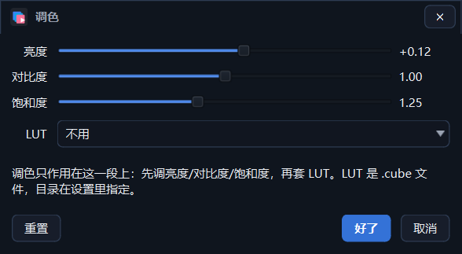

- **밝기 / 대비 / 채도**: 밝기는 -1.0～1.0(0이 그대로), 대비와 채도는 배수(1.00이 그대로)입니다. 셋 다 ffmpeg의 eq 필터이고, 영상 전체에 걸면 배경까지 함께 조정됩니다.
- **필터(LUT)**: 설정 → 화면 → LUT 폴더가 .cube 파일이 있는 폴더를 가리킵니다. 색 보정 창의 드롭다운이 그 폴더의 .cube를 나열합니다. 「사용 안 함」을 고르면 슬라이더 세 개만 적용됩니다.
- **이 구간에만 적용**: 같은 사진을 두 가지로 보정하고 싶으면 두 구간으로 나눠 따로 보정하세요.
- **필터 파일도 소재**: 파일을 옮기면 그림이 없을 때처럼 내보내기 전에 알려주고, 프로젝트를 저장했다가 열 때 다시 위치를 지정할 수 있습니다. 색 보정 파라미터와 LUT 경로는 모두 프로젝트 파일(.p2v)에 기록됩니다.

## 내보내기 프리셋과 표지

「영상 내보내기」를 누르면 먼저 이 창이 뜹니다: 플랫폼을 고르고, 실제 파라미터를 확인하고, 표지도 함께 뽑을지 정합니다.

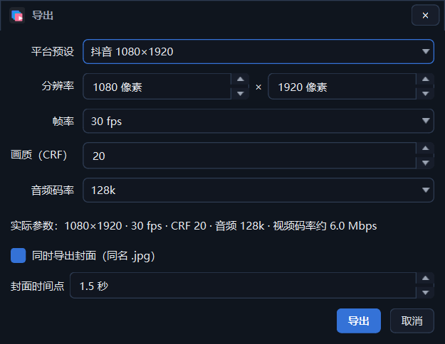

| 프리셋 | 해상도 | 프레임 레이트 | 화질 | 오디오 | 파일명 접미사 |
| --- | --- | --- | --- | --- | --- |
| 일반(현재 설정 사용) | 설정의 가로/세로 | 설정의 프레임 레이트 | 설정의 화질 | 192k | 없음 |
| 빌리빌리 1080p60 | 1920×1080 | 60 | 18 | 192k | _bilibili |
| 더우인 1080×1920 | 1080×1920 | 30 | 20 | 128k | _douyin |
| 위챗 채널 1080p30 | 1920×1080 | 30 | 20 | 128k | _channels |
| YouTube 1080p30 | 1920×1080 | 30 | 20 | 192k | _youtube |

- **한 항목이라도 직접 고치면 「사용자 지정」이 됩니다**: 해상도, 프레임 레이트, 화질, 오디오 비트레이트를 그 자리에서 바꿀 수 있고, 창의 「실제 파라미터」 줄이 함께 갱신됩니다. 비트레이트는 경험에 기반한 어림값일 뿐입니다(화질 숫자가 작을수록 높게 잡습니다).
- **프레임 레이트는 환산됩니다**: 프로젝트 타임라인은 설정의 프레임 레이트로 저장됩니다. 60fps 프리셋을 고르면 내보내기 전에 목표 프레임 레이트로 구간별 프레임 수를 다시 계산하고, 완성본 길이는 그대로라 절반이 되지 않습니다.
- **표지**: 「표지도 함께 내보내기」를 켜고 시점을 고르면(기본은 첫 번째 사진 소재의 한가운데, 완성본 타임라인 기준), 내보내기 성공 후 같은 폴더에 같은 이름의 .jpg가 생깁니다. 완성본의 그 프레임입니다. 내보내기 완료 상태 표시줄과 팝업 모두 표지의 전체 경로를 적어 주고, 표지 캡처가 실패하면 한 줄만 알리고 이미 내보낸 영상에는 영향을 주지 않습니다.
- **지난번 선택 기억**: 지난번 프리셋, 표지 여부, 표지 시점은 settings.json에 저장되어 다음에 내보내기 창을 열면 그대로입니다.
- 프리셋 이름도 프로젝트 파일(.p2v)에 기록되지만 표시일 뿐입니다. 실제로 적용되는 것은 항상 내보낼 때 고른 파라미터입니다.

## 플랫폼별 음악

| 출처 | 필요한 것 | 설명 |
| --- | --- | --- |
| 빌리빌리 | 없음 | 로그인 불필요, Cookie를 읽지 않음. DASH 오디오 트랙에서 비트레이트가 가장 높은 것을 고름 |
| 더우인 / YouTube / 콰이쇼우 / 샤오홍슈 / 웨이보 | `yt-dlp` | **필요할 때 다운로드**: 설정 → 「기타」에서 「다운로드」를 눌러 도구 폴더의 `tools/`에 설치(약 25 MB), 필요 없으면 「삭제」로 지움. 이런 링크를 처음 붙일 때도 한 번 물어봄 |
| 로컬 파일 | 없음 | 오디오는 그대로 음악이 되고, 영상은 소재로 타임라인에 추가(오디오 트랙만 뽑으려면 「음악 링크」 칸으로 끌어다 놓기) |

뽑는 것은 **오디오 트랙 전체**이고 보컬 분리는 하지 않습니다.

이것은 배경 음악이라 모든 소재 구간을 덮습니다. 다른 오디오(효과음, 두 번째 음악, 나레이션)를 더 얹고 싶으면 타임라인의 오디오 블록을 오른쪽 클릭 → 「오디오 파일 추가…」, 또는 오디오 파일을 창에 직접 끌어다 놓으세요. 오디오 하나에 블록 하나이고, 각각 시작점을 끌고 휠로 볼륨을 바꿉니다.

## 오디오 블록(파형 / 엔벨로프 / 게인)

타임라인의 오디오 블록마다 실제 파형이 그려지고, 조용한 소재도 자기 최대치 기준으로 정규화되어 기복이 잘 보입니다:

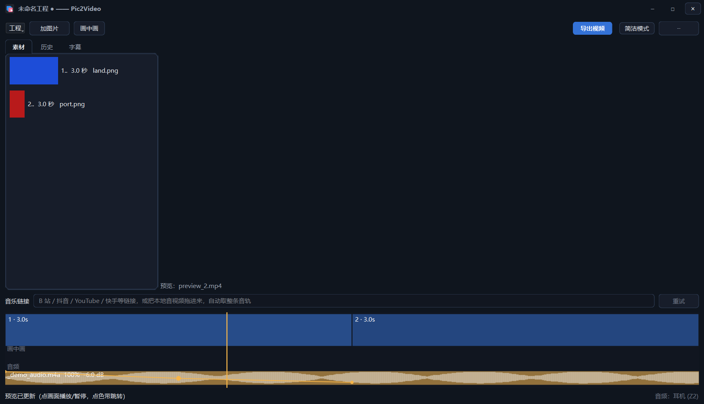

- **게인**: 오디오 블록 오른쪽 클릭 → 「게인…」, 범위 -24 ~ +12 dB, 0이 원래대로입니다. 작게 녹음된 나레이션을 통째로 올릴 때 좋습니다.
- **엔벨로프**: Alt를 누른 채 오디오 블록을 클릭하면 점이 하나 추가되고(가로축은 시간, 세로축은 0–100% 볼륨), 누른 채 위아래로 끌면 바뀝니다. 점을 오른쪽 클릭하면 삭제됩니다. 점과 점 사이는 선형으로 이어지고 내보낸 소리가 이 선을 따릅니다 — 음악 페이드 인, 나레이션을 눌렀다 올리기가 모두 이걸로 됩니다.
- **게인이 먼저, 엔벨로프가 다음**: 둘은 곱해지므로 -6 dB에 50% 엔벨로프를 더하면 최종적으로 -12 dB 정도가 됩니다.
- **파형은 어디서 오나**: ffmpeg가 오디오를 모노 8 kHz 피크로 풀어내고, 소재 하나당 캐시 하나를 `peaks/`(패키지판은 `%LOCALAPPDATA%\Pic2Video\peaks\`)에 둡니다. 소재의 파일 크기나 수정 시간이 바뀌면 자동으로 다시 계산합니다.
- 게인과 엔벨로프는 모두 .p2v 프로젝트에 저장되어 다음에 열어도 남아 있습니다.

오디오 블록을 오른쪽 클릭하면 이런 항목이 나옵니다:

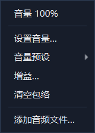

## 리소스 팩(글꼴 / 필터 / 전환 프리셋)

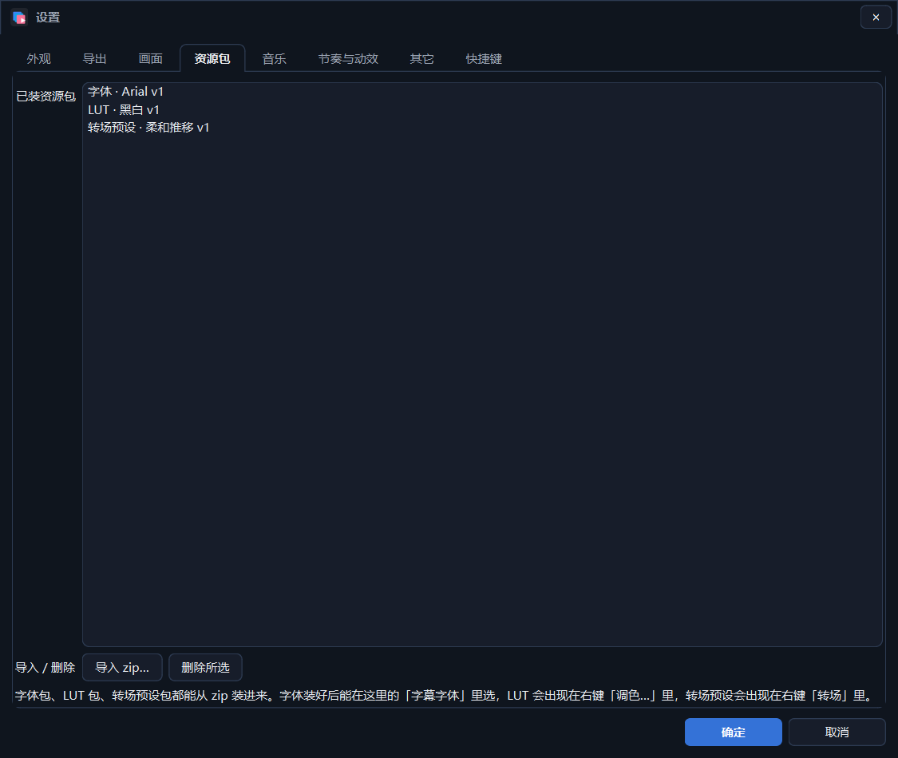

설정 → 리소스 팩(전문가 모드에서는 별도 페이지): 「zip 가져오기…」를 눌러 팩을 고르면 설치 후 목록에 나오고, 팝업과 「리소스 폴더 열기」 버튼이 어디에 설치되었는지 알려줍니다. 선택하고 「선택 항목 삭제」를 누르면 먼저 한 번 물어보고, 그 팩을 쓰는 프로젝트가 있으면 삭제 후 어느 구간인지도 알려줍니다.

- **어디에 설치되나**: 프로젝트 파일과 무관하게 도구 데이터 폴더의 `assets/fonts`, `assets/luts`, `assets/transitions`에 모입니다(패키지판은 `%LOCALAPPDATA%\Pic2Video\assets\`). 프로젝트에는 여전히 파일 경로가 기록되므로 프로젝트를 복사할 때 리소스 팩도 함께 고려하세요.
- **글꼴 팩**(.ttf / .otf / .ttc): 설치하면 설정 → 화면 → 자막 글꼴 드롭다운에 나타나고, 자막을 구울 때 그 팩 폴더를 libass에 넘겨 주므로 글꼴을 시스템에 미리 설치하지 않아도 됩니다. .ttc는 첫 번째 자형만 씁니다.
- **필터 팩**(.cube): 설치하면 오른쪽 클릭 「색 보정…」의 LUT 드롭다운에 나타나고, 「LUT 폴더」에 직접 넣은 .cube와 나란히 표시됩니다.
- **전환 프리셋 팩**(.json): 파일 하나에 프리셋 하나로, 이름, 어떤 내장 xfade를 쓰는지, 기본 몇 초인지 적혀 있습니다. 설치하면 오른쪽 클릭 → 「전환」에 「(리소스 팩)」이라고 표시되어 나타납니다. 새 알고리즘을 가져오지는 않고 ffmpeg 내장 12개 이름을 조합할 수만 있습니다.

팩 하나가 zip 하나이고, 루트에 `manifest.json`을 두며 각 파일에 sha256이 붙습니다:

```json
{
  "name": "내 LUT 모음",
  "version": "1.0",
  "kind": "lut",
  "entries": [
    {"path": "teal-orange.cube", "sha256": "…64자리 16진수…"}
  ]
}
```

- **kind**는 `font` / `lut` / `transition`만 가능하고 확장자도 맞아야 합니다(글꼴 .ttf/.otf/.ttc, LUT .cube, 전환 .json).
- **안전 경계**: 절대 경로, `..` 상위 이동, 심볼릭 링크, 실행 파일은 일절 거부합니다. 파일은 최대 64개, 압축 해제 후 64 MB 이하(zip bomb 방지)이고, 매니페스트에 선언되지 않은 여분 파일이나 체크섬이 맞지 않는 파일도 받지 않습니다. 검증을 모두 통과해야 기록합니다: 먼저 임시 폴더에 풀고 나서 원자적으로 정식 폴더로 이름을 바꾸므로 설치에 실패해도 반쯤 깔린 파일이 남지 않습니다.
- **버전**: 같은 이름 같은 버전을 다시 설치하면 거부됩니다(먼저 지우고 설치). 다른 버전은 그대로 덮어쓰고 이전 폴더는 남지 않습니다.
- **삭제 후**: 드롭다운/메뉴에서 즉시 사라집니다. 현재 프로젝트가 그 팩을 쓰고 있으면(어느 구간의 LUT, 또는 자막 글꼴) 어디서 쓰는지 알려주고, 렌더링 전에 먼저 바꾸라고 합니다.

## 명령줄(일괄 처리/스크립트용)

```
python pic2video.py --export 输出.mp4 --audio 本地音频.m4a 图1.jpg 图2.png 图3.webp
python pic2video.py --export 输出.mp4 --audio "https://www.douyin.com/video/..." 图1.jpg 图2.png
python pic2video.py --export 输出.mp4 --bili BV13qs46FE9C --total 4 图1.jpg 图2.png
python pic2video.py --export 竖屏.mp4 --bili BV... --ratio 9:16 --fps 60 --fit cover --transition fade 图1.jpg 图2.png
```

`--total`은 사진 한 장당 초이고, `--fps` / `--ratio` / `--width` / `--height` / `--fit` / `--bg` /
`--pad-color` / `--no-bg-blur` / `--transition` / `--motion` / `--crop-focus` / `--volume`은 설정 페이지와 같습니다. 명령줄에서는 `settings.json`을 쓰지 않습니다.

## 인터페이스

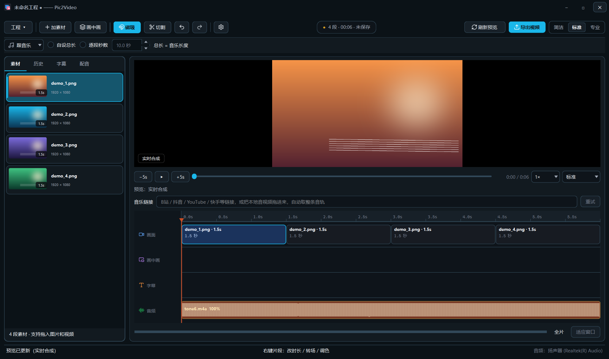

내보낼 때 상태 표시줄에 퍼센트와 남은 시간이 나오고 언제든 취소할 수 있습니다:

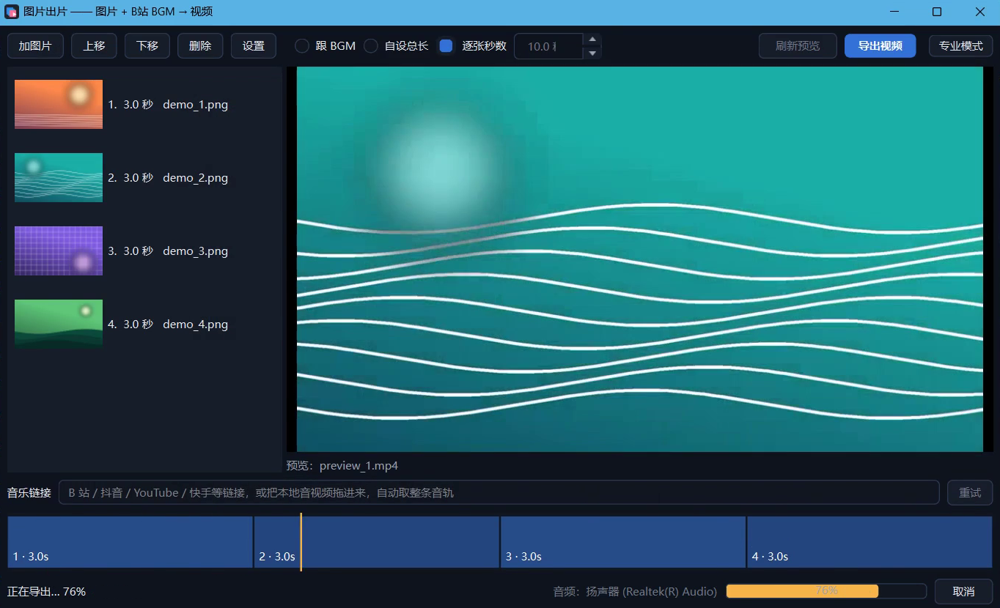

창 테두리는 소프트웨어가 직접 그려서 다크/라이트 테마, 메인 색과 함께 변하며 시스템의 회색 테두리를 쓰지 않습니다: 제목 표시줄을 끌어 창을 옮기고, 창의 네 변/네 모서리를 끌어 크기를 바꾸고, 제목 표시줄을 더블클릭해 최대화합니다. 설정, 색 선택, 알림, 초 입력 같은 창도 모두 같은 테두리입니다. 파일 선택 단계만은 시스템 기본 파일 창에 일부러 맡겼으므로 빠른 액세스, 최근 위치, 클라우드 드라이브 마운트가 평소와 같습니다.

### 세 가지 인터페이스 모드

툴바 오른쪽 위 버튼을 누르면 메뉴가 열리고 세 모드를 자유롭게 전환할 수 있습니다. 고르면 그 자리에서 적용되고 다음에 열 때도 기억합니다. 기본은 **간단**입니다.

| 모드 | 대상 | 툴바 | 타임라인 | 설정 페이지 |
| --- | --- | --- | --- | --- |
| **간단** | 사진/영상 뭉치를 영상으로 만들어 올리기만 하고 싶은 사람 | 소재 추가 / 영상 내보내기 | 화면 트랙 + 오디오 트랙 | 모양 / 내보내기 / 화면 세 묶음 |
| **표준** | 일상 편집 | 프로젝트 / 부분 화면 / 자석 / 자르기 / 실행 취소 / 이전 크기로 / 설정 추가 | 트랙 세 개, 타임라인 확대 가능 | 여섯 페이지: 모양 / 내보내기 / 화면 / 더빙 / 음악 / 템포와 움직임 |
| **전문가** | 모든 파라미터를 관리하고 싶은 사람 | 전부 제공(정렬, 리듬, 미리보기 새로고침 포함) | 전부 제공 | 리소스 팩 / 기타 / 단축키가 각각 페이지 |

- 간단 모드에서는 정렬, 삭제, 초 변경을 오른쪽 클릭에 맡깁니다: 소재 목록 오른쪽 클릭, 타임라인 색 블록 오른쪽 클릭 모두요.
- 간단 모드에는 「프로젝트」 버튼이 없고, 「⋯」 안에 새 프로젝트 / 열기 / 최근 항목 / 저장 / 다른 이름으로 저장 / 설정이 있습니다.
- 쓰일 때만 나타남: 간단 모드에서도 부분 화면을 추가해야 부분 화면 트랙이 생기고, 자막을 가져와야 「자막」 페이지가 생깁니다. 타임라인 확대 막대는 표준 이상에서 항상 있고, 간단 모드에서는 한 번 확대해야 나타납니다.

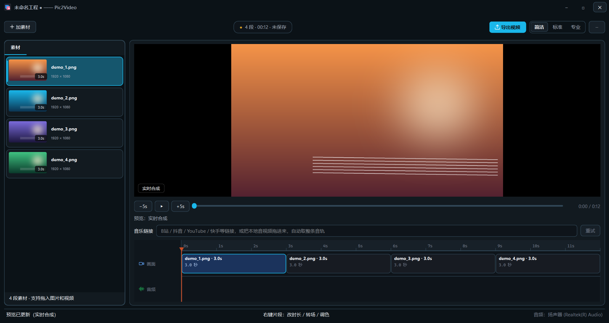


간단 모드의 설정 페이지에는 세 묶음만 남습니다:

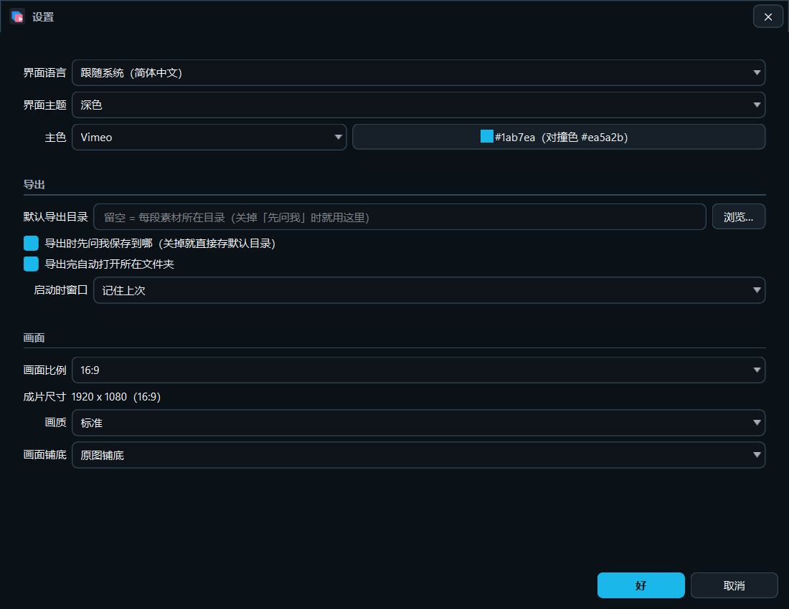

아래는 타임라인이고 네 개의 트랙이 있습니다. 맨 위는 화면 요소(오프닝 / 사진 / 영상 / 엔딩), 가운데 두 개는 부분 화면(오버레이가 있을 때만 사용)과 자막(자막이 있을 때만 사용)이며, 맨 아래는 오디오 요소입니다.

- 툴바 왼쪽은 길이 방식 드롭다운: **음악에 맞추기**(소재를 음악 전체에 고르게 배분) 또는 **소재 길이에 맞추기**(구간마다 = 오프닝+엔딩 총 길이 ÷ 소재 구간 수). 옆에 「총 길이 지정」「개별 초」 두 라디오가 더 있습니다. 고르면 오른쪽에 이번 총 길이가 무엇을 기준으로 계산되는지 함께 적힙니다(예: 「총 길이 = 음악 길이」「총 길이 = 아래 초」). 마우스를 올리면 전체 설명이 한 줄 더 나옵니다.
- 색 블록을 한 번 클릭 = 미리보기가 그 요소의 시작점으로 점프. 좌우로 끌면 블록이 따라 움직입니다(이 트랙에서 위치를 바꾸는 것과 같음).
- 색 블록의 오른쪽 경계를 끌면 이 장면이 얼마나 보이는지 바뀝니다. 오프닝/엔딩 같은 영상 구간은 왼쪽/오른쪽을 끌면 인점/아웃점 변경(최대 원본 길이까지, 최소 한 프레임), 오디오 블록은 가운데를 끌면 시작 시간, 왼쪽/오른쪽 가장자리를 끌면 그 앞/뒤를 잘라냅니다(왼쪽 가장자리는 소스의 시작점도 함께 움직이고, 오른쪽은 최대 소스 파일 끝까지).
- 툴바의 **자석** 스위치(기본 켜짐)를 켜면 끄는 변이 근처의 시간점에 붙습니다: 구간과 구간의 이음매, 오프닝/엔딩, 오디오 블록의 양 끝, 재생 헤드. 끄는 동안 파란 점선이 나타나면 붙은 것입니다. **Alt**를 누른 채 끌면 이번 한 번은 붙지 않습니다. 자석과 자르기가 켜져 있으면 버튼이 메인 색으로 빛나서 지금 그 모드인지 한눈에 보입니다.
- 툴바의 **자르기** 스위치는 칼날 모드입니다: 화면 블록이나 오디오 블록을 클릭하면 클릭한 그 초에서 두 개로 잘립니다(너무 가장자리면 자를 수 없다고 알려줍니다). **Esc**로 이 모드를 나갑니다.
- 오디오 블록 오른쪽 클릭 → 「삭제하고 앞으로 당기기」 = 리플 삭제: 이 오디오를 지우고 뒤의 오디오를 전체적으로 앞으로 당겨 빈 시간을 메웁니다.
- 재생 헤드가 어떤 요소 안에 있을 때: **I**로 인점, **O**로 아웃점, **Ctrl+K**로 여기서 한 번 자릅니다(사진 구간은 길이를 자르고, 영상 구간은 인/아웃점 기준으로 두 구간이 되며 둘을 합치면 원래 길이).
- **Shift**(또는 Ctrl)를 누른 채 여러 요소를 클릭 = 다중 선택, 이후 설정이 선택된 요소에 함께 적용됩니다.
- 색 블록을 오른쪽 클릭하면 이 요소의 메뉴가 열립니다: 화면 요소는 「페이드 인/아웃」을 켜고 끄고, 「색 보정…」에 들어가고, 「전환」에서 내장 전환 12개 중 하나(또는 하드 컷)를 고르고, 이 구간의 전환 길이만 따로 정할 수 있습니다. 부분 화면 트랙은 오버레이 추가 / 수정 / 삭제, 오디오 요소는 볼륨(25%–200% 프리셋 또는 직접 입력), 게인 설정, 엔벨로프 지우기를 할 수 있고, 다중 선택 시 한 번에 모두 바뀝니다.
- 화면 요소 하나와 오디오 하나를 함께 선택하면 화면 메뉴에 「이 오디오 길이에 화면 맞추기」가 하나 더 생깁니다: 사진이나 영상의 길이를 이 오디오 길이로 바꾸고, 영상이 오디오보다 짧으면 반복하고 길면 끝에서 잘라냅니다.
- 마우스 휠을 오디오 블록 위에 두고 위아래로 굴리면 바로 볼륨이 바뀝니다(한 칸 5%).
- 왼쪽 소재 목록도 **Shift / Ctrl 다중 선택**이 됩니다: 삭제, 위/아래로 이동, 더블클릭으로 길이 변경이 선택한 것들에 함께 적용되고, 목록과 타임라인의 선택이 연동되며, 끌어서 재정렬해도 구간별로 이미 정해 둔 색 보정, 전환, 인/아웃점이 유지됩니다.
- 외부에서 파일을 소재 목록으로 끌 때 놓는 위치에 이번 동작이 그대로 적힙니다: 가운데는 「N번째 교체」 또는(영상 구간에 놓으면) 「N번째 뒤에 삽입」, 왼쪽/오른쪽은 「N번째 앞/뒤에 삽입」, 빈 곳은 「끝에 추가」 — 버튼을 놓기 전에 결과를 볼 수 있습니다.
- 아래 타임라인 위에는 시간 눈금이 있습니다(확대 정도에 따라 밀도가 자동으로 바뀜). 확대하면 색 블록이 몇 초에 있는지 한눈에 보이고, 하단 바 오른쪽에는 「오른쪽 클릭: 길이 / 전환 / 색 보정」이라는 안내가 항상 떠 있어 오른쪽 클릭 메뉴의 기능을 추측하지 않아도 됩니다.
- 타임라인의 화면 블록에는 파일명이 적혀서 이름이 비슷한 사진들을 헷갈리지 않습니다.
- 구간이 많아 붙어 있으면 확대: **Ctrl+휠**로 타임라인을 확대/축소(마우스 위치 중심, 최대 64배), **Shift+휠** 또는 타임라인 아래 스크롤바를 끌어 좌우로 이동, **Ctrl+0** / 오른쪽 아래 「창에 맞추기」로 전체 보기. 확대 후 재생 헤드가 보이는 범위를 벗어나면 자동으로 따라갑니다.
- 여러 구간을 한 번에 옮기기: 타임라인 빈 곳에서 눌러 사각형을 그리면(예: 오디오가 없는 빈 트랙에서 위로 끌기) 그 안의 화면 블록, 부분 화면, 오디오가 함께 선택됩니다. 그중 아무 구간이나 끌면 전체가 따라 움직이고 놓을 자리에 점선이 표시됩니다. Shift / Ctrl을 누른 채 사각형을 그리면 기존 선택에 추가됩니다.
- 자막 트랙은 문장 하나에 블록 하나: 클릭하면 그 문장 시작으로 이동하고, 좌우로 끌면 문장 전체가 앞당겨지거나 밀립니다(문장 길이는 그대로, 내보내기와 미리보기 모두 따라감). 자막 텍스트 자체는 「자막」 페이지에서 보며 트랙에서 고치지 않습니다.

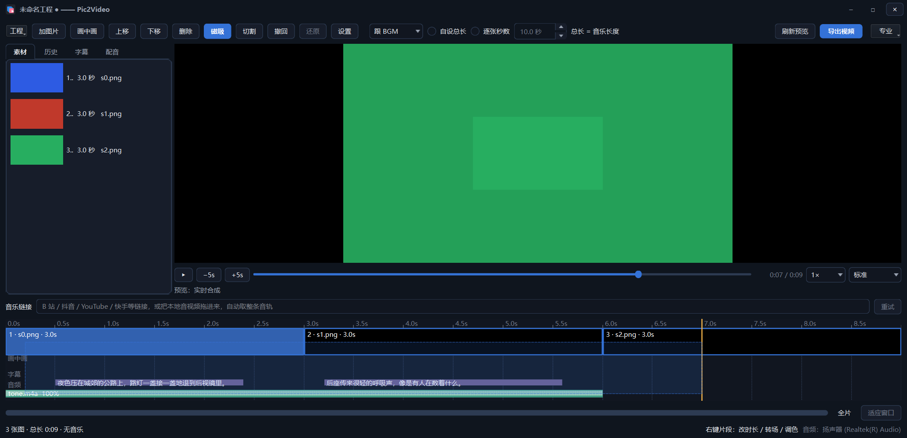
- 키보드: **← / →** 한 프레임 이동, **Shift + ← / →** 1초 이동, **Home / End** 오프닝/엔딩으로 이동, 스페이스 재생/일시정지(입력 칸, 드롭다운, 목록 안에서는 평소대로 위젯이 씁니다).
- 음악 링크 입력 칸에서 Enter를 치면 바로 오디오 트랙을 가져오기 시작하므로 「다시 시도」를 누를 필요가 없습니다.
- 소재 폴더를 통째로 옮겼을 때는 위치 지정에서 폴더를 한 번 고르면 파일명으로 자동 매칭되고, 안 맞는 것만 하나씩 물어봅니다.

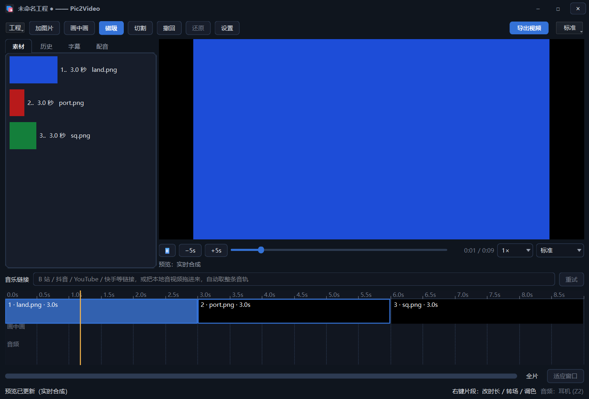

미리보기 화면 아래는 재생 컨트롤 바입니다: 왼쪽은 화면 자체를 클릭해도 재생/일시정지(마우스를 올리면 손 모양), 재생/일시정지(스페이스도 가능), −5s / +5s, 가운데는 진행 바(누른 채 끌기, 누르면 그 지점으로 점프)와 「현재 / 총 길이」, 오른쪽은 배속 드롭다운과 화질 드롭다운입니다. 재생 헤드를 끌거나, 타임라인의 색 블록을 클릭하거나, 진행 바를 끌면 화면이 실시간으로 따라 바뀌고, 화질은 미리보기 해상도만 바꿉니다 — 부드럽게 640 / 표준 960 / 선명하게 1280 / 원본 크기는 완성본과 같은 크기라 작은 완성본이 확대되지 않습니다.

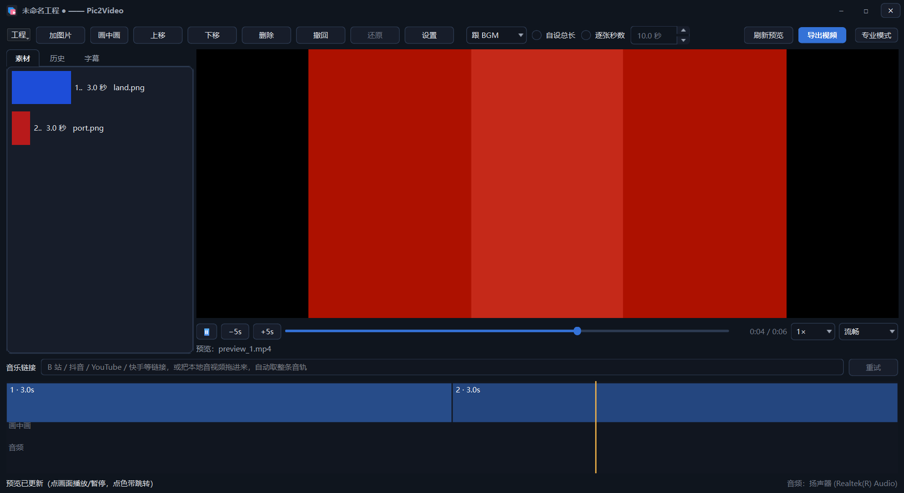

### 실시간 미리보기는 어떻게 만드나

미리보기 영역은 「먼저 mp4를 렌더링하고 재생」하는 게 아니라 시간에 맞춰 그때그때 그리는 합성기입니다:

- 프레임마다 `Scene.frame_at(t)`가 그 자리에서 조립합니다: 배경, 크기, 페이드 인/아웃, Ken Burns, 12가지 전환, 부분 화면, 자막, 색 보정을 모두 미리보기 해상도에서 QPainter로 직접 그립니다. 이미지는 한 번 디코드해 메모리에 두고, 근처 몇 구간은 배경 이미지를 미리 깔아 둡니다.
- 오디오 트랙은 따로 하나의 `.m4a`로 믹스해 마스터 클록으로 씁니다: 오디오 필터만 돌리므로 몇백 밀리초면 믹스가 끝납니다. 화면은 플레이어 위치에 맞춰 프레임별로 새로 고치므로 재생, 드래그, ±5초가 인코딩을 기다리지 않습니다.
- 파라미터를 바꾸면 장면 모델만 다시 만들고 한 프레임을 다시 그리며, 영상 인코딩은 시작하지 않습니다. ffmpeg의 전체 filtergraph는 내보낼 때만 탑니다.
- 12가지 전환은 미리보기에서 근사 효과입니다(내보내기는 여전히 ffmpeg의 xfade). 오프닝/엔딩 같은 영상 클립은 상시 디코드 파이프라인을 타고 프레임을 순서대로 읽다가 너무 멀리 점프할 때만 다시 엽니다.

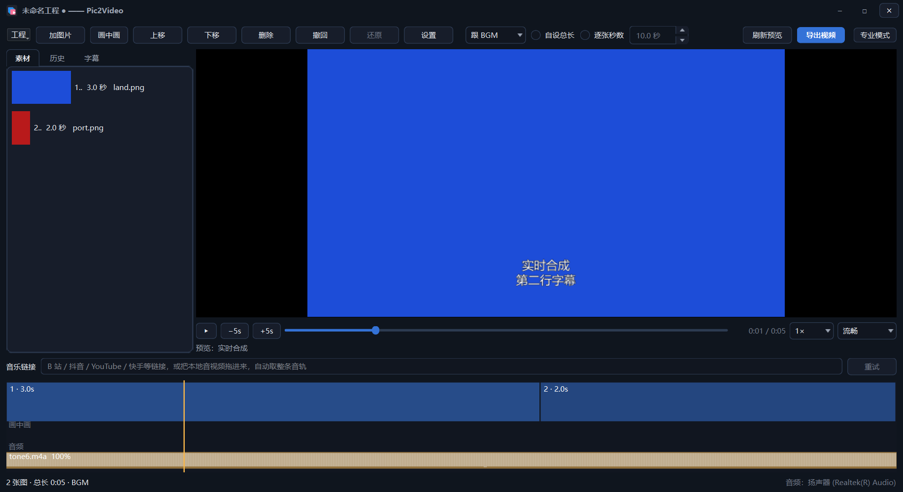

## 설정

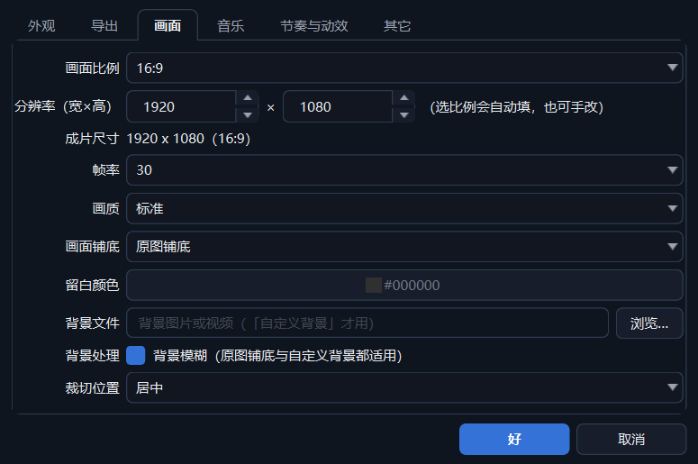

설정 페이지는 **모양 / 내보내기 / 화면 / 더빙 / 음악 / 템포와 움직임 / 리소스 팩 / 기타 / 단축키**로 나뉩니다. 표준과 전문가 모드는 그룹마다 한 페이지이고(위에서 페이지를 전환하므로 한 화면을 끝까지 스크롤할 필요 없음), 표준 모드는 리소스 팩 / 기타 / 단축키 같은 전문가용 페이지를 접어 둡니다. 간단 모드는 페이지 전환 없이 한 줄로 끝까지 내려가며 모양 / 내보내기 / 화면만 남고, 빈 그룹은 제목까지 접힙니다.

| 항목 | 설명 |
| --- | --- |
| 표시 언어 / 테마 | 다섯 언어; 시스템 따르기 / 라이트 / 다크 |
| 메인 색 | 12개 동영상 사이트 브랜드 색 프리셋(빌리빌리 / YouTube / 더우인 / 콰이쇼우 / 샤오홍슈 / 웨이보 / 텐센트 비디오 / 아이치이 / 유쿠 / Netflix / Twitch / Vimeo). 오른쪽을 눌러 색환을 직접 조정할 수도 있고, 대비색은 180°로 자동 계산 |
| 기본 내보내기 폴더 | 비우면 = 각 소재가 있는 폴더 |
| 내보낼 때 먼저 저장 위치 묻기 | 기본 켜짐(저장 창). 끄면 위의 기본 폴더에 바로 저장하고 창을 띄우지 않음 |
| 내보내기 프리셋 / 표지 | 설정 페이지에서 고치지 않음: 내보내기 창에서 고르고, 지난번 프리셋, 표지 여부, 표지 시점이 settings.json에 자동 기록됨 |
| LUT 폴더 | 필터 .cube 파일을 두는 폴더; 오른쪽 클릭 「색 보정…」 때 이 폴더에서 목록을 만들어 고름 |
| 화면 비율 / 해상도 / 프레임 레이트 / 화질 | 9단계 비율은 프리셋일 뿐이고 가로/세로 모두 직접 입력 가능; 30/60fps; 높음 / 표준 / 용량 작게 |
| 배경 방식 / 여백 색 / 배경 파일 / 배경 처리 | 다섯 가지 배경; 단색은 직접 선택; 배경 이미지/영상은 흐리게 또는 흐리지 않게 |
| 기본 길이 방식 / 개별 기본 초 | 음악에 맞추기, 소재 길이에 맞추기, 총 길이 지정, 개별 초(소재 길이에 맞추기 = 오프닝+엔딩 총 길이 ÷ 소재 구간 수, 구간마다 그만큼 재생) |
| 음악 시작 / 음악 길이 | 몇 초부터 쓸지, 얼마나 길게 쓸지; 「전곡」/ 0 = 끝까지 |
| 음악 페이드 인/아웃 / 클립 전환 | 초 조절 가능; 여기 전환 길이는 따로 지정하지 않은 구간의 기본값(개별 구간은 오른쪽 클릭 메뉴에서 변경) |
| 화면 효과 | 정지 / 천천히 확대 / 천천히 축소 / 교차 줌(Ken Burns, 기본 정지) |
| 자르기 위치 | 잘라서 채울 때 가운데 / 위쪽 / 아래쪽 유지(인물 사진은 보통 위쪽) |
| 자막 글꼴 / 자막 크기 | 완성본에 굽는 자막이 이 글꼴을 씀; 크기는 1080p 기준(16–120)이고 미리보기는 화면 높이에 맞춰 비례 축소. 리소스 팩의 글꼴도 여기에 함께 나열됨 |
| 리소스 팩 | zip에서 글꼴 / 필터(LUT) / 전환 프리셋 설치; 설치하면 해당 드롭다운과 오른쪽 클릭 메뉴에 나타남. 위의 「리소스 팩」 절 참고 |
| 더빙 | 더빙 서비스, 키(Gemini / Azure / OpenAI 호환), Azure 지역, 호환 엔드포인트 주소와 모델 이름, 더빙 프록시, 구간 사이 쉼, 합성 후 정리; 위의 「더빙」 절 참고 |
| 기본 오프닝 영상 / 기본 엔딩 영상 | 첫 사진을 추가할 때 맨 앞 / 맨 뒤에 자동 삽입, 비우면 넣지 않음. 오프닝 구간에는 음악을 넣지 않음: 오프닝이 있으면 음악은 첫 소재부터 시작하고 엔딩 구간도 마찬가지 |
| 음악 볼륨 | 0–200%, 기본 100% |
| 내보낸 뒤 폴더 열기 | 기본 켜짐; 끄면 완료 알림만 뜸 |
| 시작 시 창 / 고정 크기 | 기본은 「최대화로 시작」; 마지막 크기 기억이나 고정 크기(가로×세로 직접 입력)도 선택 가능. 더 작은 화면으로 옮기면 창이 자동으로 화면 안에 맞춰짐 |
| ffmpeg | 출력 엔진(약 120 MB). ffmpeg가 없으면 처음 열 때 「지금 다운로드할까요」를 물어보고, 받으면 바로 사용; 여기서 지웠다가 나중에 다시 받을 수도 있음 |
| yt-dlp | 더우인 / YouTube 등 플랫폼 파서(약 25 MB). 설치 여부를 표시하고 원클릭 다운로드 또는 삭제 |

음악 페이지와 「기타」(컴포넌트 관리)는 이렇게 생겼습니다:

| 음악 | 기타(ffmpeg / yt-dlp) |
| --- | --- |
| 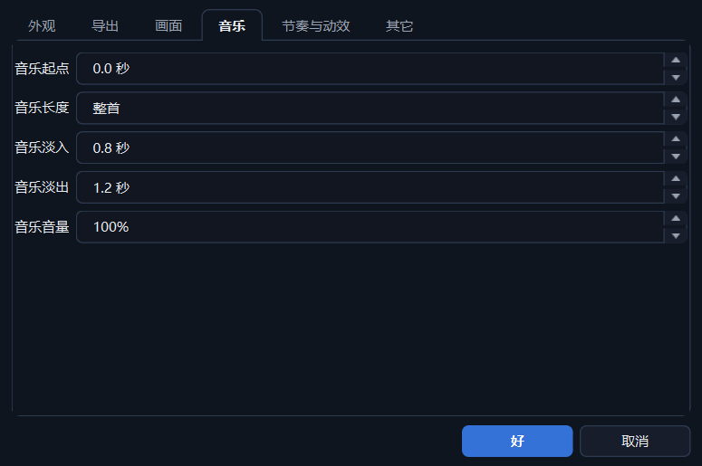 | 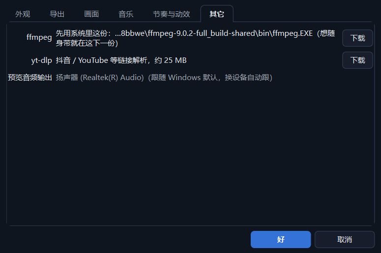 |

라이트 테마, 그리고 메인 색 오른쪽을 눌러 연 색환(대비색 자동 계산):

| 라이트 | 색환에서 색 고르기 |
| --- | --- |
| 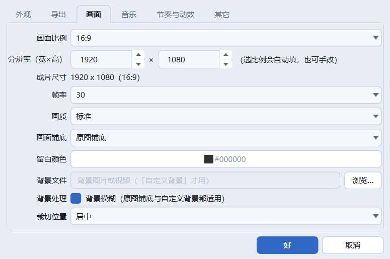 | 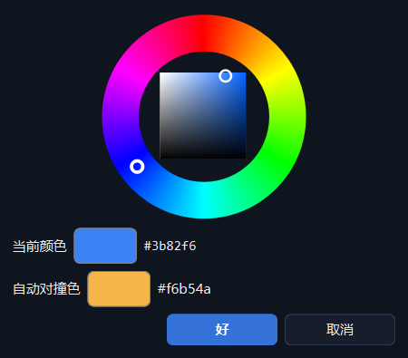 |

미리보기 오디오는 항상 **Windows 기본 출력 장치**를 따르고, 이어폰을 꽂거나 빼면 다시 시작하지 않아도 자동으로 전환됩니다.

내보내기가 끝나면 폴더가 자동으로 열립니다(설정에서 끌 수 있음). 내보내는 동안 상태 표시줄에 진행률과 「남은 시간 약 x:xx」가 표시되고 옆에 「취소」가 하나 더 생깁니다. 창 크기, 위치, 언어, 테마,
지난번 내보내기 폴더는 모두 settings.json에 기록되어 다음에 열 때 그대로입니다.

## 프로젝트 구조

```
pic2video.py     메인 프로그램(창 + 명령줄)
bili_audio.py    빌리빌리 오디오 트랙 추출(WBI 서명 + playurl)
audio_source.py  음원 판별과 yt-dlp 래퍼
components.py    ffmpeg / yt-dlp의 필요 시 다운로드와 삭제
theme.py         테마, 메인 색/대비색, QSS
i18n.py          다섯 언어의 문구
tts_engine.py    더빙: 분할, Edge 합성, 문장 단위 타임스탬프, 캐시와 이어붙이기
启动.bat           더블클릭으로 창 열기
tests/           단위 검사(1,425개)
docs/            연구 노트, 설계 기록(wayfinder 티켓), 원본 프로브 스크립트
screenshots/     README의 스크린샷
```

## 개발

```
python tests/test_project.py     # 타임라인 / 프레임 수 / 설정 / filtergraph / 테마 / 음원 / 깨진 이미지 사전 검사 / 프로젝트 파일 / 인점·아웃점 / 자막 / 전환 / 내보내기 프리셋과 표지 / 부분 화면 / 색 보정 / 오디오 엔벨로프 / 리소스 팩 / 미리보기 컨트롤 바 / 실시간 합성 / 인터페이스 세 모드 / 더빙 페이지 / 인터페이스 힌트 / 소재(사진과 영상)
python tests/scan_keys.py        # tr()의 중국어에 네 가지 번역이 모두 있는지 검사
```

## 설치 없는 exe로 패키징

`build.bat`을 더블클릭(Python 필요. PyInstaller가 없으면 스크립트가 먼저 설치해 줍니다). 끝나면 `dist\Pic2Video\` 아래에:

```
Pic2Video.exe     더블클릭으로 바로 사용
_internal\        런타임 파일, exe와 같은 위치에 둠
```

`dist\Pic2Video\` 폴더를 통째로 남에게 줘도 설치 없이 실행됩니다(약 115 MB).

패키징 후 더빙이 실제로 소리를 내는지 확인하고 싶으면 `Pic2Video.exe --tts-selftest 结果.json`을 실행하세요:
창을 열지 않고 한 문장을 실제로 합성해 성공 여부를 그 JSON 파일에 적습니다.

배포 패키지에는 ffmpeg와 yt-dlp가 **들어 있지 않습니다**: 처음 열 때 시스템에 ffmpeg가 없으면 한 번 물어보고 스스로 `tools\`에 받습니다
(약 120 MB, 한 번만 받음). 용량을 아끼고 싶을 때는 설정 → 기타에서 지울 수 있고, 다음에 필요하면 다시 받습니다.

## 알려진 제한

- 빌리빌리의 유료/멤버십 미리보기 영상은 미리보기 클립만 얻을 수 있습니다. 지역/저작권 제한이 있는 것은 바로 실패하고 이유를 알려줍니다.
- 더우인 / YouTube 등 플랫폼이 로그인을 요구하면(연령 제한, 멤버십 콘텐츠) yt-dlp가 실패하고 이유를 보여줍니다.
- 출력 시간은 영상 길이의 약 1/5입니다. 아주 긴 음악은 「개별 초」로 총 길이를 관리하거나, 내보내면서 남은 시간을 보며 기다리세요.
- 사진이 옮겨지거나 삭제되면 내보내기 전에 어느 사진인지 알려주고, 한 번 다시 추가하면 됩니다. 프로젝트로 저장했다가 열면 위치를 다시 지정할지 물어봅니다.
- 자막 텍스트는 굽기만 하고 트랙에서 고칠 수 없습니다: 자막 트랙에서 클릭해 그 문장으로 이동하고, 끌어 문장 전체의 등장/퇴장 시간을 조정할 수 있습니다(문장 길이는 그대로). 텍스트를 고치거나 글자 단위로 미세 조정하려면 .srt로 저장해 고쳐야 합니다.
- 더빙 네 가지 모두 소리를 냅니다: Edge(무료, 문장 단위 타임스탬프 포함), Gemini, Azure 음성, OpenAI 호환 엔드포인트. 뒤의 세 가지는 자신의 키가 필요하고 모두 타임스탬프를 주지 않아 자막을 Edge로 정렬합니다. Gemini 무료 계층은 할당량이 빡빡합니다(커뮤니티 실측 하루 약 10회).
- Gemini 무료 계층 할당량은 매우 빡빡하고(커뮤니티 실측 하루 약 10회 요청), 긴 원고는 여러 구간으로 쪼개져 상한에 닿으면 세 번 백오프 재시도 후 「할당량 소진」을 알립니다. 이때는 Edge로 바꾸거나 내일 다시 시도하세요.
- 더빙은 성문 자동 분리도, 글자 단위 하이라이트도 하지 않습니다: 역할은 원고의 「이름:」으로 명시하고, 역할마다 음성 하나입니다.
- 합성 후 정리는 딸깍 소리 제거 / 퍽 소리 제거 / 침묵 자르기 / 라우드니스 정규화(-14)만 하고 노이즈 제거 모델은 없습니다: 배경 소음이 뚜렷한 원본 녹음은 되살리지 못합니다.
- 글꼴은 시스템에 설치된 것, 또는 리소스 팩으로 설치한 것만 인식합니다. 설치되지 않은 글꼴 파일은 넣지 않습니다(.ttc는 첫 번째 자형만, 일부 글꼴은 자막에 쓰지 못함).
- 전환은 ffmpeg 내장 12개 이름만 쓰고 외부 전환 파일을 가져오거나 식을 직접 쓸 수 없습니다(리소스 팩의 전환 프리셋도 이 12개 이름을 조합할 수만 있음. 새 효과를 넣으려면 코드를 고쳐야 함).
- 오디오는 게인과 볼륨 엔벨로프만 합니다: 다중 오디오 트랙, 노이즈 제거 / 이퀄라이저 / 컴프레서도 없고 자동 덕킹도 하지 않습니다. 고친 뒤 약 250밀리초 후 오디오 트랙이 자동으로 다시 믹스되어 바로 들립니다.
- 자석은 드래그가 끝난 그 변에서만 동작하고, 블록 전체를 「이음매 없이 붙이기」로 스냅하지는 않습니다. 칼날 자르기는 시간만 자르고 원본 파일을 바꾸지 않으며, 자른 두 구간을 각각 다시 자를 수 있습니다.
- 리플 삭제는 오디오 블록만 앞으로 당기고 화면 구간은 함께 옮기지 않습니다. 빈 자리 표시용 오디오 블록은 앞뒤를 자를 수 없습니다.
- 내보내기는 libx264 소프트웨어 인코딩(crf + preset)만 쓰고 하드웨어 인코딩(NVENC / QSV)은 하지 않으며, 다중 플랫폼 일괄 내보내기나 직접 업로드도 하지 않습니다.
- 표지 시점은 완성본 타임라인 기준입니다(전환이 두 구간을 각각 조금씩 잡아먹음). 전환 한가운데를 뜨고 싶으면 초를 직접 입력하세요.
- 색 보정은 밝기 / 대비 / 채도 + 필터 .cube LUT 하나뿐입니다: 커브, 색환, HSL 분리 색상은 하지 않습니다. LUT는 3D .cube만 읽고(1D .cube는 읽지 않음) .3dl / .m3d도 받지 않습니다.
- 부분 화면은 「완성본 위에 얹는 오버레이」만 합니다: 회전, 마스크, 키프레임 애니메이션도 없고, 다중 트랙 중첩 / 오버레이를 메인 트랙처럼 구간 배치하는 것도 없습니다. 더 복잡한 합성이 필요하면 진짜 편집 소프트웨어를 써야 합니다.
- 영상 구간은 원본 프레임 레이트로 프레임 단위 디코드합니다: 진행 바를 아주 멀리 끌면 가끔 한두 프레임 기다려야 합니다. 화면 효과(천천히 확대 / 축소)는 사진에만 적용되고 영상 구간은 원본 화면을 유지합니다.
- 미리보기는 실시간 합성입니다: 12가지 전환은 근사 효과이고(내보내기는 ffmpeg의 xfade라 가장자리 디테일이 조금 다를 수 있음), 오프닝/엔딩과 영상 부분 화면은 프레임 단위로 디코드해 아주 멀리 점프하면 가끔 한두 프레임 기다려야 합니다. 영상 구간의 색 보정 미리보기는 아직 실시간으로 연결되지 않았습니다(내보내기는 여전히 정확). 화질은 미리보기에만, 배속은 재생에만 영향을 줍니다.
- 간단 모드는 버튼 한 줄을 줄이려고 위로/아래로/삭제/초 변경을 오른쪽 클릭 메뉴에 맡겼고, 리듬과 총 길이는 「설정 → 템포와 움직임」의 기본값으로 고정됩니다. 구간별로 세밀하게 조정하려면 표준이나 전문가로 전환하세요.
- 현재 Windows에서만 검증했습니다.
- 파일 선택은 시스템 기본 파일 창을 씁니다(테두리가 통일되지 않는 대신 빠른 액세스, 최근 위치가 그대로).

## 자주 묻는 질문

### 링크를 붙였는데 오디오 트랙을 가져오지 못함

**증상**: 상태 표시줄의 그 줄이 멈춰 있거나 오류 문구로 바뀝니다. 아래 「음악 링크」 칸에 길이가 계속 나오지 않습니다.

**원인**(흔한 순서):

1. **콘텐츠 자체를 얻을 수 없음**: 빌리빌리 유료/충전/대회원 콘텐츠는 미리보기 클립뿐이고, YouTube는 연령 제한, 더우인은 비공개 영상, 지역 또는 저작권 제한. 모두 로그인 상태가 필요하지만 이 도구는 Cookie를 읽지 않습니다.
2. **링크를 인식하지 못함**: 단축 링크가 만료됨(b23.tv를 열면 「아무것도 없음」류의 JSON), 모음집 페이지를 복사한 경우(영상 페이지가 아님).
3. **파서가 없음**: 더우인 / YouTube / 콰이쇼우 같은 사이트는 yt-dlp가 없으면 「먼저 음원 컴포넌트를 다운로드하세요」라고 바로 알려줍니다.
4. **네트워크가 닿지 않음**: 빌리빌리 API가 위험 통제에 걸리거나(-352/-412) 이 PC에서 그 사이트에 연결되지 않습니다.
5. **「계속 안 움직임」이 반드시 멈춘 것은 아님**: yt-dlp 타임아웃은 15분이고 빌리빌리 요청 실패는 스스로 3회 재시도하므로, 네트워크가 제한되면 아주 오래 조용한 것처럼 보입니다.

**두 단계**:

1. 먼저 상태 표시줄이나 팝업 본문을 읽으세요 — 빌리빌리 오류 코드는 모두 번역되어 있어(대조표는 아래) 바로 짝을 맞출 수 있습니다.
2. 짝을 맞춘 뒤 움직이세요: 컴포넌트가 없으면 → 설정 → 기타 → yt-dlp에서 「다운로드」 클릭; 위험 통제면 → 몇 분 기다렸다가 「다시 시도」를 연달아 누르지 말고 한 번만. 두루뭉술한 「오디오 트랙을 가져오지 못했습니다(설정에서 다시 시도해 보세요)」 한 줄만 남으면(더우인/YouTube 등에서 흔함) 링크에 매달리지 말고 그 영상 자체를 내려받아 「음악 링크」 칸에 직접 끌어다 놓으세요 — 로컬 오디오 추출 경로라 네트워크도 yt-dlp도 거치지 않습니다.

### 내보낸 영상이 어둡게 보임 / 원본보다 어두움

**증상**: 영상 전체가 회색빛으로 어둡고, 가장자리가 가운데보다 어둡거나, 사진마다 시작과 끝이 까맣습니다.

**네 가지 경우, 네 가지 원인**(어느 것인지 구분하고 섞지 마세요):

1. **전체가 회색빛, 흰색이 흰색이 아님**: 완성본은 limited range(16–235)인데 v1.0.0 패키지는 파일에 색 범위를 명시하지 않아(`ffprobe`로 읽으면 `color_range=unknown`) 플레이어가 추측합니다. full로 추측하면 235를 255로 표시해 흰색이 92%가 되고 검정이 16으로 올라가 회색빛으로 보입니다.
   **v1.0.1에서 고쳤습니다**: 소스가 filtergraph 끝에 `setparams=range=tv:colorspace=bt709:color_primaries=bt709:color_trc=bt709`를 추가했고, 내보낸 패키지에서 `ffprobe`가 `color_range=tv / color_space=bt709 / color_transfer=bt709 / color_primaries=bt709`로 그대로 보고합니다(단위 테스트가 지켜봅니다). v1.0.0에서 회색빛이던 분은 v1.0.1로 바꿔 다시 내보내면 정상입니다 — 구버전 다운로드 패키지는 내렸습니다.
2. **가장자리가 가운데보다 어두움**: 배경이 「원본 이미지 배경」 + 배경 흐림이고, 가장자리의 흐린 배경을 의도적으로 8% 어둡게 했습니다(`gblur=sigma=40,eq=brightness=-0.08`). 순수 주황 #FF8000 실측: 주체 중심 RGB(253,126,0)은 그대로, 왼쪽 가장자리는 (228,100,0)이 됩니다. **이것은 설계이지 버그가 아닙니다**.
3. **사진에 투명 채널이 있음**(PNG 워터마크, 배경 제거 이미지에서 흔함): 투명한 부분이 완성본에서 순수 검정이 됩니다 — 완전 투명 배경 PNG 실측, 출력 후 투명한 곳 RGB가 (0,0,0).
4. **전환이 「페이드 인/아웃」임**: 구간마다 들어오고 나갈 때 검정으로 페이드됩니다(기본 0.3초). 오프닝/엔딩이 특히 「몇 프레임 까매진」 것처럼 보입니다. 느낌을 바꾸려면 오른쪽 클릭 메뉴의 「전환」에서 다른 이름을 고르세요.

**두 단계**:

1. 어떤 경우인지 먼저 구분: 전체가 어두움 → 다른 플레이어로 한 번 더 확인; 가장자리만 어두움 → 설정 → 화면 → 배경 방식을 「잘라서 채우기」나 「단색 여백」(밝은 색)으로; 투명이 있는 이미지 → JPG로 저장하거나 그림판/PPT에서 흰 배경을 깔고 가져오기.
2. 블랙 페이드가 싫으면: 설정 → 템포와 움직임 → 클립 전환을 「하드 컷」으로 바꾸거나 전환 시간을 0.1초로 줄이세요. 특정 구간만 오른쪽 클릭해 「없음(하드 컷)」을 골라도 됩니다.

### 미리보기 영역이 계속 까맣다

**증상**: 가운데가 까맣고 진행 바를 끌어도 안 바뀌거나, 상태 표시줄에 오류가 있습니다.

**원인**:

1. **아직 소재를 추가하지 않음**: 소재가 없으면 미리보기는 검은 바탕이고 상태 표시줄에 「먼저 소재를 추가하세요」가 적힙니다.
2. **이미지 파일이 없음 / 읽을 수 없음**: 미리보기는 경로에서 그때그때 디코드하므로 파일이 옮겨지거나 삭제되거나 깨지면 검은 프레임으로 그려집니다. 내보낼 때는 「이 파일을 읽을 수 없습니다: …」라고 분명히 알립니다.
3. **오디오 믹스 실패**: 상태 표시줄이 「미리보기 오디오 실패」라고 합니다 — 보통 ffmpeg 누락이나 임시 폴더에 쓸 수 없음이고, 화면 자체는 영향받지 않습니다.
4. **플레이어가 오디오 트랙을 열지 못함**: Qt가 `ResourceError` / `FormatError`를 내고 상태 표시줄에 「미리보기 재생 오류: …」로 합쳐집니다. 이때는 재생에 마스터 클록이 없어 재생을 눌러도 진행되지 않습니다.
5. **원격 데스크톱 / 가상 머신**: 하드웨어 서피스를 못 얻으면 창이 전부 까맣게 보일 수 있습니다(완성본 자체는 문제 없음).

**두 단계**:

1. 먼저 상태 표시줄을 보세요: 소재가 없으면 추가, 이미지 경로가 바뀌었으면 프로젝트 메뉴에서 위치 다시 지정, ffmpeg가 없다는 안내가 나오면 다운로드.
2. 그래도 까맣다면: `%TEMP%`에 공간이 있는지, 이미지가 원래 자리에 있는지 확인하고, 원격 데스크톱이라면 로컬에서 열어 보세요 — 완성본이 정상인지는 내보낸 mp4를 재생하면 바로 알 수 있습니다.

### ffmpeg 다운로드 실패

**증상**: 처음 열 때 「지금 자동으로 다운로드할까요」를 물어보고, 눌렀더니 진행 바가 멈추거나 「다운로드 실패」가 뜹니다.

**원인**: gyan.dev의 Windows 빌드 패키지를 받습니다(ffmpeg 공식 사이트의 Windows 항목이 바로 이것). 압축 파일 119 MB, 풀면 약 210 MB. 다운로드는 일회성 통짜 요청이고 타임아웃 60초이며 **끊겨도 이어받지 않고 자동 재시도도 하지 않으므로** 네트워크가 잠깐 흔들려도 전체가 실패합니다. 회사 프록시/방화벽이 막을 수 있고, 백신이 방금 받은 `ffmpeg.exe`를 의심 파일로 처리하기도 합니다.

**두 단계**:

1. 「다운로드」를 한 번 더 누르세요(일시적 네트워크 흔들림이 가장 흔함). 프록시를 쓰고 있다면 프록시가 gyan.dev에도 적용되는지 먼저 확인하세요.
2. 그래도 안 되면 직접 설치: `winget install Gyan.FFmpeg`, 설치 후 도구를 다시 열면 시스템의 것을 그대로 씁니다. 또는 zip을 직접 받아 `ffmpeg.exe`, `ffprobe.exe`를 프로그램 폴더의 `tools\`에 넣으세요.

설치한 뒤에는 설정 → 기타에서 언제든 지울 수 있고, 다음에 필요하면 다시 받습니다.

더 자세한 진단(모든 결론에 해당 코드 위치와 실측 숫자가 붙어 있음): [docs/research/faq-常见故障.md](docs/research/faq-常见故障.md).

### 오류 원문 대조(빌리빌리)

| 상태 표시줄 원문 | 실제 원인 | 해결 방법 |
| --- | --- | --- |
| 영상이 없거나 삭제되었습니다 | 게시물이 삭제되었거나 볼 수 없음 | 다른 영상으로 |
| 영상을 볼 수 없습니다 (삭제/비공개/심사 중) | 위와 같음, 작성자가 비공개로 했거나 심사 중 | 심사를 기다리거나 다른 영상 |
| 지역 제한이 있습니다. 현재 네트워크에서는 볼 수 없습니다 | 지역 제한(-688) | 해당 지역의 네트워크가 필요 |
| 저작권 제한이 있어 볼 수 없습니다 | 저작권 제한(-689) | 다른 영상으로 |
| 후원 전용 영상입니다 (Bilibili 충전 필요) | 충전 전용(87007) | 이 도구는 계정을 쓰지 않음, 다른 영상으로 |
| 유료 영상입니다. 구매 후 시청할 수 있습니다 | 유료 콘텐츠(87008) | 위와 같음 |
| 회원/유료 콘텐츠의 미리보기 클립입니다. 전체 오디오는 프리미엄 계정이 필요합니다 | 미리보기만 얻을 수 있음(is_preview=1) | 다른 영상으로, 또는 오디오 파일을 직접 준비해 끌어다 놓기 |
| Bilibili 요청 제한에 걸렸습니다. 잠시 후 다시 시도하세요 | 위험 통제(-352) | 수십 초 기다렸다가 「다시 시도」 |
| 요청이 잘못되었습니다. 유효한 영상 링크가 아닐 수 있습니다 | 링크 형식 오류(-400) | 영상 페이지 주소를 복사하고 모음집을 복사하지 마세요 |
| 이 사이트에 연결할 수 없습니다(프록시가 필요할 수 있음) | 이것은 yt-dlp 쪽, 더우인/YouTube 등 | 네트워크나 프록시 확인 |
| 이 사이트는 로그인이 필요해 지금은 오디오를 가져올 수 없습니다 | yt-dlp가 로그인 벽에 막힘 | 이 도구는 Cookie를 읽지 않음, 공개 영상으로 |

## 라이선스

[MIT](LICENSE) © 2026 Xishensoft

사용한 서드파티 컴포넌트는 각자의 라이선스를 가집니다: ffmpeg(GPL 빌드, 첫 실행 시 필요에 따라 다운로드하며 저장소에 배포하지 않음),
PyQt6(GPL-3.0 / 상용 듀얼 라이선스), yt-dlp(Unlicense), 이 프로젝트 자체 코드는 MIT입니다. 이 프로젝트를 재배포할 때는 ffmpeg와 PyQt6의 라이선스도 함께 지켜야 한다는 점에 주의하세요.
