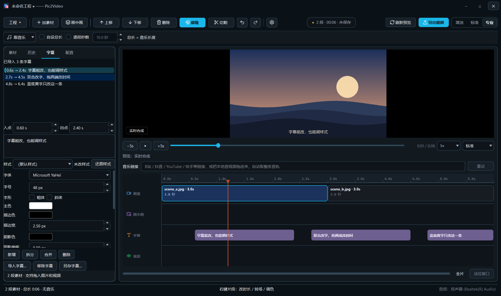
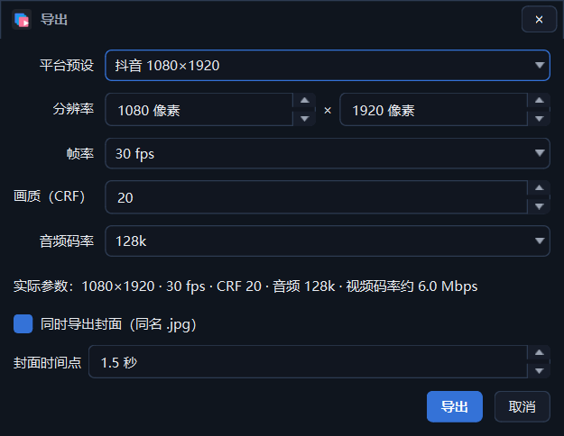
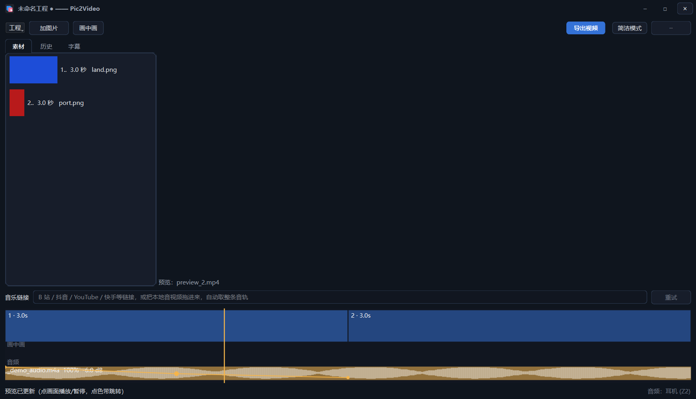
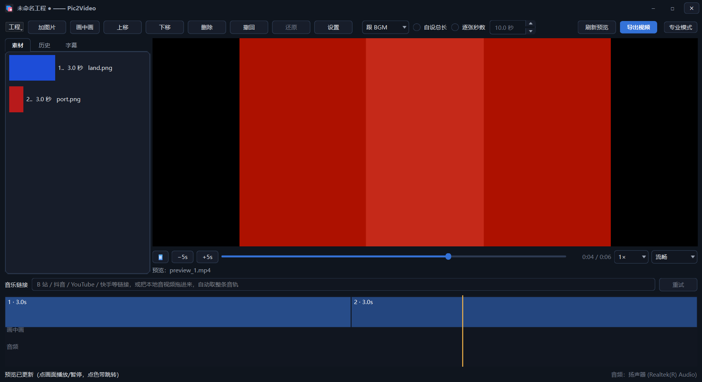
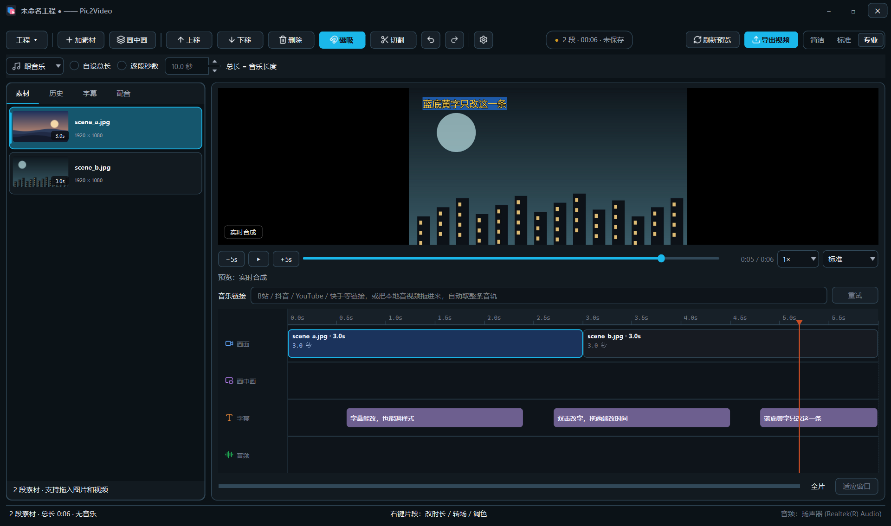
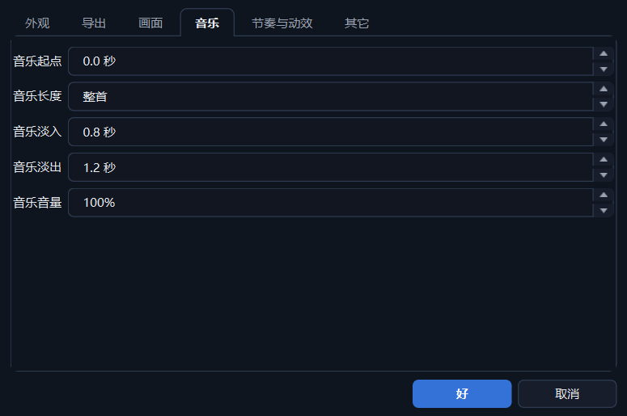
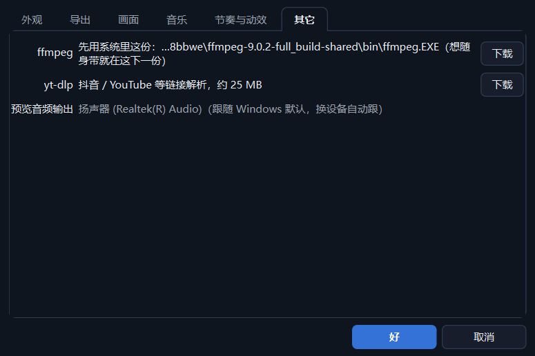

# Xishensoft's Pic2Video

简体中文 · [繁體中文](README.zh-TW.md) · [English](README.en.md) · [日本語](README.ja.md) · [한국어](README.ko.md)

给几张图片或视频、粘一个视频链接，一键出一条带背景音乐的成片。做视频时最省事的那一步：**图片 / 视频 + B站 / 抖音 / YouTube 的音乐 → mp4**。


- **图片、视频随便几段**：拖进来排序，每段单独调秒数；视频按原长成为一段，能裁头尾、切段、套转场，底部时间线点哪跳哪、拖右边界直接改时长。
- **音乐直接从视频链接取整条音轨**：B站（含 b23.tv 短链 / 裸 BV、av 号）、抖音、YouTube、快手、小红书、微博；也可以把本地音频/视频直接拖进窗口。
- **窗口里就能预览**：预览是实时合成的——改参数、拖进度条、换转场，画面下一帧就变，不用等整片重渲。
- **预览像播放器**：预览画面底下有进度条、播放/暂停、±5 秒、0.5–2× 倍速、四档清晰度（流畅 / 标准 / 清晰 / 原尺寸）；倍速和清晰度只影响预览，成片照旧按设置导出。
- **加素材不只加图片**：图片和视频都能拖进列表或点「加素材」；视频段在时间线上能拖边界裁、按 I/O 设入出点、Ctrl+K 切开，调色和转场照样能套。
- **规格可调**：9 档画面比例 + 宽高手填、30/60fps、画质三档、五种画面铺底（原图铺底 / 纯色留白 / 自定义背景图 / 背景视频 / 裁切铺满）、淡入淡出与 12 个内置转场、导出目录。
- **上手就能用**：图片、文件夹、音视频文件都能直接拖进窗口；导出完自动打开所在文件夹；照片的 EXIF 方向会自动摆正。
- **能动起来**：可选的缓慢推近 / 拉远 / 交替推拉（Ken Burns），让静态图变成有呼吸感的镜头。
- **顺手的小东西**：简体中文 / 繁體中文 / English / 日本語 / 한국어 五种界面；深色/浅色主题；只挑一个主色，自动配对撞色；三档界面（简洁只做三步出片 / 标准日常剪辑 / 专业全部参数）。
- **工程能存下来**：一键存成 .p2v 工程（图片、时长、片头片尾、音频块、字幕全在里面），下次打开接着改；每 15 秒自动存一次，崩了下次打开问你要不要恢复；「工程」菜单里有最近打开。
- **字幕**：导入或手写，一句一个块；改字、改进出时间、拆分合并、整句挪都在应用里做。字体 / 字号 / 颜色 / 描边 / 阴影 / 底色 / 对齐 / 边距都能调，预览和烧进成片的是同一套样式（同一条字幕可以单独覆盖）。另存 .srt（只有时间与文字）或 .ass（连样式一起）。不上传、不联网。
- **文稿能直接变配音**：「配音」页贴文稿 → 选音色 → 一键合成旁白和句级字幕；默认用免费的 Edge（不用密钥，带时间戳），也能填自己的 Gemini / Azure / OpenAI 兼容端点 key。合成完总长自动改成「跟旁白」，画面跟着声音走。
- **按平台出片**：导出时选 B站 / 抖音 / 视频号 / YouTube / 通用，分辨率和帧率自动配好；顺带能按成片时间轴截一张同名封面图。
- **能压一层画面**：图片或视频叠在成片上（画中画）：九宫格摆位、缩放、不透明度、进出时间都能调，时间线上直接拖。
- **能调色**：每段素材单独调亮度 / 对比度 / 饱和度，还能套一个滤镜（.cube 的 LUT，机内调色、胶片感都靠它），右键就能进。
- **音频看得见、捏得动**：时间线上画出真实波形，每段音频能设增益（分贝）、能在波形上点出一条音量包络（Alt + 点击加点、拖点改值、右键删点）。
- **资源包**：字体、LUT、转场预设都能打成 zip 装进来，装好就出现在对应的下拉/菜单里；包里有清单和校验，来路不对的直接拒收。
- **不会白等**：导出有百分比和剩余时间，随时能点「取消」；关窗前会提醒还在导出；第一次打开就最大化，之后可以在设置里改成记住上次或固定大小。

## 快速开始

1. 装依赖（只装一次）：

   ```
   python -m pip install PyQt6
   ```

   `ffmpeg`、`ffprobe` 不用自己装：第一次运行时工具会问一句，点了就自动下到 `tools/`（约 120 MB，实测 9.0.2）。
   系统 PATH 里本来就有 ffmpeg 的话直接用那份，不会再下。

2. 双击 `启动.bat`（它就是 `python pic2video.py`）。
3. 把图片或视频拖进窗口，或点「加素材」。
4. 把链接粘进「音乐链接」框，等状态栏显示「背景音乐已就绪：时长 x:xx · 文件在：…」——从链接取回来的音乐会存在工具数据目录的 `media/` 里，关掉程序也不会丢。
5. 看预览，点「导出视频」，选个平台预设（或就让参数跟着设置走），再选个目录。

也可以把一整个文件夹拖进窗口（里面的图片、音视频会一起加进来），或者直接把图片、音乐文件拖进来。素材拖到列表的某一项上还分三段：落在**左三分之一**插到它前面、落在**中间**把它换掉、落在**右三分之一**插到它后面（拖动时列表会画出插入线或高亮框）。

键盘也能使：Ctrl+I 加素材、Ctrl+M 导出、F5 刷新预览、空格播放/暂停、Delete 删掉选中的图；工程相关的 Ctrl+N 新建、Ctrl+O 打开、Ctrl+S 保存、Ctrl+Shift+S 另存为——这些键在 设置 → 快捷键 里都能改。

素材不只有图片：**视频也能加**。视频文件拖进列表（或点「加素材」）就按原长成为一段，在时间线上和图片段一样能拖边界裁、按 I/O 设入出点、Ctrl+K 切成两段、挑转场、调色；拖一整个文件夹时里面的图片和视频会按文件名顺序一起加。只有音频文件拖进窗口才走「音乐 / 额外音频」那条路——视频想只取音轨，就把它拖进「音乐链接」框。

## 工程文件（.p2v）


「工程」按钮（或 Ctrl+S）能存成 .p2v 工程：一个普通 JSON，写着版本号、帧率、节奏模式、每张图的顺序与时长、片头片尾的入出点、音频块的起点与音量、字幕内容。视频和音频本身不进工程，只记路径——所以工程和素材可以分开拷。

- **保存 / 另存为**：Ctrl+S 存回原处；没存过的第一次会问路径。保存是原子写（先写 .tmp 再换名），写一半断电不会把老工程毁掉。
- **自动保存**：每 15 秒把改动存一份到工具目录，正常存盘或关窗就清掉。上次没正常退出时，打开会自动问要不要恢复那份。
- **最近打开**：菜单里最多留 8 个，被删掉的会自动从列表里消失。
- **素材丢了**：打开时如果有图或音频被移走，会列出来并问要不要「重新定位…」；选一个新的位置，工程里所有指向这一类的条目一起换过去。
- **版本**：工程里带 version。比软件新的版本会直接拒绝打开，而不是猜着读——免得把新工程读坏。

## 字幕

左下角「字幕」页是一个小面板：上面是列表（每条的时间与文字），下面跟着这一条的属性。导入 .srt / .ass 只是起点，内容都随工程存进 .p2v，不依赖原文件还在不在。



- **列表**：一行一条，双击（或按 F2）改文字；**↑ / ↓** 换条。
- **改时间**：属性区有「入点 / 出点」两个框，直接填秒数；时间线上把鼠标放到字幕块两端，指针会变，拖左边改入点、拖右边改出点，拖中间是整句挪。两端会吸附到别的字幕首尾、播放头和片段边界；最短 0.1 秒，块和块不重叠——右端撞到下一条时，下一条整体往后让，顶到片尾就停住。
- **新增 / 删除**：**N** 在播放头处加一条 2 秒的（那儿挤不下会自动往后找一个空位）；**Delete** 删掉选中的那条。
- **拆分 / 合并**：**S** 在播放头把这一条切成两条（播放头得落在中间）；**M** 把这一条和下一条连起来，样式按前一条。
- **样式**：属性区的「样式」下拉选这条用哪套命名样式（默认一套 `Default`）。下面那一排是这条自己的覆盖值——改过的项才算覆盖，标着「已改 N 项」；点「还原样式」就回到它那套样式的样子。可以调字体、字号、粗体 / 斜体、主色、描边色与宽度、阴影色与偏移、底色与不透明度、九宫格对齐（小键盘排法，1–3 贴底）、左 / 右 / 底边距（按画面宽高的百分比算）。
- **预览和成片是同一套算法**：样式参数先算成 ASS，预览再用同一套映射画到 QPainter 上；实测同一套参数两边墨迹的重合度 ≥0.85、包围盒差 ≤2 px。字号按「1080p 下的像素」定义，540p / 竖屏都是等比换算。
- **导出**：点「另存字幕…」，选 .srt 只有序号 / 时间 / 文字（拿去做打轴、翻译都行），选 .ass 连样式和位置一起带走，拖进别的软件不用重调。
- 默认样式的字体和字号在 设置 → 画面 → 字幕字体 / 字幕字号 里改：新工程、新加的字幕都从这份默认开始，已经有字幕的工程不会被动到。
- 默认字体是 Microsoft YaHei。有些字体（尤其是部分 .ttc）只能拿到第一套字形，或者根本不含中文——成片里字幕变方块时换个字体试试。
- 花括号会原样显示（a{b}c 就写成 a{b}c，不用自己转义）；.srt 里一条字幕内的换行在 .ass 里变成强制换行。end 不晚于 start 的坏条目会被丢掉，不会让整份字幕打不开。

## 配音（文稿 → TTS → 字幕）


「配音」页（标准 / 专业档才出现）把「有稿子」变成「有片子」：贴文稿 → 选音色 → 点「开始合成」，出来一条旁白和一份句级字幕，画面总长自动跟着旁白走。

- **文稿**：直接粘进左上角的框，或「打开文稿…」读一个 .txt / .md（UTF-8，也认 GBK）。一句一行、或者一整段都行，按标点自动切句子，再按每段约 1000 字切段；框下面实时显示「会切成 N 段，共 M 字」。
- **音色**：默认 Edge（免费、不用密钥），中文音色 14 个（普通话 / 东北话 / 陕西话 / 台湾 / 粤语，男女都有）；语速 -50%～+100%。想先听听合不合适，点「试听」只合成第一段。
- **合成**：后台逐段跑，进度条显示「已完成 / 总段数」，随时能点「取消」，单段失败可以重跑。每段结果按「文本 + 服务商 + 音色 + 语速」缓存到工具目录（`tts/`），中途断开再点一次会跳过已经合成好的段。
- **接上之后**：旁白进时间线的音频轨（带波形），句级字幕进「字幕」页；节奏自动切到「跟旁白」，素材按旁白长度铺满，总长就是旁白长度。字幕想拿去别处用，点「字幕」页的「另存字幕…」（.srt 只有时间与文字，.ass 连样式一起）。合成前如果时间线上已经有字幕，会先问一句：只换声音保留现有字幕，还是连字幕一起换成新旁白的。
- **旁白文件在哪**：配音页最下面直接写出完整路径（工具目录下的 `tts/narration_<内容指纹>.m4a`，不同文稿各存各的，不会互相覆盖），旁边的「打开旁白文件夹」会在资源管理器里定位到它；想把它放到自己指定的地方，点「旁白另存为…」，存完工程就改用你选的那份。
- **合成完顺手清一下**（默认开，设置 → 配音可关）：剪掉段首段尾多余静音、削掉开头的高频咔哒和低频噗声，再按 EBU R128 把整条旁白拉到 **响度 -14**（LUFS 是响度单位，约等于平台标准的“正常音量”），最后限幅兜底。剪掉的那点静音会让字幕跟着一起往前挪，不会错位。状态栏会写「（已清理，响度 -14.0）」。
- **字幕折行**：一行最多 18 个字、最多两行，超长的句子自动拆成两条，不会一行铺满整个屏幕。
- **Gemini**：在设置 → 配音里填自己的 Gemini key 就能用（音色 Kore / Puck / Aoede / Charon / Fenrir / Leda，也能多说话人）。Gemini 不给时间戳，这里会拿同一段文本悄悄跑一遍免费的 Edge 当节奏模板，再把字幕按实际时长缩放；Edge 也连不上时才退回按字数摊。它没有语速参数，语速框会自动变灰——想快就改文稿。
- **Azure 语音**：设置 → 配音里填 key 和区域（如 `eastasia`），走 REST + SSML，音色与 Edge 同源（晓晓 / 云希 / 云扬 / 晓伊），免费层每月 50 万字。REST 不返回时间戳，字幕同样用 Edge 当节奏模板。撞上 429 会退避重试，最终提示「额度用完了」。
- **OpenAI 兼容端点**：填 key 和 base_url（硅基流动、火山、MiniMax 的兼容层都行），可再填模型名（留空 = `tts-1`）；语速会折算成 `speed`（0.25～4.0）。没有时间戳的端点同样走 Edge 对齐模板；失败会分清是 key 不对、额度用完还是网络问题。密钥明文存在本机设置文件里，不会上传。
- **不假设你的片长**：多长的稿子都行，用你自己 key 的额度就是你的额度；免费 Edge 没有每日次数限制，只有语速和并发上的软限制。

### 多人对话（任意角色名）

一问一答、多人聊天都不用手工拼：每行用「名字：」开头，后面换行接着写的都算这个角色这一轮。名字 1～12 个字，不带标点；`小明：`、`妈妈：`、`旁白：`、`老师：` 都可以。

```
小明：你好，我是小明。
妈妈：我是妈妈，今天的晚饭好了。
旁白：这是一个多人对话的测试。
老师：同学们好，我们开始上课。
```


- 配音页会按出场顺序扫出所有角色，每个角色一行，单独挑音色；角色多到超过一屏时，这一页可以上下滚。
- 旧写法继续兼容：`角色 A：` / `角色 B：`、`A:` / `B:`、`主讲：` / `听友：` 都会归到对应的两个角色上。
- 轮与轮之间留 0.35 秒（普通段间是设置里的 0.6 秒），听起来像真在接话。
- 勾上「字幕带角色名前缀」，字幕会写成「小明：你好，我是小明。」；不勾只有台词。
- 每轮单独发一次请求，所以 Gemini 这种按次计额度的服务，角色和轮次越多，用掉的次数越多。
- 稿子里没有角色标记时，一切跟以前一样，不会多出角色表。
## 转场


右键点画面元素 → 「转场」，选一个名字就行；「无（硬切）」是直接切过去。12 个名字都来自 ffmpeg 内置的 `xfade`，不吃外部文件：

| 名字 | 观感 |
| --- | --- |
| 交叉淡化 / 黑场过渡 | 叠化；黑场过渡中间会暗一下 |
| 向左 / 向右 / 向上 / 向下擦除 | 一边擦掉一边露出下一张 |
| 向左 / 向右推移 | 下一张把上一张推走 |
| 圆形展开 / 圆形收拢 | 圆形从小变大的展开、从大变小收拢 |
| 径向旋转 / 马赛克 | 转着换；先碎成马赛克再还原 |

- **时长**：同一层菜单里「转场时长」可选 0.2 / 0.3 / 0.5 / 0.8 / 1.0 秒，「跟随设置」就用 设置 → 节奏与动效 → 片段转场 那个秒数。
- **谁说了算**：两个相邻元素只要有一个开了转场，这条边界就转；两个都开了、名字不一样时听前一个的。
- **总长不变**：转场是两段「各往对方那边多伸一半、再重叠播」凑出来的——2 秒 + 2 秒、转场 0.8 秒，成片还是 4.0 秒，只是转场占了 1.6–2.4 秒这一截，两段各自实打实的静止时间各少 0.4 秒。视频段会从源里多取 0.4 秒补上，所以内容不缺。预览和导出走同一条滤镜，观感一致。
- **塞不下会拦**：相邻两段都得比「转场时长的两倍」还长。挑转场时当场提示，导出前也会再拦一次（不会导出半截坏片）。
- 工程文件里存着每段的转场名与时长；老工程没有这两项，打开就是硬切。
- 装了转场资源包之后，菜单里会多出「名字（资源包）」的预设——它仍然只是「内置转场名 + 默认时长」，不是新算法，见下面的资源包一节。

## 画中画

点顶部「画中画」选一张图或一段视频，它就会压在成片上面播——位置、大小、透明度、什么时候出现和消失都能调。


- **摆位**：九宫格选个大致位置（右上角当角标、正中当遮罩都行），再用水平/垂直偏移微调（按画面宽高的百分比，正数往右 / 往下）；「缩放」是相对成片宽度，40% 差不多是右上角一块。
- **出现 / 消失**：填秒数，或直接在时间线中间那条「画中画」轨上拖着改起点。同一轨道上可以放好几层，按加进来的顺序一层层压上去，后面的盖住前面的。
- **透明度**：0–100%，淡入淡出可以靠它自己分段叠，也可以只当个半透明水印。
- **总长不变**：叠加层是压在成片上的第二趟，不改主轨道的时间；主轨到多长，成片就多长，超出片尾的部分不会被画出来。
- 右键「画中画」轨上的块可以再编辑或删掉；工程文件里一起存着每层的素材路径、时间、位置、缩放和透明度。

## 调色

右键任意画面元素（图片、视频、片头片尾都行）→「调色…」：三个滑杆加一个滤镜（LUT），改完立刻进预览。


- **亮度 / 对比度 / 饱和度**：亮度 -1.0～1.0（0 是不动），对比度和饱和度是倍数（1.00 是不动）。三样都是 ffmpeg 的 eq 滤镜，全片一起动时会连背景铺底一起调。
- **滤镜（LUT）**：设置 → 画面 → 滤镜目录 指向放着 .cube 文件的文件夹；调色框里的下拉就列出这个目录下的 .cube。选「不用」就是只调那三个滑杆。
- **只作用在这一段上**：同一张图想两种调法，就切成两段分别调。
- **滤镜文件也是素材**：文件挪走了会跟缺图一样在导出前报出来，存工程再打开时能重新定位。调色参数和 LUT 路径都写进工程文件（.p2v）。

## 导出预设与封面

点「导出视频」后先出这张框：选平台、看实际参数、决定要不要顺带截封面。



| 预设 | 分辨率 | 帧率 | 画质 | 音频 | 文件名后缀 |
| --- | --- | --- | --- | --- | --- |
| 通用（沿用设置） | 设置里的宽高 | 设置里的帧率 | 设置里的画质 | 192k | 无 |
| B站 1080p60 | 1920×1080 | 60 | 18 | 192k | _bilibili |
| 抖音 1080×1920 | 1080×1920 | 30 | 20 | 128k | _douyin |
| 视频号 1080p30 | 1920×1080 | 30 | 20 | 128k | _channels |
| YouTube 1080p30 | 1920×1080 | 30 | 20 | 192k | _youtube |

- **手改任意一项就变「自定义」**：分辨率、帧率、画质、音频码率都能当场改，框里那行「实际参数」跟着刷新，码率只是按经验给的量级（画质数字越小估得越高）。
- **帧率会换算**：工程时间线是按设置里的帧率存的；选 60fps 的预设时，导出前按目标帧率重算每段帧数，成片时长不变，不会变成半长。
- **封面**：勾「同时导出封面」并选时间点（默认是第一段图片素材的正中间，按成片时间轴算），导出成功后在同一个目录生成同名的 .jpg，就是成片那一帧。导出完成的状态栏和弹窗都会写出封面的完整路径；截封面失败了只提示一句，不影响已经导出的视频。
- **记住上次的选择**：上次用的预设、要不要封面、封面时间点都存在 settings.json，下次打开导出框照旧。
- 预设名也写进工程文件（.p2v），但只是记号：真正生效的永远是导出时选的参数。

## 各平台的音乐

| 来源 | 需要什么 | 说明 |
| --- | --- | --- |
| B站 | 无 | 不需要登录、不读 Cookie；DASH 音轨里按码率取最高那档 |
| 抖音 / YouTube / 快手 / 小红书 / 微博 | `yt-dlp` | **按需下载**：设置 →「其它」里点「下载」装进工具目录的 `tools/`（约 25 MB），不用了点「删除」清掉；第一次粘这类链接时也会问一次 |
| 本地文件 | 无 | 音频直接当音乐；视频当素材加进时间线（想只取音轨就拖进「音乐链接」框） |

取的是**整条音轨**，不做人声分离。

这条是背景音乐，会铺满所有素材段。想再叠别的音频（音效、第二段音乐、旁白），右键时间线上的音频块 →「添加音频文件…」，或者直接把音频文件拖进窗口：一条音频一个块，各自拖起点、滚轮改音量。

## 音频块（波形 / 包络 / 增益）

时间线上每条音频块里都画出真实波形，安静的素材也按自己最大的一处归一化，看得清起伏：



- **增益**：右键音频块 →「增益…」，范围 -24 ~ +12 分贝，0 就是原样。适合把一段偏小的旁白整体抬起来。
- **包络**：按住 Alt 在音频块上点一下加一个点（横轴是时间、纵轴是 0–100% 的音量），按住点上下拖就能改；右键一个点把它删掉。点与点之间线性过渡，导出的声音照着这条线走——音乐淡入、旁白压低再抬起来都靠它。
- **先增益、后包络**：两者相乘，所以 -6 分贝再加一条 50% 的包络，最终就是 -12 分贝左右。
- **波形从哪来**：ffmpeg 把音频解成单声道 8 kHz 的峰值，一条素材一份缓存，放在 `peaks/`（打包版是 `%LOCALAPPDATA%\Pic2Video\peaks\`）；素材的文件大小或修改时间变了会自动重算。
- 增益和包络都存进 .p2v 工程，下次打开还在。

右键音频块就是这些入口：


## 资源包（字体 / 滤镜 / 转场预设）


设置 → 资源包（专业模式里是独立一页）：点「导入 zip…」选一个包，装完就在列表里，弹窗和「打开资源文件夹」按钮都会告诉你它装在哪；选中点「删除所选」会先问一句，如果有工程正在用它，删完还会告诉你是哪一段。

- **装在哪**：跟工程文件无关，统一放在工具数据目录的 `assets/fonts`、`assets/luts`、`assets/transitions`（打包版在 `%LOCALAPPDATA%\Pic2Video\assets\`）。工程里记的仍是文件路径，所以拷贝工程时要连资源包一起考虑。
- **字体包**（.ttf / .otf / .ttc）：装完出现在 设置 → 画面 → 字幕字体 的下拉里；烧字幕时自动把那个包目录交给 libass，不用先把字体装进系统。.ttc 只取第一套字形。
- **滤镜包**（.cube）：装完出现在右键「调色…」的 LUT 下拉里，和「滤镜目录」里手动放的 .cube 并列。
- **转场预设包**（.json）：一个文件一个预设，写着名字、用哪个内置 xfade、默认多少秒；装完出现在右键 →「转场」里，标着「（资源包）」。它不会带新算法，只能组合 ffmpeg 内置的 12 个名字。

一个包就是一个 zip，根上放 `manifest.json`，每个文件带 sha256：

```json
{
  "name": "我的 LUT 合集",
  "version": "1.0",
  "kind": "lut",
  "entries": [
    {"path": "teal-orange.cube", "sha256": "…64 位十六进制…"}
  ]
}
```

- **kind** 只能是 `font` / `lut` / `transition`；扩展名也要对得上（字体 .ttf/.otf/.ttc、LUT .cube、转场 .json）。
- **安全边界**：绝对路径、`..` 上跳、符号链接、可执行文件一律拒收；最多 64 个文件、解压后不超过 64 MB（防 zip bomb）；清单里没声明的多余文件、校验对不上的文件也不收。校验全过才落盘：先解到临时目录，再原子改名成正式目录，装失败不会留半套文件。
- **版本**：同名包同一个版本再装会被拒（先删再装）；不同版本直接覆盖，旧目录不会留着。
- **删掉之后**：下拉/菜单里立刻消失。如果当前工程正用着这个包（某一段的 LUT、或字幕字体），会提示是哪儿在用，渲染前先换掉。

## 命令行（批量/脚本用）

```
python pic2video.py --export 输出.mp4 --audio 本地音频.m4a 图1.jpg 图2.png 图3.webp
python pic2video.py --export 输出.mp4 --audio "https://www.douyin.com/video/..." 图1.jpg 图2.png
python pic2video.py --export 输出.mp4 --bili BV13qs46FE9C --total 4 图1.jpg 图2.png
python pic2video.py --export 竖屏.mp4 --bili BV... --ratio 9:16 --fps 60 --fit cover --transition fade 图1.jpg 图2.png
```

`--total` 是每张图的秒数；`--fps` / `--ratio` / `--width` / `--height` / `--fit` / `--bg` /
`--pad-color` / `--no-bg-blur` / `--transition` / `--motion` / `--crop-focus` / `--volume` 同设置页；命令行不写 `settings.json`。

## 界面


导出时状态栏给百分比和剩余时间，随时能取消：


窗口边框是软件自己画的，跟深色/浅色主题、主色一起变，不用系统那套灰边：拖动标题栏移动窗口，拖窗口四边/四角改大小，双击标题栏最大化。设置、选色、提示、问秒数这些窗口也都是同一套边框；选文件那一步特意留给系统原生文件框，快速访问、最近位置、网盘挂载都跟平时一样。

### 三种界面档位

工具条右上角那个按钮点开是菜单，三档随便切：选完当场生效，下次打开还记得。默认是**简洁**。

| 档位 | 给谁用 | 工具条 | 时间线 | 设置页 |
| --- | --- | --- | --- | --- |
| **简洁** | 只想把一叠图片/视频配成视频发出去 | 加素材 / 导出视频 | 画面轨 + 音频轨 | 外观 / 导出 / 画面 三块 |
| **标准** | 日常剪辑 | 再加 工程 / 画中画 / 磁吸 / 切割 / 撤回 / 还原 / 设置 | 三条轨，能缩放时间线 | 六页：外观 / 导出 / 画面 / 配音 / 音乐 / 节奏与动效 |
| **专业** | 每个参数都要管 | 全给（排序、节奏、刷新预览都在） | 全给 | 资源包 / 其它 / 快捷键 各自成页 |

- 简洁模式把排序、删除、改秒数交给右键：素材列表右键、时间线色块右键都在。
- 简洁模式没有「工程」按钮，「⋯」里有新建 / 打开 / 最近打开 / 保存 / 另存为 / 设置。
- 用到了才出现：简洁模式加了画中画才多出画中画轨，导入了字幕才多出「字幕」页；时间线缩放条在标准以上常驻，简洁模式放大过才露头。


简洁模式的设置页就剩三块：


底部是时间线，四段轨道：最上面是画面元素（片头 / 图片 / 视频 / 片尾），中间两条是画中画（有叠加层时才用）和字幕（有字幕时才用），最下面是音频元素。

- 工具条左边是节奏下拉：**跟音乐**（素材平摊整条音乐）或 **跟素材总长**（每段 ＝ 片头+片尾总长 ÷ 素材段数）；旁边还有「自设总长」「逐段秒数」两个单选。选完之后右边会跟着写明这回总长按谁算（例如「总长 = 音乐长度」「总长 = 下面这个秒数」），鼠标停上去还有一句完整解释。
- 点一下色块＝预览跳到这个元素的起点；按住左右拖，那块就跟着走（等于在这条轨上换位置）。
- 拖色块右边界改这一张显示多久；片头片尾这种视频段拖左边/右边＝改入点/出点（最长到原片长度，最短留一帧），音频块拖中间改起始时间，拖音频块的左边缘／右边缘＝裁掉它的开头／结尾（左边缘连源里的起点一起走，右边最多拉到源文件末尾）。
- 工具条上的 **磁吸** 开关（默认开）让拖动的边贴住附近的时间点：段与段的接缝、片头片尾、音频块首尾、播放头。拖动时出现一条蓝色虚线就是贴上了；按住 **Alt** 拖＝这一次不吸。磁吸和切割开着的时候按钮会亮成主色，一眼能看出现在是不是这个模式。
- 工具条上的 **切割** 开关是刀片模式：点画面块或音频块，就在点的那一秒切成两块（太靠边会提示切不了），按 **Esc** 退出这个模式。
- 右键音频块 →「删除并前移」＝涟漪删除：删掉这条音频，后面的音频整体往前补上空出来的时间。
- 播放头停在某个元素里：按 **I** 设入点、**O** 设出点，**Ctrl+K** 在这里切一刀（图片段切时长，视频段按入出点切成两段，两段加起来还是原来那么长）。
- 按住 **Shift**（或 Ctrl）点多个元素＝多选，之后的设置在选中的元素上一起生效。
- 右键色块开这个元素的菜单：画面元素能开关「淡入淡出」、进「调色…」、能从「转场」里挑 12 个内置转场之一（或硬切），还能单独定这段转场多长；画中画轨能加 / 改 / 删叠加层；音频元素能设音量（25%–200% 预设或手填）、设增益、清空包络，多选时一次改全部。
- 同时选中一个画面元素和一条音频时，画面菜单会多一项「画面铺满这条音频」：图片或视频把时长改成这条音频的长度，视频比音频短就循环、比音频长就从结尾截短。
- 鼠标滚轮停在音频块上，直接上下滚音量（每格 5%）。
- 左边素材列表也能 **Shift / Ctrl 多选**：删除、上移/下移、双击改时长都按选中的那几张一起生效；列表和时间线的选中是联动的，拖拽重排还会保住每段已经设好的调色、转场、入出点。
- 从外面拖文件进素材列表时，落点会直接写出这一下会做什么：中间那段是「替换第 N 张」或者（拖到视频段上）「插到第 N 张后面」，左 / 右两边是「插到第 N 张前面 / 后面」，拖到空白处是「加到末尾」——不用先松手再看结果。
- 底部时间线顶上有一条时间刻度（按缩放自动换密度），放大以后也能一眼看出色块落在第几秒；底栏右边常驻一句「右键片段：改时长 / 转场 / 调色」，右键菜单里那些功能不用再靠猜。
- 时间线上的画面块会写出文件名，几张名字相近的图不会认错。
- 段一多挤在一起就缩放：**Ctrl+滚轮**在时间线上放大 / 缩小（以鼠标位置为中心，最多 64 倍），**Shift+滚轮**或拖时间线下面的滚动条左右看，**Ctrl+0** / 右下「适应窗口」回到全片；放大后播放头走出可见范围会自动跟着走。
- 想一次挪好几段：从时间线的空白处按住拖出一个框（比如从没放音频的那条空轨往上拖），框到的画面块、画中画、音频会一起选中；再拖其中任意一段，整块跟着走，落点有虚线提示。Shift / Ctrl 拖着框＝在原来选中的基础上再加。
- 字幕轨上是一句一个块：点一下跳到这句开头；拖中间＝整句提前 / 推后（句长不变），拖两端＝改入点 / 出点，拖动时就会吸附相邻块和播放头，导出和预览都跟着改。拖动过程中预览只重画当前帧，松手才记一步撤销。文字改在「字幕」页的属性区里。


- 键盘：**← / →** 步进一帧，**Shift + ← / →** 步进一秒，**Home / End** 跳到片头 / 片尾，空格播放暂停（在输入框、下拉框、列表里照常给控件自己用）。
- 音乐链接输入框里敲回车就开始取音轨，不用再点「重试」。
- 素材整个文件夹搬走时，重新定位可以先选一次文件夹，按文件名自动对上；对不上的再一个一个问。


预览画面底下是一条播放控制条：左边的画面本身也能点一下播放 / 暂停（鼠标移上去会变成手型）；播放/暂停（空格也行）、−5s / +5s，中间是进度条（按住拖、点哪跳哪）和「当前 / 总长」，右边是倍速下拉和清晰度下拉。拖动播放头、在时间线上点色块、拖着进度条走，画面都实时跟着变；清晰度只改预览分辨率——流畅 640 / 标准 960 / 清晰 1280 / 原尺寸跟成片一样大，小成片不会被放大。



### 实时预览是怎么做的

预览区不是「先渲染一个 mp4 再播」，而是一个按时间现画的合成器：

- 每一帧由 `Scene.frame_at(t)` 现拼：铺底、缩放、淡入淡出、Ken Burns、12 个转场、画中画、字幕、调色，都在预览分辨率下用 QPainter 直接画出来；图片解码一次进内存，附近几段会提前铺好底图。
- 音轨单独混成一条 `.m4a` 当主时钟：只跑音频滤镜，几百毫秒就能混完；画面按播放器位置逐帧刷新，所以播放、拖动、±5 秒都不会等编码。
- 改参数只重建场景模型、重画一帧，不启动视频编码；只有导出时才走 ffmpeg 的完整 filtergraph。
- 12 个转场在预览里是近似效果（导出仍用 ffmpeg 的 xfade）；片头片尾这类视频片段走一条常驻解码管道，顺序读帧，跳太远才重开。



## 设置


设置页按 **外观 / 导出 / 画面 / 配音 / 音乐 / 节奏与动效 / 资源包 / 其它 / 快捷键** 分块：标准与专业模式都是每组一页（顶上切页，不用再滚一屏），标准模式把资源包 / 其它 / 快捷键这些专业页收起来；简洁模式不切页，一列到底，只剩外观 / 导出 / 画面，空掉的组连标题一起收起来。

| 项 | 说明 |
| --- | --- |
| 界面语言 / 界面主题 | 五种语言；跟随系统 / 浅色 / 深色 |
| 主色 | 12 家视频站的品牌色预设（哔哩哔哩 / YouTube / 抖音 / 快手 / 小红书 / 微博 / 腾讯视频 / 爱奇艺 / 优酷 / Netflix / Twitch / Vimeo），也可以点右边开色环自己调；对撞色自动按 180° 算 |
| 默认导出目录 | 留空＝每段素材所在目录 |
| 导出时先问保存到哪 | 默认开（弹保存框）；关掉就直接存上面那个默认目录，不再弹框 |
| 导出预设 / 封面 | 不在设置页里改：在导出框里选，上次用的预设、要不要封面、封面时间点会自动记进 settings.json |
| 滤镜目录 | 放滤镜 .cube 文件的文件夹；右键「调色…」时从这个目录里列出来选 |
| 画面比例 / 分辨率 / 帧率 / 画质 | 9 档比例只当预设，宽高都能手填；30/60fps；高 / 标准 / 小体积 |
| 画面铺底 / 留白颜色 / 背景文件 / 背景处理 | 五种铺底；纯色可自选；背景图/视频可模糊或不模糊 |
| 默认节奏 / 逐张默认秒数 | 跟音乐、跟素材总长、自设总长、逐段秒数（跟素材总长＝片头+片尾的总长 ÷ 素材段数，每段都播这么久） |
| 音乐起点 / 音乐长度 | 从第几秒开始用、用多长；「整首」/ 0＝一直用到结尾 |
| 音乐淡入淡出 / 片段转场 | 秒数可调；这里的转场时长是没单独设过的段落的默认值（单个段落能在右键菜单里改） |
| 画面动效 | 静止 / 缓慢推近 / 缓慢拉远 / 交替推拉（Ken Burns，默认静止） |
| 裁切位置 | 裁切铺满时留住居中 / 偏上 / 偏下（人像照片常常要偏上） |
| 字幕字体 / 字幕字号 | 新的默认样式用这个字体；字号按 1080p 定义（16–120），预览按画面高度等比缩放。单条字幕可以在「字幕」页里覆盖。资源包里的字体会一起列在这里 |
| 资源包 | 从 zip 装字体 / 滤镜（LUT）/ 转场预设；装好出现在对应的下拉与右键菜单里，详见上面的「资源包」一节 |
| 配音 | 配音服务、密钥（Gemini / Azure / OpenAI 兼容）、Azure 区域、兼容端点地址与模型名、配音代理、段间停顿、合成后清理；详见上面的「配音」一节 |
| 默认片头视频 / 默认片尾视频 | 加第一张图时自动插在最前 / 最后，留空就不加。片头段不放音乐：有片头时音乐从第一段素材才开始，片尾段同理 |
| 音乐音量 | 0–200%，默认 100% |
| 导出完自动打开所在文件夹 | 默认开；关掉就只弹完成提示 |
| 启动时窗口 / 固定大小 | 默认「启动时最大化」；也可选记住上次或固定大小（自己填宽×高）。换到更小的屏幕时窗口会自动夹进屏幕 |
| ffmpeg | 出片引擎（约 120 MB）。没装过 ffmpeg 时第一次打开会问「现在下载吗」，下完直接用；也能在这删掉、以后重新下 |
| yt-dlp | 抖音 / YouTube 等平台的解析器（约 25 MB）。显示装没装、一键下载或删除 |

音乐页与「其它」（组件管理）长这样：

| 音乐 | 其它（ffmpeg / yt-dlp） |
| --- | --- |
|  |  |

浅色主题，以及点主色右边开的色环（对撞色自动算）：

| 浅色 | 色环取色 |
| --- | --- |
|  |  |

预览音频始终跟随 **Windows 默认输出设备**，插拔耳机自动切，不用重启。

导出完会自动打开所在文件夹（设置里可以关）。导出时状态栏会显示进度和「剩余约 x:xx」，旁边多一个「取消」；窗口大小、位置、语言、主题、
上次导出目录都记在 settings.json 里，下次打开照旧。

## 项目结构

```
pic2video.py     主程序（窗口 + 命令行）
bili_audio.py    B站取音轨（WBI 签名 + playurl）
audio_source.py  音源判定与 yt-dlp 封装
components.py    ffmpeg / yt-dlp 的按需下载与删除
theme.py         主题、主色/对撞色、QSS
i18n.py          五种语言的词条
tts_engine.py    配音：分段、Edge 合成、句级时间戳、缓存与拼接
启动.bat          双击开窗口
tests/           单元检查（1425 条）
docs/            研究笔记、设计记录（wayfinder 票）与原始探针脚本
screenshots/     README 里的截图
```

## 开发

```
python tests/test_project.py     # 时间线 / 帧数 / 设置 / filtergraph / 主题 / 音源 / 坏图预检 / 工程文件 / 入出点 / 字幕 / 转场 / 导出预设与封面 / 画中画 / 调色 / 音频包络 / 资源包 / 预览控制条 / 实时合成 / 界面三档 / 配音页 / 界面提示 / 素材（图片和视频）
python tests/test_tts.py         # 配音：切句 / 折行 / 缓存 / 各家服务商的请求组装
python tests/test_subtitle_style.py   # 字幕样式：14 键 → ASS / QPainter 的换算与像素对齐常数
python tests/test_subtitle_panel.py   # 字幕面板冒烟：离屏起窗口，真点一遍改字 / 改样式 / 拆分合并 / 撤销（会还原 settings.json）
python tests/scan_keys.py        # 检查 tr() 的中文都有四种译文
```

## 打包成免安装 exe

双击 `build.bat`（需要 python；PyInstaller 没装的话脚本会先帮你装）。跑完在 `dist\Pic2Video\` 下：

```
Pic2Video.exe    双击就能用
_internal\       运行时文件，和 exe 放在一起
```

整个 `dist\Pic2Video\` 文件夹拷给别人就能跑，不用安装（约 115 MB）。

打包后想确认配音真的能出声，可以跑 `Pic2Video.exe --tts-selftest 结果.json`：
它不开窗口，真合成一句，把成功与否写进那个 JSON 文件。

发布包里**不带** ffmpeg 和 yt-dlp：第一次打开时如果系统里没有 ffmpeg，会问一句然后自己下到
`tools\`（约 120 MB，只下一次）；哪天想省地方，在 设置 → 其它 里能删掉，下次需要还会自己下。

## 已知限制

- B站付费/会员试看视频只能拿到试看片段；地区/版权限制的会直接失败并给原因。
- 抖音 / YouTube 等平台如果要求登录（年龄限制、会员内容），yt-dlp 会失败并显示原因。
- 出片时间约为片长的 1/5；很长的音乐建议用「逐段秒数」控总长，或者导出时看着剩余时间等着。
- 图片被移动/删掉后会在导出前报出是哪一张，重新加一次即可；存成工程后再打开会问要不要重新定位。
- 字幕不做这些：多选、查找替换、整批时间偏移、自动打轴（听音频切句）、双语双轨、卡拉 OK 逐字高亮——现在是一条一条改。
- 配音四家都能出声：Edge（免费、带句级时间戳）、Gemini、Azure 语音、OpenAI 兼容端点；后三家要自己的密钥，且都不给时间戳，字幕靠 Edge 对齐。Gemini 免费层额度紧（社区实测约每天 10 次）。
- Gemini 的免费层额度很紧（社区实测约每天 10 次请求），长文稿会被切成多段，撞上限会退避重试三次再报「额度用完了」；这时候换 Edge 或者明天再试。
- 配音不做声纹自动分角色、不做字级高亮：角色靠文稿里的「名字：」显式标出，每个角色一个音色。
- 合成后的清理只做去咔哒 / 去噗声 / 剪静音 / 响度归一（-14），不带降噪模型：底噪明显的原始录音它救不回来。
- 字体只认系统里装了的、或者从资源包装进来的；没装字体文件不会打进去（.ttc 只取第一套字形，个别字体不能用于字幕）。
- 转场只用 ffmpeg 自带的那 12 个名字，不能导入外部转场文件、也不能自己写表达式（资源包里的转场预设也只能组合这 12 个名字；想加新效果得改代码）。
- 音频只做增益与音量包络：没有多音轨、降噪 / 均衡 / 压缩，也不做自动闪避；改完约 250 毫秒后音轨自动重混，立刻能听到。
- 磁吸只在拖动结束的那条边上生效，不做整块吸附成「无缝拼接」；刀片切开只切时间、不改源文件，切完两段还能各自再裁。
- 涟漪删除只前移音频块，不会把画面段也跟着挪；空白的占位音频块不能裁头尾。
- 导出只用 libx264 软件编码（crf + preset），不做硬件编码（NVENC / QSV），也不做多平台批量导出或直接上传。
- 封面时间点是按成片时间轴算的（转场会把两段各挤掉一点），想截转场正中间就手动填秒数。
- 调色只有亮度 / 对比度 / 饱和度 + 一个滤镜 .cube LUT：不做曲线、色轮、HSL 分色；LUT 只读 3D 的 .cube（1D 的 .cube 不读），也不吃 .3dl / .m3d。
- 画中画只做「压在成片上的叠加层」：不做旋转、蒙版、关键帧动画，也不做多轨嵌套 / 把叠加层当成主轨排段；要更复杂的合成就得换真正的剪辑软件。
- 视频段按原帧率逐帧解码：拖进度条跳很远时偶尔要等一两帧；画面动效（缓慢推近 / 拉远）只作用于图片，视频段保持原画面。
- 预览是实时合成的：12 个转场是近似效果（导出走 ffmpeg 的 xfade，边缘细节会略有差别）；片头片尾与视频画中画逐帧解码，跳很远时偶尔要等一两帧；视频段上的调色预览还没实时接上（导出仍是准的）。清晰度只影响预览，倍速只影响播放。
- 简洁模式为了少一排按钮，把上移 / 下移 / 删除 / 改秒数交给右键菜单，节奏与总长固定在「设置 → 节奏与动效」的默认值；要逐段细调就切到标准或专业。
- 目前只在 Windows 上验证过。
- 选文件走系统原生文件框（边框不统一，换来的是快速访问、最近位置都在）。

## 常见问题

### 粘了链接，取不到音轨

**现象**：状态栏那行字停住不动，或者变成一句报错；下面「音乐链接」那栏一直没有时长。

**原因**（按常见程度）：

1. **内容本身拿不到**：B站付费/充电/大会员内容只有试看片段；YouTube 有年龄限制、抖音是私密视频；地区或版权限制。这些都要登录态，本工具不读 Cookie。
2. **链接没被认出来**：短链失效（b23.tv 打开是「啥都木有」那种 JSON）、复制成了合集页而不是视频页。
3. **缺解析器**：抖音 / YouTube / 快手这类站在 yt-dlp 没装时会直接提示「先下载音源组件」。
4. **网络到不了**：B站接口被风控（-352/-412）或本机连不上该站。
5. **「一直不动」未必是卡死**：yt-dlp 的超时是 15 分钟、B站请求失败会自己重试 3 次，网络被限流时就表现成很久没动静。

**两步**：

1. 先读状态栏或弹窗正文——B站的错误码都翻成了中文（对照表见下），能直接对上号。
2. 对上号再动手：缺组件 → 设置 → 其它 → yt-dlp 点「下载」；风控 → 等几分钟再点「重试」，别连着点。只剩一句笼统的「取音轨失败（详情见设置里重试一次）」时（抖音/YouTube 等站常见），别在链接上耗：把那段视频本身下载下来，直接拖进「音乐链接」框——走的是本地抽音轨，不过网络也不经 yt-dlp。

### 导出的片子发黑 / 比原图暗

**现象**：整片发灰不够亮、四周一圈比中间暗，或者每张图开头结尾一黑。

**四种情况，四种原因**（看是哪一种，别混在一起）：

1. **整片发灰、白色不白**：成片是 limited range（16–235），v1.0.0 那个包没在文件里写清颜色范围（`ffprobe` 读回来是 `color_range=unknown`），播放器只能猜；猜成 full 就会把 235 当 255 显示，白变成 92%、黑被抬到 16，观感就是发灰。
   **v1.0.1 已经修了**：源码在 filtergraph 结尾加了 `setparams=range=tv:colorspace=bt709:color_primaries=bt709:color_trc=bt709`，导出包里 `ffprobe` 会如实报 `color_range=tv / color_space=bt709 / color_transfer=bt709 / color_primaries=bt709`（有单测盯着）。用 v1.0.0 觉得发灰的，换成 v1.0.1 重新导出一次就正常——旧版的下载包已经撤下了。
2. **四周比中间暗**：铺底用的是「原图铺底」+ 背景模糊，四周那张虚化底被故意压暗了 8%（`gblur=sigma=40,eq=brightness=-0.08`）。实测纯橙 #FF8000：主体中心 RGB(253,126,0) 不变，左边缘变 (228,100,0)。**这是设计，不是 bug**。
3. **图片带透明通道**（PNG 水印、去背景图最常见）：透明部分在成片里是纯黑——实测全透明底的 PNG，出片后透明处 RGB 是 (0,0,0)。
4. **转场用的是「淡入淡出」**：每段进、出都淡到黑（默认 0.3 秒），片头片尾最像「黑了几帧」。想换观感就在右键菜单的「转场」里挑别的名字。

**两步**：

1. 先分清是哪种：整片暗 → 换播放器再确认一次；只有四周暗 → 设置 → 画面 → 画面铺底改「裁切铺满」或「纯色留白」（挑个亮色）；带透明的图 → 另存为 JPG，或先在画图/PPT 里铺个白底再导入。
2. 不想要黑场过渡：设置 → 节奏与动效 → 片段转场改「硬切」，或把转场时长压到 0.1 秒；也可以只给某一段右键选「无（硬切）」。

### 预览区一直是黑的

**现象**：中间那块黑的，拖进度条也不变，或者状态栏有报错。

**原因**：

1. **还没加素材**：没有素材时预览就是黑底，状态栏会写「先加素材」。
2. **图片文件不在了 / 读不出来**：预览按路径现解码，文件被移走、删掉或坏了就画成黑帧；导出时会明确报「这个文件读不出来：…」。
3. **音频混音失败**：状态栏会说「预览音频失败」——通常是 ffmpeg 缺失或临时目录写不进去，画面本身不受影响。
4. **播放器打不开音轨**：Qt 会报 `ResourceError` / `FormatError`，状态栏拼成「预览播放出错：…」，这时播放没有主时钟，点播放不会走。
5. **远程桌面 / 虚拟机**：拿不到硬件表面时窗口里可能全黑（成片本身没问题）。

**两步**：

1. 先看状态栏：没素材就加素材；图片路径变了就在工程菜单里重新定位；提示 ffmpeg 缺了就让它下载。
2. 还是黑：确认 `%TEMP%` 有空间、图片还在原地；远程桌面里换到本机打开试试——判定成片是否正常，直接播导出的 mp4 就知道。

### ffmpeg 下载失败

**现象**：第一次打开问「现在就自动下载吗」，点下去进度条停住，或弹「下载失败」。

**原因**：下的是 gyan.dev 的 Windows 构建包（ffmpeg 官网 Windows 一栏列的就是它），压缩包 119 MB、解开占约 210 MB。下载是一次性的整包请求、超时 60 秒，**断了不续传、不会自动重试**，所以网络抖一下就会整体失败；公司代理/防火墙会拦，杀毒软件有时也会把刚下好的 `ffmpeg.exe` 当可疑文件处理掉。

**两步**：

1. 再点一次「下载」（临时网络抖动最常见）；挂着代理的话先确认代理对 gyan.dev 也生效。
2. 还是不行就手动装：`winget install Gyan.FFmpeg`，装完重开工具，它会直接用系统里那份；或者自己下 zip，把 `ffmpeg.exe`、`ffprobe.exe` 放进程序目录的 `tools\` 里。

装好以后在 设置 → 其它 里能随时删掉，下次需要会自己再下。

更细的排查（每条结论都标了对应的代码位置和实测数字）：[docs/research/faq-常见故障.md](docs/research/faq-常见故障.md)。

### 报错原文对照（B站）

| 状态栏原文 | 真正的原因 | 怎么办 |
| --- | --- | --- |
| 视频不存在或已被删除 | 稿件被删或不可见 | 换个视频 |
| 稿件不可见（已删除/仅自己可见/审核中） | 同上，作者设为私密或在审核 | 等审核或换视频 |
| 该内容有地区限制，当前网络无法观看 | 地区限制（-688） | 需要对应地区的网络 |
| 该内容有版权限制，无法观看 | 版权限制（-689） | 换视频 |
| 充电专属视频，需要给 UP 主充电后才能观看 | 充电专属（87007） | 本工具不带账号，换视频 |
| 付费视频，需要购买后才能观看 | 付费内容（87008） | 同上 |
| 这是会员/付费内容的试看片段，完整音轨需要大会员账号 | 只能拿到试看（is_preview=1） | 换视频，或自己准备音频文件拖进来 |
| 请求被 B站风控拦截，请稍后重试或降低频率 | 风控（-352） | 等几十秒点「重试」 |
| 链接可能不是有效的视频地址 | 链接格式不对（-400） | 复制视频页地址，别复制合集 |
| 网络连不上该站点（可能要代理） | 这条是 yt-dlp 的，抖音/YouTube 等站 | 检查网络或代理 |
| 该站点要求登录，暂时取不到音轨 | yt-dlp 撞到登录墙 | 本工具不读 Cookie，换公开视频 |

## 许可

[MIT](LICENSE) © 2026 Xishensoft

用到的第三方组件各有自己的许可：ffmpeg（GPL 构建，第一次运行时按需下载，不随仓库分发）、
PyQt6（GPL-3.0 / 商业双授权）、yt-dlp（Unlicense）、本项目自己的代码是 MIT；如果你要把本项目再分发，注意 ffmpeg 与 PyQt6 的许可是要一并遵守的。
