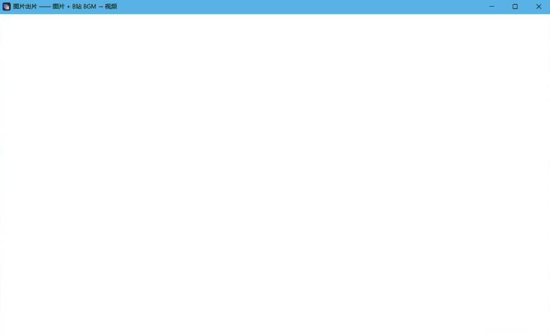
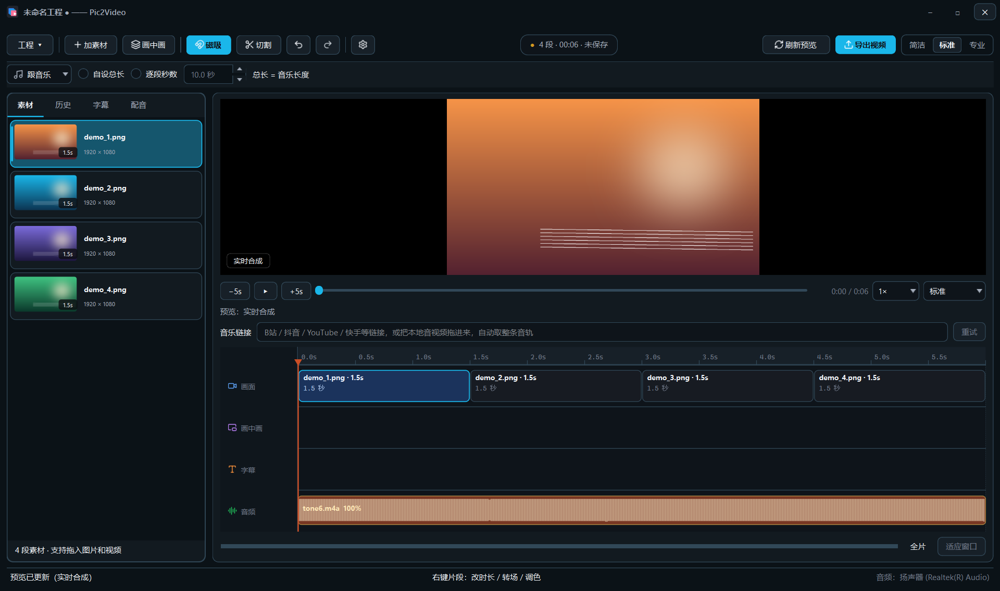
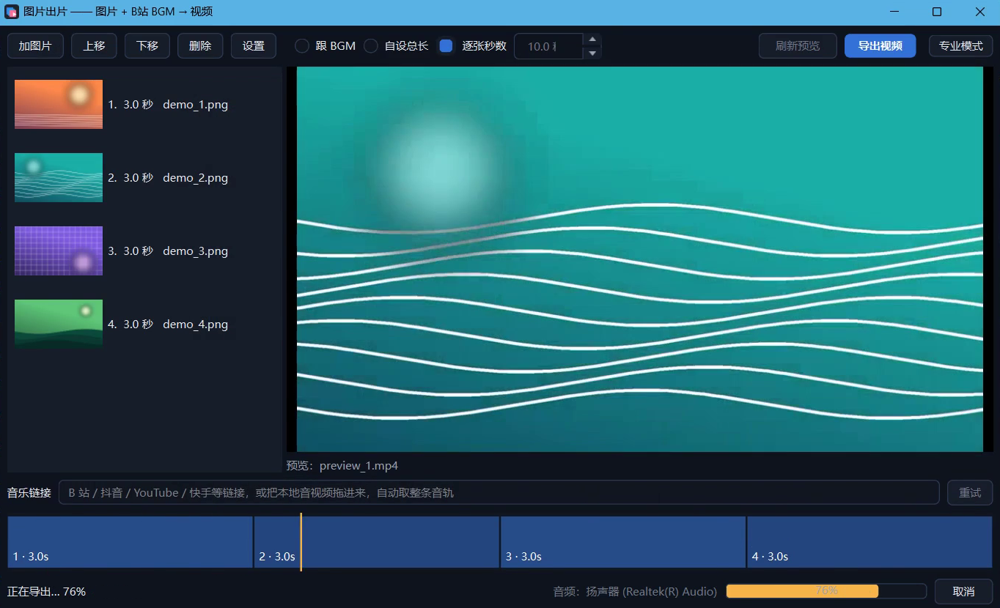
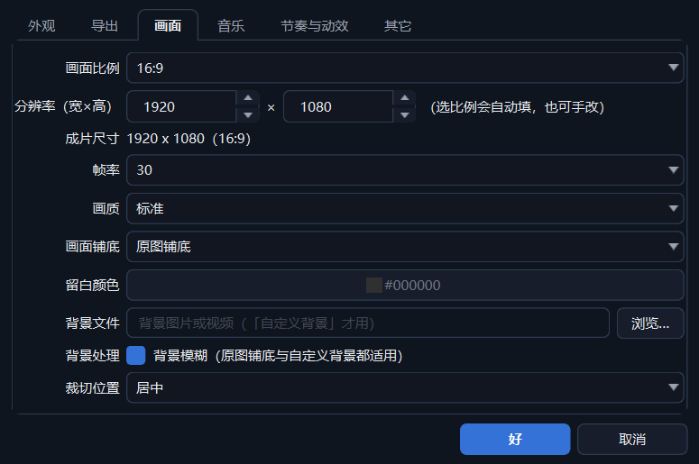
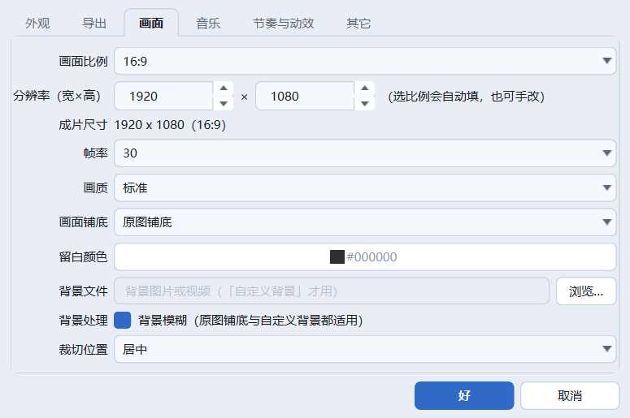
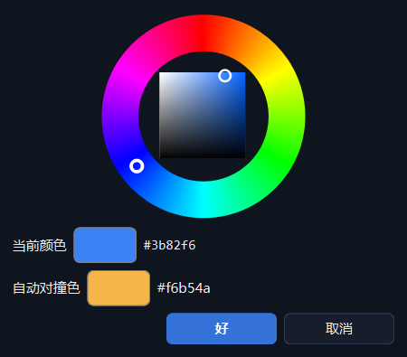

# Xishensoft's Pic2Video

给几张图片、粘一个视频链接，一键出一条带背景音乐的成片。做视频时最省事的那一步：**图片 + B 站 / 抖音 / YouTube 的音乐 → mp4**。



- **图片随便几张**：拖进来排序，每张单独调秒数，底部时间线点哪跳哪、拖右边界直接改时长。
- **音乐直接从视频链接取整条音轨**：B 站（含 b23.tv 短链 / 裸 BV、av 号）、抖音、YouTube、快手、小红书、微博；也可以把本地音频/视频直接拖进窗口。
- **窗口里就能预览**：540p 预览片在窗口里播，改完参数自动重渲。
- **规格可调**：9 档画面比例 + 宽高手填、30/60fps、画质三档、五种画面铺底（原图铺底 / 纯色留白 / 自定义背景图 / 背景视频 / 裁切铺满）、淡入淡出与转场、导出目录。
- **上手就能用**：图片、文件夹、音视频文件都能直接拖进窗口；导出完自动打开所在文件夹；照片的 EXIF 方向会自动摆正。
- **能动起来**：可选的缓慢推近 / 拉远 / 交替推拉（Ken Burns），让静态图变成有呼吸感的镜头。
- **顺手的小东西**：简体中文 / 繁體中文 / English / 日本語 / 한국어 五种界面；深色/浅色主题；只挑一个主色，自动配对撞色；简洁模式（只留「加图片 / 导出视频」）与专业模式。
- **不会白等**：导出有百分比和剩余时间，随时能点「取消」；关窗前会提醒还在导出；窗口大小和位置下次打开还在原位。

## 快速开始

1. 装依赖（只装一次）：

   ```
   python -m pip install PyQt6
   ```

   `ffmpeg`、`ffprobe` 不用自己装：第一次运行时工具会问一句，点了就自动下到 `tools/`（约 120 MB，实测 9.0.2）。
   系统 PATH 里本来就有 ffmpeg 的话直接用那份，不会再下。

2. 双击 `启动.bat`（它就是 `python pic2video.py`）。
3. 把图片拖进窗口，或点「加图片」。
4. 把链接粘进「音乐链接」框，等状态栏显示「BGM 已就绪：时长 x:xx」。
5. 看预览，点「导出视频」，选个目录。

也可以把一整个文件夹拖进窗口（里面的图片、音视频会一起加进来），或者直接把图片、音乐文件拖进来。

键盘也能使：Ctrl+O 加图片、Ctrl+S 导出、F5 刷新预览、空格播放/暂停、Delete 删掉选中的图。

## 各平台的音乐

| 来源 | 需要什么 | 说明 |
| --- | --- | --- |
| B 站 | 无 | 不需要登录、不读 Cookie；DASH 音轨里按码率取最高那档 |
| 抖音 / YouTube / 快手 / 小红书 / 微博 | `yt-dlp` | **按需下载**：设置 →「其它」里点「下载」装进工具目录的 `tools/`（约 25 MB），不用了点「删除」清掉；第一次粘这类链接时也会问一次 |
| 本地文件 | 无 | 音频直接当 BGM；视频自动抽音轨 |

取的是**整条音轨**，不做人声分离。

## 命令行（批量/脚本用）

```
python pic2video.py --export 输出.mp4 --audio 本地音频.m4a 图1.jpg 图2.png 图3.webp
python pic2video.py --export 输出.mp4 --audio "https://www.douyin.com/video/..." 图1.jpg 图2.png
python pic2video.py --export 输出.mp4 --bili BV13qs46FE9C --total 4 图1.jpg 图2.png
python pic2video.py --export 竖屏.mp4 --bili BV... --ratio 9:16 --fps 60 --fit cover --transition fade 图1.jpg 图2.png
```

`--total` 是每张图的秒数；`--fps` / `--ratio` / `--width` / `--height` / `--fit` / `--bg` /
`--pad-color` / `--no-bg-blur` / `--transition` / `--motion` / `--crop-focus` / `--volume` 同设置页；命令行不写 `settings.json`。

## 界面



导出时状态栏给百分比和剩余时间，随时能取消：



窗口边框是软件自己画的，跟深色/浅色主题、主色一起变，不用系统那套灰边：拖动标题栏移动窗口，拖窗口四边/四角改大小，双击标题栏最大化。设置、选色、提示、问秒数、选文件这些窗口也都是同一套边框（文件框是 Qt 自绘的那版，所以没有系统的「快速访问 / 最近位置」侧栏）。

## 设置



设置页按 **外观 / 导出 / 画面 / 音乐 / 节奏与动效 / 其它** 分块：专业模式每组一页（顶上切页，不用再滚一屏），
简洁模式仍是一列、组间用细线分开，只留其中的必要项，空掉的组连标题一起收起来。

| 项 | 说明 |
| --- | --- |
| 界面语言 / 界面主题 | 五种语言；跟随系统 / 浅色 / 深色 |
| 主色 | 12 家视频站的品牌色预设（哔哩哔哩 / YouTube / 抖音 / 快手 / 小红书 / 微博 / 腾讯视频 / 爱奇艺 / 优酷 / Netflix / Twitch / Vimeo），也可以点右边开色环自己调；对撞色自动按 180° 算 |
| 默认导出目录 | 留空＝每张图所在目录 |
| 导出时先问保存到哪 | 默认开（弹保存框）；关掉就直接存上面那个默认目录，不再弹框 |
| 画面比例 / 分辨率 / 帧率 / 画质 | 9 档比例只当预设，宽高都能手填；30/60fps；高 / 标准 / 小体积 |
| 画面铺底 / 留白颜色 / 背景文件 / 背景处理 | 五种铺底；纯色可自选；背景图/视频可模糊或不模糊 |
| 默认节奏 / 逐张默认秒数 | 跟 BGM、自设总长、逐张秒数 |
| 音乐起点 / 音乐长度 | 从第几秒开始用、用多长；「整首」/ 0＝一直用到结尾 |
| 音乐淡入淡出 / 图片转场 | 秒数可调；转场支持硬切与淡入淡出 |
| 画面动效 | 静止 / 缓慢推近 / 缓慢拉远 / 交替推拉（Ken Burns，默认静止） |
| 裁切位置 | 裁切铺满时留住居中 / 偏上 / 偏下（人像照片常常要偏上） |
| 音乐音量 | 0–200%，默认 100% |
| 导出完自动打开所在文件夹 | 默认开；关掉就只弹完成提示 |
| ffmpeg | 出片引擎（约 120 MB）。没装过 ffmpeg 时第一次打开会问「现在下载吗」，下完直接用；也能在这删掉、以后重新下 |
| yt-dlp | 抖音 / YouTube 等平台的解析器（约 25 MB）。显示装没装、一键下载或删除 |

音乐页与「其它」（组件管理）长这样：

| 音乐 | 其它（ffmpeg / yt-dlp） |
| --- | --- |
|  |  |

浅色主题，以及点主色右边开的色环（对撞色自动算）：

| 浅色 | 色环取色 |
| --- | --- |
|  |  |

预览音频始终跟随 **Windows 默认输出设备**，插拔耳机自动切，不用重启。

导出完会自动打开所在文件夹（设置里可以关）。导出时状态栏会显示进度和「剩余约 x:xx」，旁边多一个「取消」；窗口大小、位置、语言、主题、
上次导出目录都记在 settings.json 里，下次打开照旧。

## 项目结构

```
pic2video.py     主程序（窗口 + 命令行）
bili_audio.py    B 站取音轨（WBI 签名 + playurl）
audio_source.py  音源判定与 yt-dlp 封装
components.py    ffmpeg / yt-dlp 的按需下载与删除
theme.py         主题、主色/对撞色、QSS
i18n.py          五种语言的词条
启动.bat          双击开窗口
tests/           单元检查（216 条）
docs/            研究笔记、设计记录（wayfinder 票）与原始探针脚本
screenshots/     README 里的截图
```

## 开发

```
python tests/test_project.py     # 时间线 / 帧数 / 设置 / filtergraph / 主题 / 音源 / 坏图预检
python tests/scan_keys.py        # 检查 tr() 的中文都有四种译文
```

## 打包成免安装 exe

双击 `build.bat`（需要 python；PyInstaller 没装的话脚本会先帮你装）。跑完在 `dist\Pic2Video\` 下：

```
Pic2Video.exe    双击就能用
_internal\       运行时文件，和 exe 放在一起
```

整个 `dist\Pic2Video\` 文件夹拷给别人就能跑，不用安装（约 115 MB）。

发布包里**不带** ffmpeg 和 yt-dlp：第一次打开时如果系统里没有 ffmpeg，会问一句然后自己下到
`tools\`（约 120 MB，只下一次）；哪天想省地方，在 设置 → 其它 里能删掉，下次需要还会自己下。

## 已知限制

- B 站付费/会员试看视频只能拿到试看片段；地区/版权限制的会直接失败并给原因。
- 抖音 / YouTube 等平台如果要求登录（年龄限制、会员内容），yt-dlp 会失败并显示原因。
- 出片时间约为片长的 1/5；很长的音乐建议用「逐张秒数」控总长，或者导出时看着剩余时间等着。
- 图片被移动/删掉后会在导出前报出是哪一张，重新加一次即可。
- 预览是 540p 的样片，画质不代表成片。
- 目前只在 Windows 上验证过。
- 选文件用的是自绘文件框（为了边框统一），没有系统文件框的「快速访问 / 最近使用」侧栏；路径可以手输。

## 常见问题

### 粘了链接，取不到音轨

**现象**：状态栏那行字停住不动，或者变成一句报错；下面 BGM 那栏一直没有时长。

**原因**（按常见程度）：

1. **内容本身拿不到**：B 站付费/充电/大会员内容只有试看片段；YouTube 有年龄限制、抖音是私密视频；地区或版权限制。这些都要登录态，本工具不读 Cookie。
2. **链接没被认出来**：短链失效（b23.tv 打开是「啥都木有」那种 JSON）、复制成了合集页而不是视频页。
3. **缺解析器**：抖音 / YouTube / 快手这类站在 yt-dlp 没装时会直接提示「先下载音源组件」。
4. **网络到不了**：B 站接口被风控（-352/-412）或本机连不上该站。
5. **「一直不动」未必是卡死**：yt-dlp 的超时是 15 分钟、B 站请求失败会自己重试 3 次，网络被限流时就表现成很久没动静。

**两步**：

1. 先读状态栏或弹窗正文——B 站的错误码都翻成了中文（对照表见下），能直接对上号。
2. 对上号再动手：缺组件 → 设置 → 其它 → yt-dlp 点「下载」；风控 → 等几分钟再点「重试」，别连着点。只剩一句笼统的「取音轨失败（详情见设置里重试一次）」时（抖音/YouTube 等站常见），别在链接上耗：把那段视频本身下载下来，直接拖进「音乐链接」框——走的是本地抽音轨，不过网络也不经 yt-dlp。

### 导出的片子发黑 / 比原图暗

**现象**：整片发灰不够亮、四周一圈比中间暗，或者每张图开头结尾一黑。

**四种情况，四种原因**（看是哪一种，别混在一起）：

1. **整片发灰、白色不白**：成片是 limited range（16–235），v1.0.0 那个包没在文件里写清颜色范围（`ffprobe` 读回来是 `color_range=unknown`），播放器只能猜；猜成 full 就会把 235 当 255 显示，白变成 92%、黑被抬到 16，观感就是发灰。
   **v1.0.1 已经修了**：源码在 filtergraph 结尾加了 `setparams=range=tv:colorspace=bt709:color_primaries=bt709:color_trc=bt709`，导出包里 `ffprobe` 会如实报 `color_range=tv / color_space=bt709 / color_transfer=bt709 / color_primaries=bt709`（有单测盯着）。用 v1.0.0 觉得发灰的，换成 v1.0.1 重新导出一次就正常——旧版的下载包已经撤下了。
2. **四周比中间暗**：铺底用的是「原图铺底」+ 背景模糊，四周那张虚化底被故意压暗了 8%（`gblur=sigma=40,eq=brightness=-0.08`）。实测纯橙 #FF8000：主体中心 RGB(253,126,0) 不变，左边缘变 (228,100,0)。**这是设计，不是 bug**。
3. **图片带透明通道**（PNG 水印、去背景图最常见）：透明部分在成片里是纯黑——实测全透明底的 PNG，出片后透明处 RGB 是 (0,0,0)。
4. **转场用的是「淡入淡出」**：每张图进、出都淡到黑（默认 0.3 秒），片头片尾最像「黑了几帧」。

**两步**：

1. 先分清是哪种：整片暗 → 换播放器再确认一次；只有四周暗 → 设置 → 画面 → 画面铺底改「裁切铺满」或「纯色留白」（挑个亮色）；带透明的图 → 另存为 JPG，或先在画图/PPT 里铺个白底再导入。
2. 不想要黑场过渡：设置 → 节奏与动效 → 图片转场改「硬切」，或把转场时长压到 0.1 秒。

### 预览区一直是黑的

**现象**：中间那块黑的，状态栏没反应，或者弹「预览失败」。

**原因**：

1. **那块地方本来就是黑底**：视频控件被刷成纯黑，没画面和有画面但出错时长得一模一样——只能靠状态栏区分。
2. **还在渲染**：预览不是即时的，要先渲一条 540p 样片（几秒钟），渲完才有画面；改完参数那一刻本来就是黑的。
3. **播放器打不开文件**：文件不在了、或没渲完整时，Qt 会报 `ResourceError` / `FormatError`，文案都是 `Could not open file`，工具把它拼成状态栏那句「预览播放出错：…」。看到这行 = 播放器没拿到文件，不是解码问题。
4. **临时目录写不进去**：预览文件写在 `%TEMP%\pic2video_*` 里，清理软件或权限问题会让它生成不出来。
5. **远程桌面 / 虚拟机**：视频渲染层拿不到硬件表面，窗口里就是黑的（成片本身没问题）。

**两步**：

1. 等状态栏出现「预览已更新」；一直不动就点右上「刷新预览」，失败会告诉你原因。
2. 还是黑：确认 `%TEMP%` 有空间、图片文件还在原地；远程桌面里就换到本机打开试试——判定成片是否正常，直接播导出的 mp4 就知道。

### ffmpeg 下载失败

**现象**：第一次打开问「现在就自动下载吗」，点下去进度条停住，或弹「下载失败」。

**原因**：下的是 gyan.dev 的 Windows 构建包（ffmpeg 官网 Windows 一栏列的就是它），压缩包 119 MB、解开占约 210 MB。下载是一次性的整包请求、超时 60 秒，**断了不续传、不会自动重试**，所以网络抖一下就会整体失败；公司代理/防火墙会拦，杀毒软件有时也会把刚下好的 `ffmpeg.exe` 当可疑文件处理掉。

**两步**：

1. 再点一次「下载」（临时网络抖动最常见）；挂着代理的话先确认代理对 gyan.dev 也生效。
2. 还是不行就手动装：`winget install Gyan.FFmpeg`，装完重开工具，它会直接用系统里那份；或者自己下 zip，把 `ffmpeg.exe`、`ffprobe.exe` 放进程序目录的 `tools\` 里。

装好以后在 设置 → 其它 里能随时删掉，下次需要会自己再下。

更细的排查（每条结论都标了对应的代码位置和实测数字）：[docs/research/faq-常见故障.md](docs/research/faq-常见故障.md)。

### 报错原文对照（B 站）

| 状态栏原文 | 真正的原因 | 怎么办 |
| --- | --- | --- |
| 视频不存在或已被删除 | 稿件被删或不可见 | 换个视频 |
| 稿件不可见（已删除/仅自己可见/审核中） | 同上，作者设为私密或在审核 | 等审核或换视频 |
| 该内容有地区限制，当前网络无法观看 | 地区限制（-688） | 需要对应地区的网络 |
| 该内容有版权限制，无法观看 | 版权限制（-689） | 换视频 |
| 充电专属视频，需要给 UP 主充电后才能观看 | 充电专属（87007） | 本工具不带账号，换视频 |
| 付费视频，需要购买后才能观看 | 付费内容（87008） | 同上 |
| 这是会员/付费内容的试看片段，完整音轨需要大会员账号 | 只能拿到试看（is_preview=1） | 换视频，或自己准备音频文件拖进来 |
| 请求被 B 站风控拦截，请稍后重试或降低频率 | 风控（-352） | 等几十秒点「重试」 |
| 链接可能不是有效的视频地址 | 链接格式不对（-400） | 复制视频页地址，别复制合集 |
| 网络连不上该站点（可能要代理） | 这条是 yt-dlp 的，抖音/YouTube 等站 | 检查网络或代理 |
| 该站点要求登录，暂时取不到音轨 | yt-dlp 撞到登录墙 | 本工具不读 Cookie，换公开视频 |

## 许可

[MIT](LICENSE) © 2026 Xishensoft

用到的第三方组件各有自己的许可：ffmpeg（GPL 构建，第一次运行时按需下载，不随仓库分发）、
PyQt6（GPL-3.0 / 商业双授权）、yt-dlp（Unlicense）、本项目自己的代码是 MIT；如果你要把本项目再分发，注意 ffmpeg 与 PyQt6 的许可是要一并遵守的。
