# Xishensoft's Pic2Video

[简体中文](README.md) · 繁體中文 · [English](README.en.md) · [日本語](README.ja.md) · [한국어](README.ko.md)

給幾張圖片或影片、貼上一個影片連結，一鍵產出一支帶背景音樂的成品。做影片時最省事的那一步：**圖片 / 影片 + B站 / 抖音 / YouTube 的音樂 → mp4**。

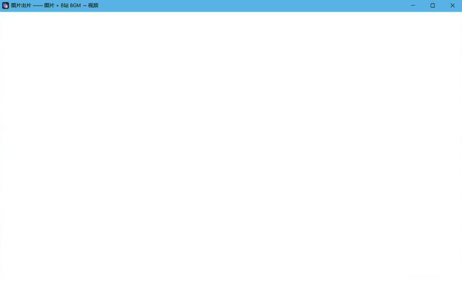

- **圖片、影片隨便幾段**：拖進來排序，每段單獨調秒數；影片依原長成為一段，能裁頭尾、切段、套轉場，底部時間線點哪跳哪、拖右邊界直接改長度。
- **音樂直接從影片連結取整條音軌**：B站（含 b23.tv 短連結 / 裸 BV、av 號）、抖音、YouTube、快手、小紅書、微博；也可以把本機音訊/影片直接拖進視窗。
- **在視窗裡就能預覽**：預覽是即時合成的——改參數、拖進度條、換轉場，畫面下一個影格就變，不用等整片重新算圖。
- **預覽像播放器**：預覽畫面底下有進度條、播放/暫停、±5 秒、0.5–2× 倍速、四檔清晰度（流暢 / 標準 / 清晰 / 原尺寸）；倍速和清晰度只影響預覽，成品照舊依設定匯出。
- **加素材不只加圖片**：圖片和影片都能拖進清單或點「加素材」；影片段在時間線上能拖邊界裁、按 I/O 設入出點、Ctrl+K 切開，調色和轉場照樣能套。
- **規格可調**：9 檔畫面比例 + 寬高手動填寫、30/60fps、畫質三檔、五種畫面鋪底（原圖鋪底 / 純色留白 / 自訂背景圖 / 背景影片 / 裁切填滿）、淡入淡出與 12 個內建轉場、匯出資料夾。
- **上手就能用**：圖片、資料夾、影音檔案都能直接拖進視窗；匯出完自動開啟所在資料夾；照片的 EXIF 方向會自動擺正。
- **能動起來**：可選的緩慢推近 / 拉遠 / 交替推拉（Ken Burns），讓靜態圖變成有呼吸感的鏡頭。
- **順手的小東西**：简体中文 / 繁體中文 / English / 日本語 / 한국어 五種介面；深色/淺色主題；只挑一個主色，自動配對對撞色；三種介面模式（簡潔模式只做三步出片 / 標準日常剪輯 / 專業模式全部參數）。
- **專案能存下來**：一鍵存成 .p2v 專案（圖片、長度、片頭片尾、音訊塊、字幕全在裡面），下次開啟接著改；每 15 秒自動存一次，當掉下次開啟問你要不要恢復；「專案」選單裡有最近開啟。
- **字幕**：匯入 .srt / .ass，直接燒進成品（字型、字級在設定裡挑）；不上傳、不連網，也不做應用程式內編輯。
- **文稿能直接變配音**：「配音」頁貼上文稿 → 選音色 → 一鍵合成旁白和句級字幕；預設用免費的 Edge（不用金鑰，帶時間戳記），也能填自己的 Gemini / Azure / OpenAI 相容端點 金鑰。合成完總長自動改成「跟旁白」，畫面跟著聲音走。
- **依平台出片**：匯出時選 B站 / 抖音 / 視頻號 / YouTube / 通用，解析度和影格率自動配好；順帶能依成品時間線截一張同名封面圖。
- **能疊一層畫面**：圖片或影片疊在成品上（畫中畫）：九宮格擺位、縮放、不透明度、進出時間都能調，時間線上直接拖。
- **能調色**：每段素材單獨調亮度 / 對比度 / 飽和度，還能套一個濾鏡（.cube 的 LUT，機內調色、底片感都靠它），按右鍵就能進。
- **音訊看得見、捏得動**：時間線上畫出真實波形，每段音訊能設增益（分貝）、能在波形上點出一條音量包絡（Alt + 點擊加點、拖點改值、右鍵刪點）。
- **資源包**：字型、LUT、轉場預設都能打包成 zip 裝進來，裝好就出現在對應的下拉/選單裡；包裡有清單和校驗，來源不對的直接拒收。
- **不會白等**：匯出有百分比和剩餘時間，隨時能點「取消」；關窗前會提醒還在匯出；第一次開啟就最大化，之後可以在設定裡改成記住上次或固定大小。

## 快速開始

1. 安裝相依套件（只裝一次）：

   ```
   python -m pip install PyQt6
   ```

   `ffmpeg`、`ffprobe` 不用自己裝：第一次執行時工具會問一句，點了就自動下載到 `tools/`（約 120 MB，實測 9.0.2）。
   系統 PATH 裡本來就有 ffmpeg 的話直接用那份，不會再下載。

2. 雙擊 `启动.bat`（它就是 `python pic2video.py`）。
3. 把圖片或影片拖進視窗，或點「加素材」。
4. 把連結貼進「音樂連結」框，等狀態列顯示「背景音樂已就緒：長度 x:xx · 檔案在：…」——從連結取回的音樂會存在工具資料目錄的 `media/` 裡，關掉程式也不會遺失。
5. 看預覽，點「匯出影片」，選個平台預設（或就讓參數跟著設定走），再選個資料夾。

也可以把一整個資料夾拖進視窗（裡面的圖片、影音會一起加進來），或者直接把圖片、音樂檔案拖進來。素材拖到清單的某一項上還分三段：落在**左三分之一**插到它前面、落在**中間**把它換掉、落在**右三分之一**插到它後面（拖曳時清單會畫出插入線或高亮框）。

鍵盤也能使：Ctrl+I 加素材、Ctrl+M 匯出、F5 重新整理預覽、空白鍵播放/暫停、Delete 刪掉選取的圖；專案相關的 Ctrl+N 新增、Ctrl+O 開啟、Ctrl+S 儲存、Ctrl+Shift+S 另存新檔——這些鍵在 設定 → 快捷鍵 裡都能改。

素材不只有圖片：**影片也能加**。影片檔案拖進清單（或點「加素材」）就依原長成為一段，在時間線上跟圖片段一樣能拖邊界裁、按 I/O 設入出點、Ctrl+K 切成兩段、挑轉場、調色；拖一整個資料夾時裡面的圖片和影片會依檔名順序一起加。只有音訊檔案拖進視窗才走「音樂 / 額外音訊」那條路——影片只想取音軌，就把它拖進「音樂連結」框。

## 專案檔（.p2v）

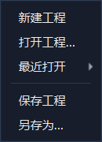

「專案」按鈕（或 Ctrl+S）能存成 .p2v 專案：一個普通 JSON，寫著版本號、影格率、節奏模式、每張圖的順序與長度、片頭片尾的入出點、音訊塊的起點與音量、字幕內容。影片和音訊本身不進專案，只記路徑——所以專案和素材可以分開拷貝。

- **儲存 / 另存新檔**：Ctrl+S 存回原處；沒存過的第一次會問路徑。儲存是原子寫入（先寫 .tmp 再換名），寫到一半斷電不會把舊專案毀掉。
- **自動儲存**：每 15 秒把改動存一份到工具目錄，正常儲存或關窗就清掉。上次沒正常結束時，開啟會自動問要不要恢復那份。
- **最近開啟**：選單裡最多留 8 個，被刪掉的自動從清單裡消失。
- **素材不見了**：開啟時如果有圖或音訊被移走，會列出來並問要不要「重新定位…」；選一個新的位置，專案裡所有指向這一類的項目一起換過去。
- **版本**：專案裡帶 version。比軟體新的版本會直接拒絕開啟，而不是猜著讀——免得把新專案讀壞。

## 字幕

左下角「字幕」頁：點「匯入字幕…」選 .srt 或 .ass，立刻列出每一條的時間與文字，預覽和匯出都會把它燒進畫面。

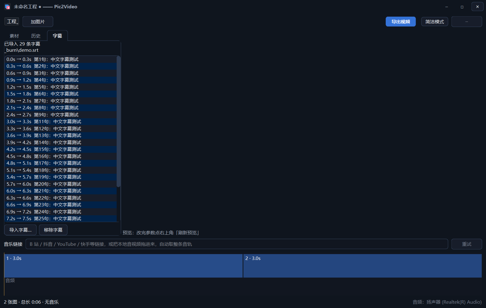

- 只做**匯入 + 燒錄**：解析在匯入時做一次，字幕內容存進專案（.p2v 裡），不依賴原檔案還在不在；不做應用程式內加字、改時間線。
- 字型、字級在 設定 → 畫面 → 字幕字型 / 字幕字級 裡挑。字級是「1080p 下的像素」，預覽 540p 會按比例減半，所以預覽和成品的觀感一致。
- 預設字型是 Microsoft YaHei。有些字型（尤其是部分 .ttc）只能拿到第一套字形，或者根本不含中文——成品裡字幕變方塊時換個字型試試。
- 大括號會原樣顯示（a{b}c 就寫成 a{b}c，不用自己轉義）；.srt 裡一條字幕內的換行在 .ass 裡變成強制換行。end 不晚於 start 的壞項目會被丟掉，不會讓整份字幕打不開。

## 配音（文稿 → TTS → 字幕）

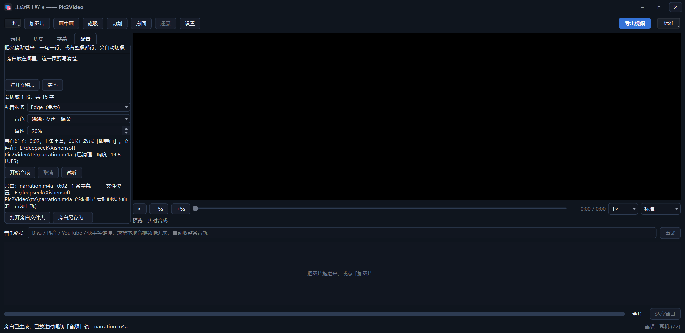

「配音」頁（標準 / 專業模式才出現）把「有稿子」變成「有片子」：貼上文稿 → 選音色 → 點「開始合成」，出來一條旁白和一份句級字幕，畫面總長自動跟著旁白走。

- **文稿**：直接貼進左上角的框，或「開啟文稿…」讀一個 .txt / .md（UTF-8，也認 GBK）。一句一行、或者一整段都行，依標點自動切句子，再依每段約 1000 字切段；框下面即時顯示「會切成 N 段，共 M 字」。
- **音色**：預設 Edge（免費、不用金鑰），中文音色 14 個（國語 / 東北話 / 陝西話 / 台灣 / 粵語，男女都有）；語速 -50%～+100%。想先聽聽合不合適，點「試聽」只合成第一段。
- **合成**：背景逐段執行，進度條顯示「已完成 / 總段數」，隨時能點「取消」，單段失敗可以重跑。每段結果依「文字 + 服務商 + 音色 + 語速」快取到工具目錄（`tts/`），中途中斷再點一次會跳過已經合成好的段。
- **接上之後**：旁白進時間線的音訊軌（帶波形），句級字幕進「字幕」頁；節奏自動切到「跟旁白」，素材依旁白長度鋪滿，總長就是旁白長度。字幕想拿去別處用，點「字幕」頁的「另存 .srt…」。
- **旁白檔案在哪**：配音頁最下面直接寫出完整路徑（工具目錄下的 `tts/narration_<內容指紋>.m4a`，不同文稿各存各的，不會互相覆蓋），旁邊的「開啟旁白資料夾」會在檔案總管裡定位到它；想把它放到自己指定的地方，點「旁白另存新檔…」，存完專案就改用你選的那份。
- **合成完順手清一下**（預設開，設定 → 配音可關）：剪掉段首段尾多餘靜音、削掉開頭的高頻咔噠和低頻噗聲，再依 EBU R128 把整條旁白拉到 **響度 -14**（LUFS 是響度單位，約等於平台標準的「正常音量」），最後限幅兜底。剪掉的那點靜音會讓字幕跟著一起往前挪，不會錯位。狀態列會寫「（已清理，響度 -14.0）」。
- **字幕折行**：一行最多 18 個字、最多兩行，超長的句子自動拆成兩條，不會一行鋪滿整個螢幕。
- **Gemini**：在設定 → 配音裡填自己的 Gemini 金鑰 就能用（音色 Kore / Puck / Aoede / Charon / Fenrir / Leda，也能多說話人）。Gemini 不給時間戳記，這裡會拿同一段文字悄悄跑一遍免費的 Edge 當節奏範本，再把字幕依實際長度縮放；Edge 也連不上時才退回依字數均攤。它沒有語速參數，語速框會自動變灰——想快就改文稿。
- **Azure 語音**：設定 → 配音裡填 金鑰 和區域（如 `eastasia`），走 REST + SSML，音色與 Edge 同源（曉曉 / 雲希 / 雲揚 / 曉伊），免費層每月 50 萬字。REST 不回傳時間戳記，字幕同樣用 Edge 當節奏範本。撞上 429 會退避重試，最終提示「額度用完了」。
- **OpenAI 相容端點**：填 金鑰 和 base_url（硅基流動、火山、MiniMax 的相容層都行），可再填模型名稱（留空 = `tts-1`）；語速會換算成 `speed`（0.25～4.0）。沒有時間戳記的端點同樣走 Edge 對齊範本；失敗會分清是 金鑰 不對、額度用完還是網路問題。金鑰以明文存在本機設定檔裡，不會上傳。
- **不預設你的片長**：多長的稿子都行，用你自己 金鑰 的額度就是你的額度；免費 Edge 沒有每日次數限制，只有語速和並行上的軟限制。

### 多人對話（任意角色名）

一問一答、多人聊天都不用手動拼接：每行用「名字：」開頭，後面換行接著寫的都算這個角色這一輪。名字 1～12 個字，不帶標點；`小明：`、`媽媽：`、`旁白：`、`老師：` 都可以。

```
小明：你好，我是小明。
媽媽：我是媽媽，今天的晚飯好了。
旁白：這是一個多人對話的測試。
老師：同學們好，我們開始上課。
```

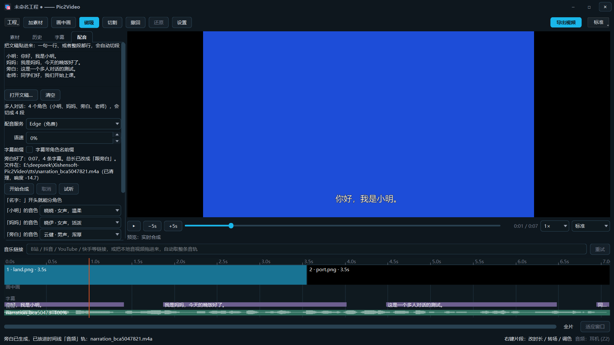

- 配音頁會依出場順序掃出所有角色，每個角色一行，單獨挑音色；角色多到超過一螢幕時，這一頁可以上下捲動。
- 舊寫法繼續相容：`角色 A：` / `角色 B：`、`A:` / `B:`、`主講：` / `聽友：` 都會歸到對應的兩個角色上。
- 輪與輪之間留 0.35 秒（一般段間是設定裡的 0.6 秒），聽起來像真的在接話。
- 勾選「字幕帶角色名前綴」，字幕會寫成「小明：你好，我是小明。」；不勾只有台詞。
- 每一輪單獨送一次請求，所以 Gemini 這種依次計額度的服務，角色和輪次越多，用掉的次數越多。
- 稿子裡沒有角色標記時，一切跟以前一樣，不會多出角色表。
## 轉場

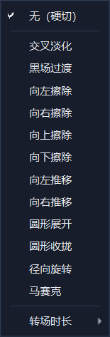

在畫面元素上按右鍵 →「轉場」，選一個名字就行；「無（硬切）」是直接切過去。12 個名字都來自 ffmpeg 內建的 `xfade`，不吃外部檔案：

| 名稱 | 觀感 |
| --- | --- |
| 交叉淡化 / 黑場過渡 | 疊化；黑場過渡中間會暗一下 |
| 向左 / 向右 / 向上 / 向下擦除 | 一邊擦掉一邊露出下一張 |
| 向左 / 向右推移 | 下一張把上一張推走 |
| 圓形展開 / 圓形收攏 | 圓形從小變大的展開、從大變小收攏 |
| 徑向旋轉 / 馬賽克 | 轉著換；先碎成馬賽克再還原 |

- **時長**：同一層選單裡「轉場時長」可選 0.2 / 0.3 / 0.5 / 0.8 / 1.0 秒，「跟隨設定」就用 設定 → 節奏與動效 → 片段轉場 那個秒數。
- **誰說了算**：兩個相鄰元素只要有一個開了轉場，這條邊界就轉；兩個都開了、名字不一樣時聽前一個的。
- **總長不變**：轉場是兩段「各往對方那邊多伸一半、再重疊播放」湊出來的——2 秒 + 2 秒、轉場 0.8 秒，成品還是 4.0 秒，只是轉場佔了 1.6–2.4 秒這一段，兩段各自實打實的靜止時間各少 0.4 秒。影片段會從來源多取 0.4 秒補上，所以內容不缺。預覽和匯出走同一條濾鏡，觀感一致。
- **塞不下會攔**：相鄰兩段都得比「轉場時長的兩倍」還長。挑轉場時當場提示，匯出前也會再攔一次（不會匯出半截壞片）。
- 專案檔裡存著每段的轉場名稱與時長；舊專案沒有這兩項，開啟就是硬切。
- 裝了轉場資源包之後，選單裡會多出「名稱（資源包）」的預設——它仍然只是「內建轉場名稱 + 預設時長」，不是新演算法，見下面的資源包一節。

## 畫中畫

點頂部「畫中畫」選一張圖或一段影片，它就會壓在成品上面播放——位置、大小、透明度、什麼時候出現和消失都能調。

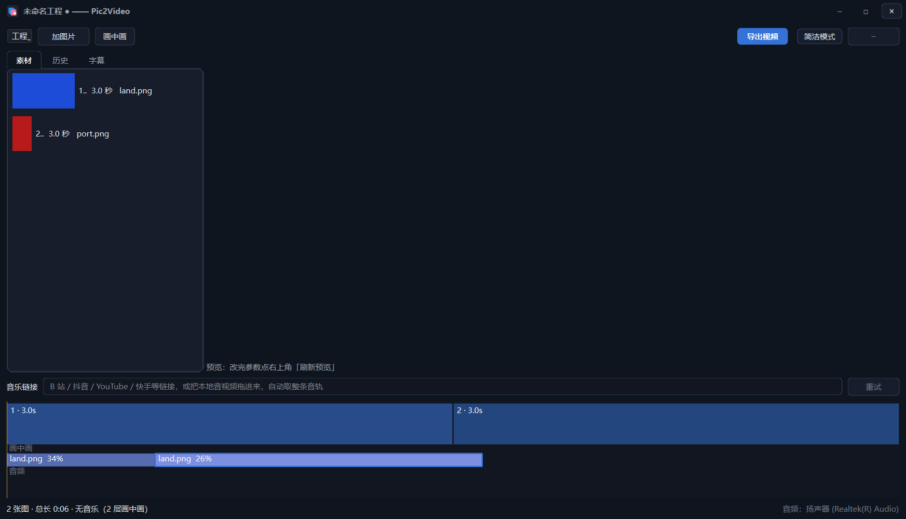

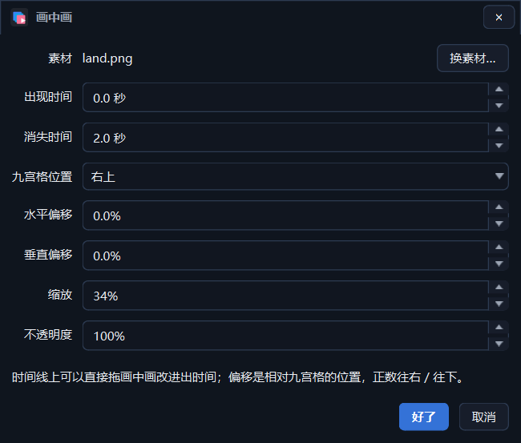

- **擺位**：九宮格選個大致位置（右上角當角標、正中當遮罩都行），再用水平/垂直偏移微調（依畫面寬高的百分比，正數往右 / 往下）；「縮放」是相對於成品寬度，40% 差不多是右上角一塊。
- **出現 / 消失**：填秒數，或直接在時間線中間那條「畫中畫」軌上拖著改起點。同一軌道上可以放好幾層，依加進來的順序一層層壓上去，後面的蓋住前面的。
- **透明度**：0–100%，淡入淡出可以靠它自己分段疊，也可以只當個半透明浮水印。
- **總長不變**：疊加層是壓在成品上的第二趟，不改主軌道的時間；主軌到多長，成品就多長，超出片尾的部分不會被畫出來。
- 對「畫中畫」軌上的塊按右鍵可以再編輯或刪掉；專案檔裡一起存著每層的素材路徑、時間、位置、縮放和透明度。

## 調色

對任意畫面元素（圖片、影片、片頭片尾都行）按右鍵 →「調色…」：三個滑桿加一個濾鏡（LUT），改完立刻進預覽。

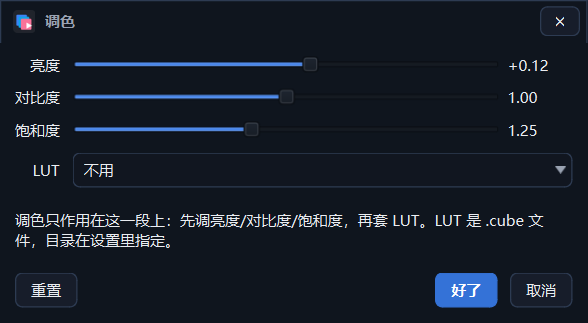

- **亮度 / 對比度 / 飽和度**：亮度 -1.0～1.0（0 是不動），對比度和飽和度是倍數（1.00 是不動）。三樣都是 ffmpeg 的 eq 濾鏡，全片一起動時會連背景鋪底一起調。
- **濾鏡（LUT）**：設定 → 畫面 → 濾鏡目錄 指向放著 .cube 檔案的資料夾；調色框裡的下拉就列出這個目錄下的 .cube。選「不用」就是只調那三個滑桿。
- **只作用在這一段上**：同一張圖想兩種調法，就切成兩段分別調。
- **濾鏡檔案也是素材**：檔案挪走了會跟缺圖一樣在匯出前報出來，存成專案再開啟時能重新定位。調色參數和 LUT 路徑都寫進專案檔（.p2v）。

## 匯出預設與封面

點「匯出影片」後先出這個框：選平台、看實際參數、決定要不要順帶截封面。

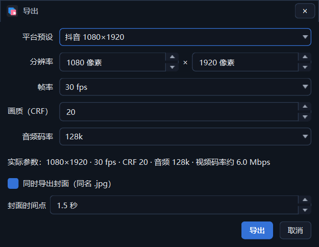

| 預設 | 解析度 | 影格率 | 畫質 | 音訊 | 檔名後綴 |
| --- | --- | --- | --- | --- | --- |
| 通用（沿用設定） | 設定裡的寬高 | 設定裡的影格率 | 設定裡的畫質 | 192k | 無 |
| B站 1080p60 | 1920×1080 | 60 | 18 | 192k | _bilibili |
| 抖音 1080×1920 | 1080×1920 | 30 | 20 | 128k | _douyin |
| 視頻號 1080p30 | 1920×1080 | 30 | 20 | 128k | _channels |
| YouTube 1080p30 | 1920×1080 | 30 | 20 | 192k | _youtube |

- **手改任一項就變「自訂」**：解析度、影格率、畫質、音訊位元率都能當場改，框裡那行「實際參數」跟著重新整理，位元率只是依經驗給的量級（畫質數字越小估得越高）。
- **影格率會換算**：專案時間線是依設定裡的影格率存的；選 60fps 的預設時，匯出前依目標影格率重算每段影格數，成品長度不變，不會變成半長。
- **封面**：勾選「同時匯出封面」並選時間點（預設是第一段圖片素材的正中間，依成品時間線算），匯出成功後在同一個資料夾產生同名的 .jpg，就是成品那一格。匯出完成的狀態列和彈窗都會寫出封面的完整路徑；截封面失敗了只提示一句，不影響已經匯出的影片。
- **記住上次的選擇**：上次用的預設、要不要封面、封面時間點都存在 settings.json，下次開啟匯出框照舊。
- 預設名稱也寫進專案檔（.p2v），但只是記號：真正生效的永遠是匯出時選的參數。

## 各平台的音樂

| 來源 | 需要什麼 | 說明 |
| --- | --- | --- |
| B站 | 無 | 不需要登入、不讀 Cookie；DASH 音軌裡依位元率取最高那檔 |
| 抖音 / YouTube / 快手 / 小紅書 / 微博 | `yt-dlp` | **隨需下載**：設定 →「其它」裡點「下載」裝進工具目錄的 `tools/`（約 25 MB），不用了點「刪除」清掉；第一次貼這類連結時也會問一次 |
| 本機檔案 | 無 | 音訊直接當音樂；影片當素材加進時間線（只想取音軌就拖進「音樂連結」框） |

取的是**整條音軌**，不做人聲分離。

這條是背景音樂，會鋪滿所有素材段。想再疊別的音訊（音效、第二段音樂、旁白），對時間線上的音訊塊按右鍵 →「新增音訊檔案…」，或者直接把音訊檔案拖進視窗：一條音訊一個塊，各自拖起點、滾輪改音量。

## 音訊塊（波形 / 包絡 / 增益）

時間線上每條音訊塊裡都畫出真實波形，安靜的素材也依自己最大的一處正規化，看得清起伏：

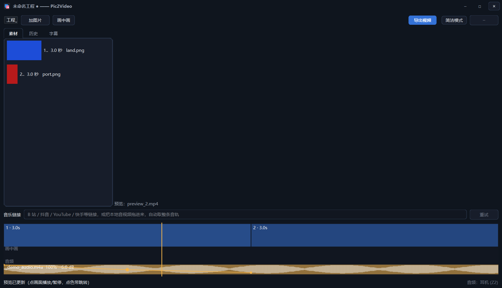

- **增益**：對音訊塊按右鍵 →「增益…」，範圍 -24 ~ +12 分貝，0 就是原樣。適合把一段偏小的旁白整體抬起來。
- **包絡**：按住 Alt 在音訊塊上點一下加一個點（橫軸是時間、縱軸是 0–100% 的音量），按住點上下拖就能改；對一個點按右鍵把它刪掉。點與點之間線性過渡，匯出的聲音照著這條線走——音樂淡入、旁白壓低再抬起來都靠它。
- **先增益、後包絡**：兩者相乘，所以 -6 分貝再加一條 50% 的包絡，最終就是 -12 分貝左右。
- **波形從哪來**：ffmpeg 把音訊解成單聲道 8 kHz 的峰值，一條素材一份快取，放在 `peaks/`（打包版是 `%LOCALAPPDATA%\Pic2Video\peaks\`）；素材的檔案大小或修改時間變了會自動重算。
- 增益和包絡都存進 .p2v 專案，下次開啟還在。

對音訊塊按右鍵就是這些入口：

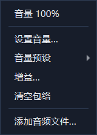

## 資源包（字型 / 濾鏡 / 轉場預設）

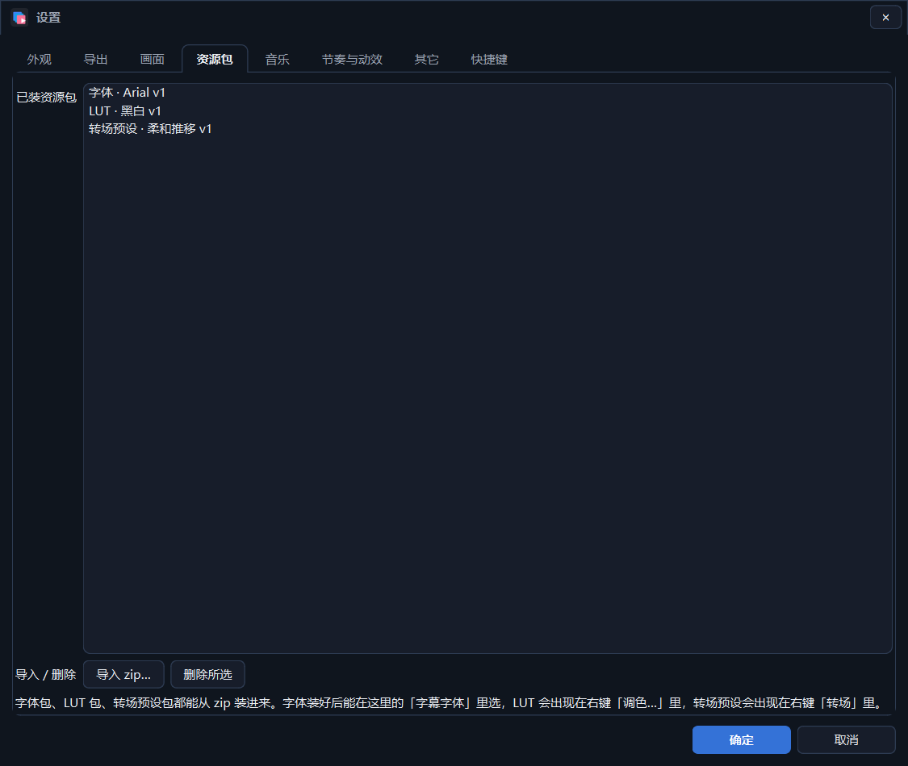

設定 → 資源包（專業模式裡是獨立一頁）：點「匯入 zip…」選一個包，裝完就在清單裡，彈窗和「開啟資源資料夾」按鈕都會告訴你它裝在哪；選取後點「刪除所選」會先問一句，如果有專案正在用它，刪完還會告訴你是哪一段。

- **裝在哪**：跟專案檔無關，統一放在工具資料目錄的 `assets/fonts`、`assets/luts`、`assets/transitions`（打包版在 `%LOCALAPPDATA%\Pic2Video\assets\`）。專案裡記的仍是檔案路徑，所以拷貝專案時要連資源包一起考慮。
- **字型包**（.ttf / .otf / .ttc）：裝完出現在 設定 → 畫面 → 字幕字型 的下拉裡；燒字幕時自動把那個包的目錄交給 libass，不用先把字型裝進系統。.ttc 只取第一套字形。
- **濾鏡包**（.cube）：裝完出現在右鍵「調色…」的 LUT 下拉裡，和「濾鏡目錄」裡手動放的 .cube 並列。
- **轉場預設包**（.json）：一個檔案一個預設，寫著名稱、用哪個內建 xfade、預設多少秒；裝完出現在右鍵 →「轉場」裡，標著「（資源包）」。它不會帶新演算法，只能組合 ffmpeg 內建的 12 個名稱。

一個包就是一個 zip，根目錄放 `manifest.json`，每個檔案帶 sha256：

```json
{
  "name": "我的 LUT 合集",
  "version": "1.0",
  "kind": "lut",
  "entries": [
    {"path": "teal-orange.cube", "sha256": "…64 位十六進位…"}
  ]
}
```

- **kind** 只能是 `font` / `lut` / `transition`；副檔名也要對得上（字型 .ttf/.otf/.ttc、LUT .cube、轉場 .json）。
- **安全邊界**：絕對路徑、`..` 上跳、符號連結、可執行檔一律拒收；最多 64 個檔案、解壓後不超過 64 MB（防 zip bomb）；清單裡沒宣告的多餘檔案、校驗對不上的檔案也不收。校驗全過才寫入磁碟：先解到暫存目錄，再原子改名成正式目錄，裝失敗不會留半套檔案。
- **版本**：同名包同一個版本再裝會被拒（先刪再裝）；不同版本直接覆蓋，舊目錄不會留著。
- **刪掉之後**：下拉/選單裡立刻消失。如果目前專案正用著這個包（某一段的 LUT、或字幕字型），會提示是哪裡在用，算圖前先換掉。

## 命令列（批次/腳本用）

```
python pic2video.py --export 輸出.mp4 --audio 本機音訊.m4a 圖1.jpg 圖2.png 圖3.webp
python pic2video.py --export 輸出.mp4 --audio "https://www.douyin.com/video/..." 圖1.jpg 圖2.png
python pic2video.py --export 輸出.mp4 --bili BV13qs46FE9C --total 4 圖1.jpg 圖2.png
python pic2video.py --export 直式.mp4 --bili BV... --ratio 9:16 --fps 60 --fit cover --transition fade 圖1.jpg 圖2.png
```

`--total` 是每張圖的秒數；`--fps` / `--ratio` / `--width` / `--height` / `--fit` / `--bg` /
`--pad-color` / `--no-bg-blur` / `--transition` / `--motion` / `--crop-focus` / `--volume` 同設定頁；命令列不寫 `settings.json`。

## 介面

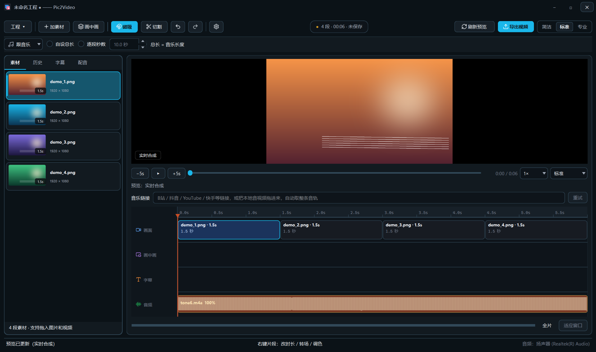

匯出時狀態列給百分比和剩餘時間，隨時能取消：

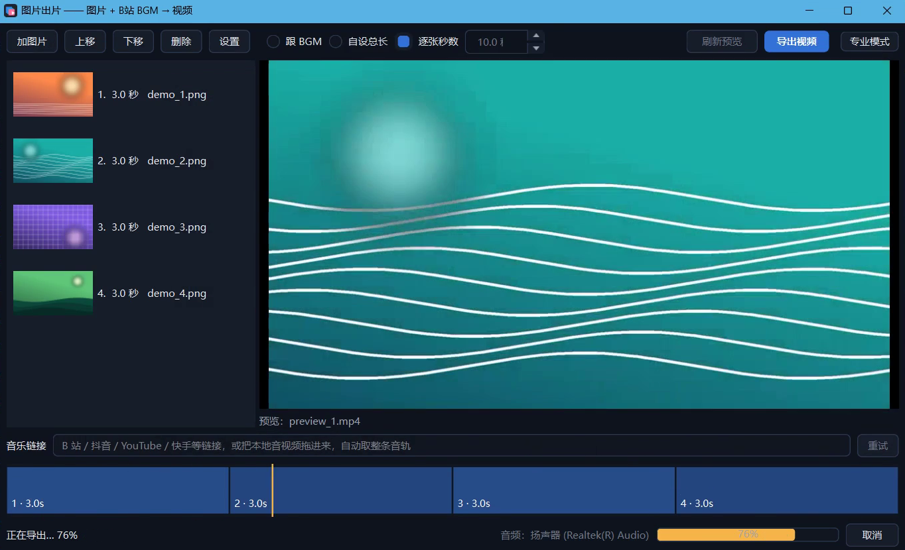

視窗邊框是軟體自己畫的，跟深色/淺色主題、主色一起變，不用系統那套灰邊：拖曳標題列移動視窗，拖視窗四邊/四角改大小，雙擊標題列最大化。設定、選色、提示、問秒數這些視窗也都是同一套邊框；選檔案那一步特地留給系統原生檔案對話框，快速存取、最近位置、網路磁碟掛載都跟平常一樣。

### 三種介面模式

工具列右上角那個按鈕點開是選單，三檔隨便切：選完當場生效，下次開啟還記得。預設是**簡潔**。

| 模式 | 給誰用 | 工具列 | 時間線 | 設定頁 |
| --- | --- | --- | --- | --- |
| **簡潔** | 只想把一疊圖片/影片配成影片發出去 | 加素材 / 匯出影片 | 畫面軌 + 音訊軌 | 外觀 / 匯出 / 畫面 三塊 |
| **標準** | 日常剪輯 | 再加 專案 / 畫中畫 / 磁吸 / 切割 / 撤回 / 還原 / 設定 | 三條軌，能縮放時間線 | 六頁：外觀 / 匯出 / 畫面 / 配音 / 音樂 / 節奏與動效 |
| **專業** | 每個參數都要管 | 全給（排序、節奏、重新整理預覽都在） | 全給 | 資源包 / 其它 / 快捷鍵 各自成頁 |

- 簡潔模式把排序、刪除、改秒數交給右鍵：素材清單右鍵、時間線色塊右鍵都在。
- 簡潔模式沒有「專案」按鈕，「⋯」裡有新增 / 開啟 / 最近開啟 / 儲存 / 另存新檔 / 設定。
- 用到了才出現：簡潔模式加了畫中畫才多出畫中畫軌，匯入了字幕才多出「字幕」頁；時間線縮放條在標準以上常駐，簡潔模式放大過才露頭。

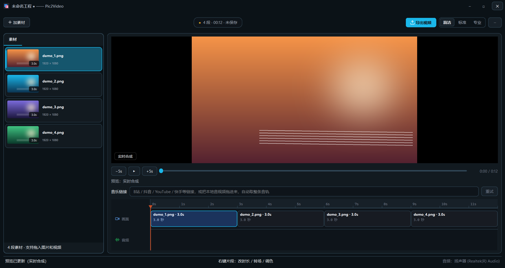


簡潔模式的設定頁就剩三塊：

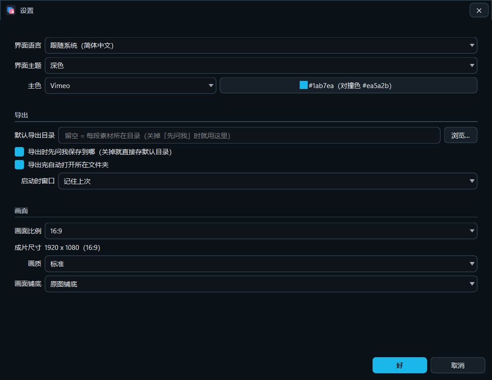

底部是時間線，四段軌道：最上面是畫面元素（片頭 / 圖片 / 影片 / 片尾），中間兩條是畫中畫（有疊加層時才用）和字幕（有字幕時才用），最下面是音訊元素。

- 工具列左邊是節奏下拉：**跟音樂**（素材均攤整條音樂）或 **跟素材總長**（每段 ＝ 片頭+片尾總長 ÷ 素材段數）；旁邊還有「自訂總長」「逐張秒數」兩個單選。選完之後右邊會跟著寫明這回總長依誰算（例如「總長 = 音樂長度」「總長 = 下面這個秒數」），滑鼠停上去還有一句完整說明。
- 點一下色塊＝預覽跳到這個元素的起點；按住左右拖，那塊就跟著走（等於在這條軌上換位置）。
- 拖色塊右邊界改這一張顯示多久；片頭片尾這種影片段拖左邊/右邊＝改入點/出點（最長到原片長度，最短留一格），音訊塊拖中間改起始時間，拖音訊塊的左邊緣／右邊緣＝裁掉它的開頭／結尾（左邊緣連來源裡的起點一起走，右邊最多拉到來源檔案末尾）。
- 工具列上的 **磁吸** 開關（預設開）讓拖動的邊貼住附近的時間點：段與段的接縫、片頭片尾、音訊塊首尾、播放頭。拖動時出現一條藍色虛線就是貼上了；按住 **Alt** 拖＝這一次不吸。磁吸和切割開著的時候按鈕會亮成主色，一眼能看出現在是不是這個模式。
- 工具列上的 **切割** 開關是刀片模式：點畫面塊或音訊塊，就在點的那一秒切成兩塊（太靠邊會提示切不了），按 **Esc** 退出這個模式。
- 對音訊塊按右鍵 →「刪除並前移」＝漣漪刪除：刪掉這條音訊，後面的音訊整體往前補上空出來的時間。
- 播放頭停在某個元素裡：按 **I** 設入點、**O** 設出點，**Ctrl+K** 在這裡切一刀（圖片段切長度，影片段依入出點切成兩段，兩段加起來還是原來那麼長）。
- 按住 **Shift**（或 Ctrl）點多個元素＝多選，之後的設定在選取的元素上一起生效。
- 對色塊按右鍵開這個元素的選單：畫面元素能開關「淡入淡出」、進「調色…」、能從「轉場」裡挑 12 個內建轉場之一（或硬切），還能單獨定這段轉場多長；畫中畫軌能加 / 改 / 刪疊加層；音訊元素能設音量（25%–200% 預設或手動填寫）、設增益、清空包絡，多選時一次改全部。
- 同時選取一個畫面元素和一條音訊時，畫面選單會多一項「畫面鋪滿這條音訊」：圖片或影片把長度改成這條音訊的長度，影片比音訊短就循環、比音訊長就從結尾截短。
- 滑鼠滾輪停在音訊塊上，直接上下滾音量（每格 5%）。
- 左邊素材清單也能 **Shift / Ctrl 多選**：刪除、上移/下移、雙擊改長度都依選取的那幾張一起生效；清單和時間線的選取是連動的，拖曳重排還會保住每段已經設好的調色、轉場、入出點。
- 從外面拖檔案進素材清單時，落點會直接寫出這一下會做什麼：中間那段是「替換第 N 張」或者（拖到影片段上）「插到第 N 張後面」，左 / 右兩邊是「插到第 N 張前面 / 後面」，拖到空白處是「加到末尾」——不用先放手再看結果。
- 底部時間線頂上有一條時間刻度（依縮放自動換密度），放大以後也能一眼看出色塊落在第幾秒；底欄右邊常駐一句「右鍵片段：改長度 / 轉場 / 調色」，右鍵選單裡那些功能不用再靠猜。
- 時間線上的畫面塊會寫出檔名，幾張名字相近的圖不會認錯。
- 段一多擠在一起就縮放：**Ctrl+滾輪**在時間線上放大 / 縮小（以滑鼠位置為中心，最多 64 倍），**Shift+滾輪**或拖時間線下面的捲軸左右看，**Ctrl+0** / 右下「適應視窗」回到全片；放大後播放頭走出可見範圍會自動跟著走。
- 想一次挪好幾段：從時間線的空白處按住拖出一個框（比如從沒放音訊的那條空軌往上拖），框到的畫面塊、畫中畫、音訊會一起選取；再拖其中任意一段，整塊跟著走，落點有虛線提示。Shift / Ctrl 拖著框＝在原來選取的基礎上再加。
- 字幕軌上是一句一個塊：點一下跳到這句開頭，左右拖＝整句提前 / 延後（句長不變，匯出和預覽都跟著改）；字幕文字本身仍在「字幕」頁裡看，不在軌上改。

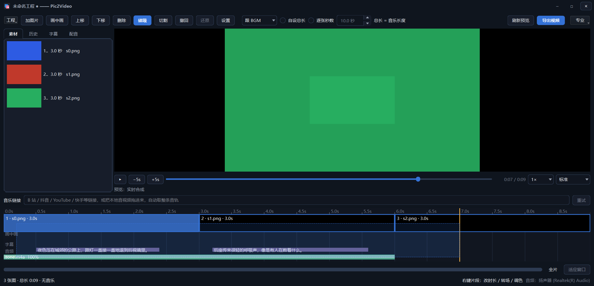
- 鍵盤：**← / →** 前進一格，**Shift + ← / →** 前進一秒，**Home / End** 跳到片頭 / 片尾，空白鍵播放暫停（在輸入框、下拉框、清單裡照常給控制項自己用）。
- 音樂連結輸入框裡按 Enter 就開始取音軌，不用再點「重試」。
- 素材整個資料夾搬走時，重新定位可以先選一次資料夾，依檔名自動對上；對不上的再一個一個問。

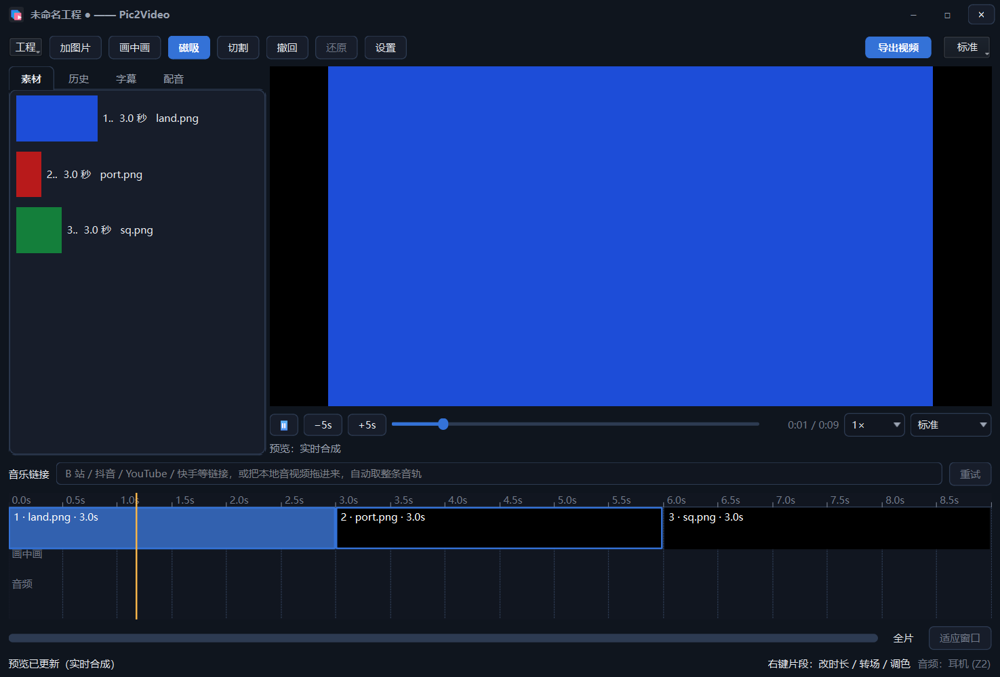

預覽畫面底下是一條播放控制列：左邊的畫面本身也能點一下播放 / 暫停（滑鼠移上去會變成手型）；播放/暫停（空白鍵也行）、−5s / +5s，中間是進度條（按住拖、點哪跳哪）和「目前 / 總長」，右邊是倍速下拉和清晰度下拉。拖動播放頭、在時間線上點色塊、拖著進度條走，畫面都即時跟著變；清晰度只改預覽解析度——流暢 640 / 標準 960 / 清晰 1280 / 原尺寸跟成品一樣大，小成品不會被放大。

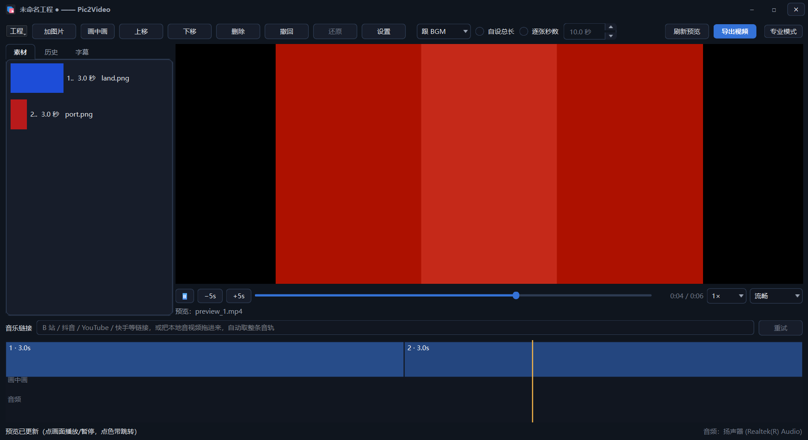

### 即時預覽是怎麼做的

預覽區不是「先算圖一個 mp4 再播放」，而是一個依時間現畫的合成器：

- 每個影格由 `Scene.frame_at(t)` 現拼：鋪底、縮放、淡入淡出、Ken Burns、12 個轉場、畫中畫、字幕、調色，都在預覽解析度下用 QPainter 直接畫出來；圖片解碼一次進記憶體，附近幾段會提前鋪好底圖。
- 音軌單獨混成一條 `.m4a` 當主時鐘：只跑音訊濾鏡，幾百毫秒就能混完；畫面依播放器位置逐格重新整理，所以播放、拖動、±5 秒都不會等編碼。
- 改參數只重建場景模型、重畫一格，不啟動影片編碼；只有匯出時才走 ffmpeg 的完整 filtergraph。
- 12 個轉場在預覽裡是近似效果（匯出仍用 ffmpeg 的 xfade）；片頭片尾這類影片片段走一條常駐解碼管道，順序讀取影格，跳太遠才重開。

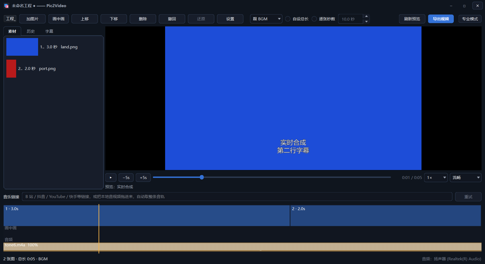

## 設定

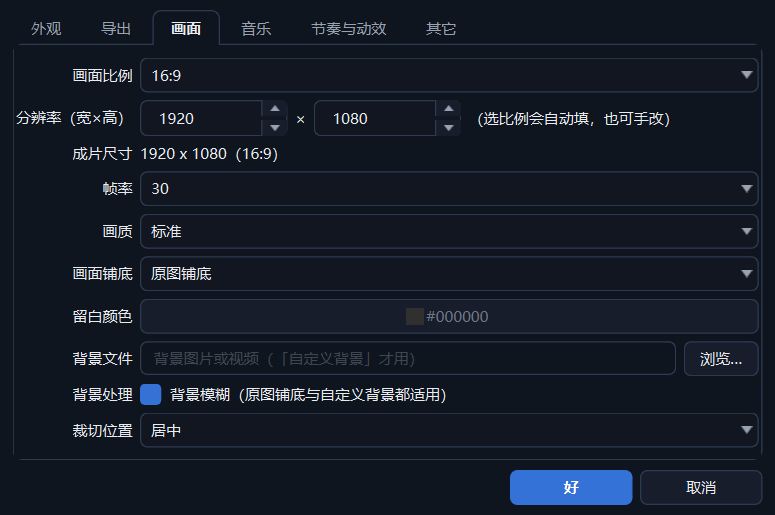

設定頁依 **外觀 / 匯出 / 畫面 / 配音 / 音樂 / 節奏與動效 / 資源包 / 其它 / 快捷鍵** 分塊：標準與專業模式都是每組一頁（頂上切頁，不用再滾一螢幕），標準模式把資源包 / 其它 / 快捷鍵這些專業頁收起來；簡潔模式不切頁，一列到底，只剩外觀 / 匯出 / 畫面，空掉的組連標題一起收起來。

| 項目 | 說明 |
| --- | --- |
| 介面語言 / 介面主題 | 五種語言；跟隨系統 / 淺色 / 深色 |
| 主色 | 12 家影音平台的品牌色預設（嗶哩嗶哩 / YouTube / 抖音 / 快手 / 小紅書 / 微博 / 騰訊視頻 / 愛奇藝 / 優酷 / Netflix / Twitch / Vimeo），也可以點右邊開色環自己調；對撞色自動依 180° 算 |
| 預設匯出資料夾 | 留空＝每段素材所在目錄 |
| 匯出時先問存到哪 | 預設開（彈出儲存框）；關掉就直接存上面那個預設資料夾，不再彈框 |
| 匯出預設 / 封面 | 不在設定頁裡改：在匯出框裡選，上次用的預設、要不要封面、封面時間點會自動記進 settings.json |
| 濾鏡目錄 | 放濾鏡 .cube 檔案的資料夾；右鍵「調色…」時從這個目錄裡列出來選 |
| 畫面比例 / 解析度 / 影格率 / 畫質 | 9 檔比例只當預設，寬高都能手動填寫；30/60fps；高 / 標準 / 小體積 |
| 畫面鋪底 / 留白顏色 / 背景檔案 / 背景處理 | 五種鋪底；純色可自選；背景圖/影片可模糊或不模糊 |
| 預設節奏 / 逐張預設秒數 | 跟音樂、跟素材總長、自訂總長、逐張秒數（跟素材總長＝片頭+片尾的總長 ÷ 素材段數，每段都播這麼久） |
| 音樂起點 / 音樂長度 | 從第幾秒開始用、用多長；「整首」/ 0＝一直用到結尾 |
| 音樂淡入淡出 / 片段轉場 | 秒數可調；這裡的轉場時長是沒單獨設過的段落的預設值（單一段落能在右鍵選單裡改） |
| 畫面動效 | 靜止 / 緩慢推近 / 緩慢拉遠 / 交替推拉（Ken Burns，預設靜止） |
| 裁切位置 | 裁切填滿時留住置中 / 偏上 / 偏下（人像照片常常要偏上） |
| 字幕字型 / 字幕字級 | 燒進成品的字幕用這個字型；字級依 1080p 定義（16–120），預覽會依畫面高度等比縮放。資源包裡的字型會一起列在這裡 |
| 資源包 | 從 zip 裝字型 / 濾鏡（LUT）/ 轉場預設；裝好出現在對應的下拉與右鍵選單裡，詳見上面的「資源包」一節 |
| 配音 | 配音服務、金鑰（Gemini / Azure / OpenAI 相容）、Azure 區域、相容端點位址與模型名稱、配音代理、段間停頓、合成後清理；詳見上面的「配音」一節 |
| 預設片頭影片 / 預設片尾影片 | 加第一張圖時自動插在最前 / 最後，留空就不加。片頭段不放音樂：有片頭時音樂從第一段素材才開始，片尾段同理 |
| 音樂音量 | 0–200%，預設 100% |
| 匯出完自動開啟所在資料夾 | 預設開；關掉就只彈完成提示 |
| 啟動時視窗 / 固定大小 | 預設「啟動時最大化」；也可選記住上次或固定大小（自己填寬×高）。換到更小的螢幕時視窗會自動夾進螢幕 |
| ffmpeg | 出片引擎（約 120 MB）。沒裝過 ffmpeg 時第一次開啟會問「現在下載嗎」，下完直接用；也能在這刪掉、以後重新下載 |
| yt-dlp | 抖音 / YouTube 等平台的解析器（約 25 MB）。顯示裝沒裝、一鍵下載或刪除 |

音樂頁與「其它」（元件管理）長這樣：

| 音樂 | 其它（ffmpeg / yt-dlp） |
| --- | --- |
| 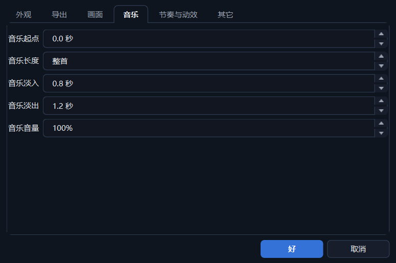 | 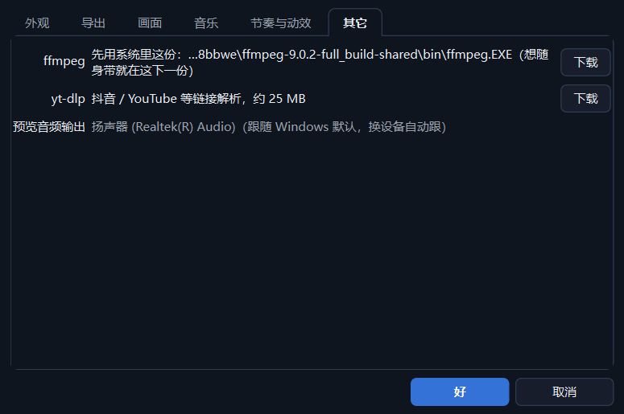 |

淺色主題，以及點主色右邊開的色環（對撞色自動算）：

| 淺色 | 色環取色 |
| --- | --- |
| 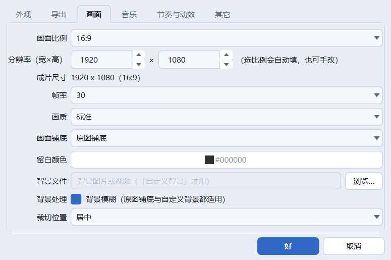 | 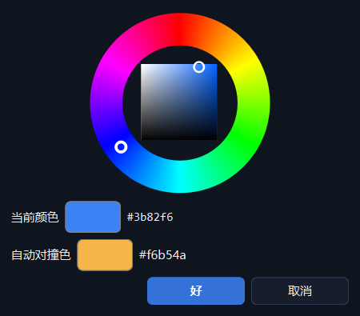 |

預覽音訊始終跟隨 **Windows 預設輸出裝置**，插拔耳機自動切換，不用重新啟動。

匯出完會自動開啟所在資料夾（設定裡可以關）。匯出時狀態列會顯示進度和「剩餘約 x:xx」，旁邊多一個「取消」；視窗大小、位置、語言、主題、
上次匯出資料夾都記在 settings.json 裡，下次開啟照舊。

## 專案結構

```
pic2video.py     主程式（視窗 + 命令列）
bili_audio.py    B站取音軌（WBI 簽章 + playurl）
audio_source.py  音源判定與 yt-dlp 封裝
components.py    ffmpeg / yt-dlp 的隨需下載與刪除
theme.py         主題、主色/對撞色、QSS
i18n.py          五種語言的詞條
tts_engine.py    配音：分段、Edge 合成、句級時間戳記、快取與拼接
启动.bat          雙擊開視窗
tests/           單元檢查（1425 條）
docs/            研究筆記、設計記錄（wayfinder 票）與原始探針腳本
screenshots/     README 裡的截圖
```

## 開發

```
python tests/test_project.py     # 時間線 / 影格數 / 設定 / filtergraph / 主題 / 音源 / 壞圖預檢 / 專案檔 / 入出點 / 字幕 / 轉場 / 匯出預設與封面 / 畫中畫 / 調色 / 音訊包絡 / 資源包 / 預覽控制列 / 即時合成 / 介面三檔 / 配音頁 / 介面提示 / 素材（圖片和影片）
python tests/scan_keys.py        # 檢查 tr() 的中文都有四種譯文
```

## 打包成免安裝 exe

雙擊 `build.bat`（需要 python；PyInstaller 沒裝的話腳本會先幫你裝）。跑完在 `dist\Pic2Video\` 下：

```
Pic2Video.exe    雙擊就能用
_internal\       執行時檔案，和 exe 放在一起
```

整個 `dist\Pic2Video\` 資料夾拷給別人就能跑，不用安裝（約 115 MB）。

打包後想確認配音真的能出聲，可以跑 `Pic2Video.exe --tts-selftest 結果.json`：
它不開視窗，真的合成一句，把成功與否寫進那個 JSON 檔案。

發佈包裡**不帶** ffmpeg 和 yt-dlp：第一次開啟時如果系統裡沒有 ffmpeg，會問一句然後自己下載到
`tools\`（約 120 MB，只下一次）；哪天想省空間，在 設定 → 其它 裡能刪掉，下次需要還會自己下載。

## 已知限制

- B站付費/會員試看影片只能拿到試看片段；地區/版權限制的會直接失敗並給原因。
- 抖音 / YouTube 等平台如果要求登入（年齡限制、會員內容），yt-dlp 會失敗並顯示原因。
- 出片時間約為片長的 1/5；很長的音樂建議用「逐張秒數」控總長，或者匯出時看著剩餘時間等。
- 圖片被移動/刪掉後會在匯出前報出是哪一張，重新加一次即可；存成專案後再開啟會問要不要重新定位。
- 字幕文字只燒錄、不能在軌道上改：字幕軌裡可以點一下跳到那句、拖動整句改進出時間（句長不變）；想改文字或逐字微調，要另存 .srt 再改。
- 配音四家都能出聲：Edge（免費、帶句級時間戳記）、Gemini、Azure 語音、OpenAI 相容端點；後三家要自己的金鑰，且都不給時間戳記，字幕靠 Edge 對齊。Gemini 免費層額度緊（社群實測約每天 10 次）。
- Gemini 的免費層額度很緊（社群實測約每天 10 次請求），長文稿會被切成多段，撞上限會退避重試三次再報「額度用完了」；這時候換 Edge 或者明天再試。
- 配音不做聲紋自動分角色、不做字級高亮：角色靠文稿裡的「名字：」明確標出，每個角色一個音色。
- 合成後的清理只做去咔噠 / 去噗聲 / 剪靜音 / 響度正規化（-14），不帶降噪模型：底噪明顯的原始錄音它救不回來。
- 字型只認系統裡裝了的、或者從資源包裝進來的；沒裝字型檔案不會打進去（.ttc 只取第一套字形，個別字型不能用於字幕）。
- 轉場只用 ffmpeg 內建的那 12 個名稱，不能匯入外部轉場檔案、也不能自己寫表達式（資源包裡的轉場預設也只能組合這 12 個名稱；想加新效果得改程式碼）。
- 音訊只做增益與音量包絡：沒有多音軌、降噪 / 等化 / 壓縮，也不做自動閃避；改完約 250 毫秒後音軌自動重混，立刻能聽到。
- 磁吸只在拖動結束的那條邊上生效，不做整塊吸附成「無縫拼接」；刀片切開只切時間、不改來源檔案，切完兩段還能各自再裁。
- 漣漪刪除只前移音訊塊，不會把畫面段也跟著挪；空白的佔位音訊塊不能裁頭尾。
- 匯出只用 libx264 軟體編碼（crf + preset），不做硬體編碼（NVENC / QSV），也不做多平台批次匯出或直接上傳。
- 封面時間點是依成品時間線算的（轉場會把兩段各擠掉一點），想截轉場正中間就手動填秒數。
- 調色只有亮度 / 對比度 / 飽和度 + 一個濾鏡 .cube LUT：不做曲線、色輪、HSL 分色；LUT 只讀 3D 的 .cube（1D 的 .cube 不讀），也不吃 .3dl / .m3d。
- 畫中畫只做「壓在成品上的疊加層」：不做旋轉、遮罩、關鍵影格動畫，也不做多軌巢狀 / 把疊加層當成主軌排段；要更複雜的合成得換真正的剪輯軟體。
- 影片段依原影格率逐格解碼：拖進度條跳很遠時偶爾要等一兩格；畫面動效（緩慢推近 / 拉遠）只作用於圖片，影片段保持原畫面。
- 預覽是即時合成的：12 個轉場是近似效果（匯出走 ffmpeg 的 xfade，邊緣細節會略有差別）；片頭片尾與影片畫中畫逐格解碼，跳很遠時偶爾要等一兩格；影片段上的調色預覽還沒即時接上（匯出仍是準的）。清晰度只影響預覽，倍速只影響播放。
- 簡潔模式為了少一排按鈕，把上移 / 下移 / 刪除 / 改秒數交給右鍵選單，節奏與總長固定在「設定 → 節奏與動效」的預設值；要逐段細調就切到標準或專業。
- 目前只在 Windows 上驗證過。
- 選檔案走系統原生檔案對話框（邊框不統一，換來的是快速存取、最近位置都在）。

## 常見問題

### 貼了連結，取不到音軌

**現象**：狀態列那行字停住不動，或者變成一句錯誤訊息；下面「音樂連結」那欄一直沒有長度。

**原因**（依常見程度）：

1. **內容本身拿不到**：B站付費/充電/大會員內容只有試看片段；YouTube 有年齡限制、抖音是私密影片；地區或版權限制。這些都要登入狀態，本工具不讀 Cookie。
2. **連結沒被認出來**：短連結失效（b23.tv 打開是「啥都木有」那種 JSON）、複製成了合集頁而不是影片頁。
3. **缺解析器**：抖音 / YouTube / 快手這類網站 yt-dlp 沒裝時會直接提示「先下載音源元件」。
4. **網路到不了**：B站介面被風控（-352/-412）或本機連不上該站。
5. **「一直不動」未必是卡死**：yt-dlp 的逾時是 15 分鐘、B站請求失敗會自己重試 3 次，網路被限流時就表現成很久沒動靜。

**兩步**：

1. 先讀狀態列或彈窗內容——B站的錯誤碼都翻成了中文（對照表見下），能直接對上號。
2. 對上號再動手：缺元件 → 設定 → 其它 → yt-dlp 點「下載」；風控 → 等幾分鐘再點「重試」，別連續點。只剩一句籠統的「取音軌失敗（詳情見設定裡重試一次）」時（抖音/YouTube 等站常見），別在連結上耗：把那段影片本身下載下來，直接拖進「音樂連結」框——走的是本機抽音軌，不過網路也不經 yt-dlp。

### 匯出的片子發黑 / 比原圖暗

**現象**：整片發灰不夠亮、四周一圈比中間暗，或者每張圖開頭結尾一黑。

**四種情況，四種原因**（看是哪一種，別混在一起）：

1. **整片發灰、白色不白**：成品是 limited range（16–235），v1.0.0 那個包沒在檔案裡寫清顏色範圍（`ffprobe` 讀回來是 `color_range=unknown`），播放器只能猜；猜成 full 就會把 235 當 255 顯示，白變成 92%、黑被抬到 16，觀感就是發灰。
   **v1.0.1 已經修了**：原始碼在 filtergraph 結尾加了 `setparams=range=tv:colorspace=bt709:color_primaries=bt709:color_trc=bt709`，匯出包裡 `ffprobe` 會如實回報 `color_range=tv / color_space=bt709 / color_transfer=bt709 / color_primaries=bt709`（有單元測試盯著）。用 v1.0.0 覺得發灰的，換成 v1.0.1 重新匯出一次就正常——舊版的下載包已經撤下了。
2. **四周比中間暗**：鋪底用的是「原圖鋪底」+ 背景模糊，四周那張虛化底被故意壓暗了 8%（`gblur=sigma=40,eq=brightness=-0.08`）。實測純橙 #FF8000：主體中心 RGB(253,126,0) 不變，左邊緣變 (228,100,0)。**這是設計，不是 bug**。
3. **圖片帶透明通道**（PNG 浮水印、去背圖最常見）：透明部分在成品裡是純黑——實測全透明底的 PNG，出片後透明處 RGB 是 (0,0,0)。
4. **轉場用的是「淡入淡出」**：每段進、出都淡到黑（預設 0.3 秒），片頭片尾最像「黑了幾格」。想換觀感就在右鍵選單的「轉場」裡挑別的名稱。

**兩步**：

1. 先分清是哪種：整片暗 → 換播放器再確認一次；只有四周暗 → 設定 → 畫面 → 畫面鋪底改「裁切填滿」或「純色留白」（挑個亮色）；帶透明的圖 → 改存成 JPG，或先在小畫家/PPT 裡鋪個白底再匯入。
2. 不想要黑場過渡：設定 → 節奏與動效 → 片段轉場改「硬切」，或把轉場時長壓到 0.1 秒；也可以只給某一段右鍵選「無（硬切）」。

### 預覽區一直是黑的

**現象**：中間那塊黑的，拖進度條也不變，或者狀態列有錯誤訊息。

**原因**：

1. **還沒加素材**：沒有素材時預覽就是黑底，狀態列會寫「先加素材」。
2. **圖片檔案不在了 / 讀不出來**：預覽依路徑現解碼，檔案被移走、刪掉或壞了就畫成黑畫面；匯出時會明確回報「這個檔案讀不出來：…」。
3. **音訊混音失敗**：狀態列會說「預覽音訊失敗」——通常是 ffmpeg 缺少或暫存目錄寫不進去，畫面本身不受影響。
4. **播放器打不開音軌**：Qt 會回報 `ResourceError` / `FormatError`，狀態列拼成「預覽播放出錯：…」，這時播放沒有主時鐘，點播放不會走。
5. **遠端桌面 / 虛擬機**：拿不到硬體介面時視窗裡可能全黑（成品本身沒問題）。

**兩步**：

1. 先看狀態列：沒素材就加素材；圖片路徑變了就在專案選單裡重新定位；提示 ffmpeg 缺了就讓它下載。
2. 還是黑：確認 `%TEMP%` 有空間、圖片還在原地；遠端桌面裡換到本機開啟試試——判定成品是否正常，直接播匯出的 mp4 就知道。

### ffmpeg 下載失敗

**現象**：第一次開啟問「現在就自動下載嗎」，點下去進度條停住，或彈出「下載失敗」。

**原因**：下的是 gyan.dev 的 Windows 建置包（ffmpeg 官網 Windows 欄位列的就是它），壓縮包 119 MB、解開約佔 210 MB。下載是一次性的整包請求、逾時 60 秒，**斷了不續傳、不會自動重試**，所以網路抖一下就會整體失敗；公司代理/防火牆會攔，防毒軟體有時也會把剛下好的 `ffmpeg.exe` 當可疑檔案處理掉。

**兩步**：

1. 再點一次「下載」（暫時網路抖動最常見）；掛著代理的話先確認代理對 gyan.dev 也生效。
2. 還是不行就手動裝：`winget install Gyan.FFmpeg`，裝完重開工具，它會直接用系統裡那份；或者自己下 zip，把 `ffmpeg.exe`、`ffprobe.exe` 放進程式目錄的 `tools\` 裡。

裝好以後在 設定 → 其它 裡能隨時刪掉，下次需要會自己再下載。

更細的排查（每條結論都標了對應的程式碼位置和實測數字）：[docs/research/faq-常见故障.md](docs/research/faq-常见故障.md)。

### 錯誤訊息原文對照（B站）

| 狀態列原文 | 真正的原因 | 怎麼辦 |
| --- | --- | --- |
| 影片不存在或已被刪除 | 稿件被刪或不可見 | 換個影片 |
| 稿件不可見（已刪除/僅自己可見/審核中） | 同上，作者設為私密或在審核 | 等審核或換影片 |
| 該內容有地區限制，目前網路無法觀看 | 地區限制（-688） | 需要對應地區的網路 |
| 該內容有版權限制，無法觀看 | 版權限制（-689） | 換影片 |
| 充電專屬影片，需要給 UP 主充電後才能觀看 | 充電專屬（87007） | 本工具不帶帳號，換影片 |
| 付費影片，需要購買後才能觀看 | 付費內容（87008） | 同上 |
| 這是會員/付費內容的試看片段，完整音軌需要大會員帳號 | 只能拿到試看（is_preview=1） | 換影片，或自己準備音訊檔案拖進來 |
| 請求被 B站風控攔截，請稍後重試或降低頻率 | 風控（-352） | 等幾十秒點「重試」 |
| 連結可能不是有效的影片位址 | 連結格式不對（-400） | 複製影片頁位址，別複製合集 |
| 網路連不上該站點（可能要代理） | 這條是 yt-dlp 的，抖音/YouTube 等站 | 檢查網路或代理 |
| 該站點要求登入，暫時取不到音軌 | yt-dlp 撞到登入牆 | 本工具不讀 Cookie，換公開影片 |

## 授權

[MIT](LICENSE) © 2026 Xishensoft

用到的第三方元件各有自己的授權：ffmpeg（GPL 建置，第一次執行時隨需下載，不隨儲存庫散布）、
PyQt6（GPL-3.0 / 商業雙授權）、yt-dlp（Unlicense）、本專案自己的程式碼是 MIT；如果你要把本專案再散布，注意 ffmpeg 與 PyQt6 的授權是要一併遵守的。
